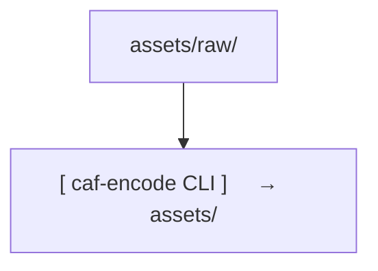

# 🔧 Asset Pipeline

> **Phase:**6 — The Olympus
> **Namespace:** `Caffeine::Tools` 
> **Status: ** Implemented
> **RFs:** RF6.5

---

## Overview

**Asset Pipeline** is the command line tool (CLI) responsible for converting assets into raw format (PNG, WAV, OBJ, GLTF) for optimized binary format `.caf` — the native format of the Caffeine Engine.

The pipeline operates out of runtime** — runs before the game, during the build. In editor mode (Phase 6), it can be invoked automatically when detecting changes in assets.

**Fluxo geral:**



---

## API Planejada

```cpp
namespace Caffeine::Tools {

// ============================================================================
// @brief  Resultado de uma operação de conversão.
// ============================================================================
struct ConversionResult {
    bool        success = false;
    std::string errorMessage;
    u64         inputBytes  = 0;
    u64         outputBytes = 0;
    f32         compressionRatio = 0.0f;  // outputBytes / inputBytes
};

// ============================================================================
// @brief  Opções de conversão de textura.
// ============================================================================
struct TextureEncodeOptions {
    enum class Format { RGBA8, RGB8, BC1, BC3, BC7 } format = Format::RGBA8;
    bool generateMipmaps = true;
    u32  maxMipLevels    = 0;    // 0 = automático (log2 da dimensão maior)
    bool premultiplyAlpha = false;
    bool flipVertically   = false;
};

// ============================================================================
// @brief  Opções de conversão de áudio.
// ============================================================================
struct AudioEncodeOptions {
    enum class Format { PCM16, OGG_VORBIS } format = Format::PCM16;
    u32  targetSampleRate = 44100;
    bool mono             = false;   // mixar para mono (reduz tamanho)
    f32  normalizeGain    = 0.0f;    // 0 = sem normalização
};

// ============================================================================
// @brief  Opções de conversão de mesh.
// ============================================================================
struct MeshEncodeOptions {
    bool optimizeVertexCache = true;    // overdraw reduction
    bool generateTangents    = true;
    bool compressVertices    = false;   // quantização de vértices
    f32  lodReductionRatio   = 0.0f;    // 0 = sem LOD, 0.5 = 50% redução
};

// ============================================================================
// @brief  Conversor de textura PNG/BMP/TGA → .caf
// ============================================================================
class TextureEncoder {
public:
    // Converte um único arquivo de textura
    ConversionResult encode(std::string_view inputPath,
                            std::string_view outputPath,
                            const TextureEncodeOptions& opts = {});

    // Gera apenas os dados de mipmaps (sem reescrever o arquivo)
    std::vector<Assets::MipLevel> generateMipmaps(const u8* pixels,
                                                   u32 width, u32 height,
                                                   u32 channels);
private:
    ConversionResult writeCafTexture(std::string_view outputPath,
                                     const Assets::CafHeader& header,
                                     const std::vector<u8>& data,
                                     const TextureEncodeOptions& opts);
};

// ============================================================================
// @brief  Conversor de áudio WAV/MP3/OGG → .caf
// ============================================================================
class AudioEncoder {
public:
    ConversionResult encode(std::string_view inputPath,
                            std::string_view outputPath,
                            const AudioEncodeOptions& opts = {});
private:
    ConversionResult encodeWav(std::string_view inputPath,
                               std::string_view outputPath,
                               const AudioEncodeOptions& opts);
};

// ============================================================================
// @brief  Conversor de mesh OBJ/GLTF → .caf
// ============================================================================
class MeshEncoder {
public:
    ConversionResult encode(std::string_view inputPath,
                            std::string_view outputPath,
                            const MeshEncodeOptions& opts = {});
private:
    ConversionResult encodeObj(std::string_view inputPath,
                               std::string_view outputPath,
                               const MeshEncodeOptions& opts);
    ConversionResult encodeGltf(std::string_view inputPath,
                                std::string_view outputPath,
                                const MeshEncodeOptions& opts);
};

// ============================================================================
// @brief  Manifesto de assets do projeto.
//
//  O AssetManifest é um ficheiro JSON que lista todos os assets do projeto
//  com metadados (tipo, caminho, hash, tamanho). Permite ao AssetManager
//  da engine encontrar e carregar assets por nome lógico.
//
//  Exemplo de manifesto gerado:
//  {
//    "version": 1,
//    "assets": [
//      { "id": "hero",    "path": "sprites/hero.caf",    "type": "Texture" },
//      { "id": "bgm",     "path": "audio/bgm.caf",       "type": "Audio"   },
//      { "id": "level01", "path": "meshes/level01.caf",  "type": "Mesh"    }
//    ]
//  }
// ============================================================================
struct AssetManifestEntry {
    std::string         id;       // nome lógico (sem extensão)
    std::string         path;     // caminho relativo ao /assets/
    Assets::AssetType   type;
    u64                 sizeBytes = 0;
    u32                 crc32     = 0;     // para detecção de mudanças
};

class AssetManifest {
public:
    bool load(std::string_view manifestPath);
    bool save(std::string_view manifestPath) const;

    void addEntry(AssetManifestEntry entry);
    void removeEntry(std::string_view id);

    const AssetManifestEntry* find(std::string_view id) const;
    const std::vector<AssetManifestEntry>& entries() const { return m_entries; }

private:
    std::vector<AssetManifestEntry> m_entries;
};

// ============================================================================
// @brief  Pipeline de batch — converte uma pasta inteira de assets.
//
//  Comportamento:
//  1. Descobre todos os assets suportados em inputDir (recursivo)
//  2. Para cada asset, verifica se output .caf está desatualizado (via CRC)
//  3. Converte apenas os assets desatualizados (build incremental)
//  4. Atualiza o AssetManifest com as novas entradas
//  5. Gera relatório final (N convertidos, M ignorados, K erros)
// ============================================================================
class AssetPipeline {
public:
    struct BatchOptions {
        std::string inputDir;
        std::string outputDir;
        std::string manifestPath;   // se vazio, não gera manifesto
        bool        forceRebuild    = false;  // ignorar CRC, reconverter tudo
        bool        verbose         = false;
        u32         threadCount     = 4;      // conversões em paralelo
    };

    struct BatchReport {
        u32 converted = 0;
        u32 skipped   = 0;   // sem mudanças (CRC igual)
        u32 errors    = 0;
        std::vector<std::string> errorMessages;
        f64 totalTimeSeconds = 0.0;
        u64 totalInputBytes  = 0;
        u64 totalOutputBytes = 0;
    };

    BatchReport run(const BatchOptions& opts);

private:
    TextureEncoder m_textureEncoder;
    AudioEncoder   m_audioEncoder;
    MeshEncoder    m_meshEncoder;

    Assets::AssetType detectAssetType(const std::filesystem::path& path) const;
    bool isOutdated(const std::filesystem::path& src,
                    const std::filesystem::path& dst) const;
};

}  // namespace Caffeine::Tools
```

---

## CLI: caf-encode

```bash
# Converter um único arquivo:
caf-encode texture hero.png assets/sprites/hero.caf --mipmaps --format BC3

# Converter áudio:
caf-encode audio bgm.wav assets/audio/bgm.caf --format ogg --sample-rate 44100

# Converter mesh:
caf-encode mesh level01.gltf assets/meshes/level01.caf --optimize --tangents

# Processar pasta inteira (build incremental):
caf-encode batch ./raw/ ./assets/ --manifest assets/manifest.json --jobs 8

# Forçar reconversão de tudo:
caf-encode batch ./raw/ ./assets/ --force-rebuild

# Apenas verificar o que seria convertido (dry-run):
caf-encode batch ./raw/ ./assets/ --dry-run
```

---

## Directory Structure

- `project/`
  - `raw/ ← assets originais (não vão no build final)`
    - `sprites/`
      - `hero.png`
      - `enemy.png`
    - `audio/`
      - `bgm.wav`
      - `jump.wav`
    - `meshes/`
    - `level01.gltf`
    - `level01_textures/`
    - `diffuse.png`
  - `assets/ ← assets convertidos (incluídos no build)`
    - `sprites/`
      - `hero.caf ← textura RGBA8 + mipmaps`
      - `enemy.caf`
    - `audio/`
      - `bgm.caf ← OGG Vorbis`
      - `jump.caf ← PCM16`
    - `meshes/`
      - `level01.caf ← Mesh3D + materiais + texturas embutidas`
    - `manifest.json ← índice de todos os assets`
  - `build.sh / CMakeLists ← invoca caf-encode batch antes do link`


---

## Format .caf — Header Structure

```cpp
// Header de 32 bytes (definido em assets/caf-format.md):
struct CafHeader {
    u32  magic;        // 0xCAFECAFE
    u8   version;      // 1
    u8   assetType;    // Texture=0, Audio=1, Mesh=2, etc.
    u16  flags;        // COMPRESSED=0x01, MIPMAPS=0x02, etc.
    u32  dataSize;     // tamanho do payload em bytes
    u32  crc32;        // checksum do payload
    u32  reserved[4];  // alinhamento + uso futuro
};
```

For full format specification, see [`assets/caf-format.md`](../assets/caf-format.md).

---

## Integration with Build (CMake)

```cmake
# CMakeLists.txt — executar pipeline antes de compilar o jogo:
add_custom_command(
    OUTPUT  ${CMAKE_BINARY_DIR}/assets/manifest.json
    COMMAND caf-encode batch
            ${CMAKE_SOURCE_DIR}/raw/
            ${CMAKE_BINARY_DIR}/assets/
            --manifest ${CMAKE_BINARY_DIR}/assets/manifest.json
            --jobs 4
    DEPENDS ${RAW_ASSET_FILES}
    COMMENT "Converting raw assets to .caf format..."
    VERBATIM
)

add_custom_target(assets DEPENDS ${CMAKE_BINARY_DIR}/assets/manifest.json)
add_dependencies(${GAME_TARGET} assets)
```

---

## Build Incremental (CRC-based)

```mermaid
flowchart TD
  raw_hero_png["raw/hero.png"] --> CRC__0xABCD1234_____assets_hero_caf_exis["CRC: 0xABCD1234  →  assets/hero.caf existe?"]
  CRC__0xABCD1234_____assets_hero_caf_exis["CRC: 0xABCD1234  →  assets/hero.caf existe?"] --> m[""]
  n[""] --> ___________["┌────┴────┐"]
  ___________["┌────┴────┐"] --> Existe___["Existe  │"]
  Existe___["Existe  │"] --> __________["───┬─────┘"]
  __________["───┬─────┘"] --> m[""]
  n[""] --> CRC_stored____CRC_actual_["CRC stored == CRC actual?"]
  CRC_stored____CRC_actual_["CRC stored == CRC actual?"] --> _["│"]
  _["│"] --> SIM_________NÃO["SIM         NÃO"]
  SIM_________NÃO["SIM         NÃO"] --> _["│"]
  _["│"] --> SKIP_______CONVERTER["SKIP       CONVERTER"]
  SKIP_______CONVERTER["SKIP       CONVERTER"] --> _0__CPU_____TextureEncoder_["(0% CPU)   (TextureEncoder)"]
```


---

## Mipmap Generation

- `Textura original: 512×512 (RGBA8, 1MB)`
  - `Mip 0: 512×512 (1MB)`
  - `Mip 1: 256×256 (256KB)`
  - `Mip 2: 128×128 (64KB)`
  - `Mip 3: 64×64 (16KB)`
  - `Mip 4: 32×32 (4KB)`
  - `Mip 5: 16×16 (1KB)`
  - `Mip 6: 8×8 (256B)`
  - `Mip 7: 4×4 (64B)`
  - `Mip 8: 2×2 (16B)`
  - `Mip 9: 1×1 (4B)`
- `Total: ~1.33MB (apenas 33% de overhead)`
- `Algoritmo de filtragem: Lanczos-3 (alta qualidade) ou Box (rápido)`
- `Configurável via --mip-filter lanczos|box`


---

## Acceptance Criteria

- [x] `caf-encode texture` converts PNG → .caf with correct mipmaps
- [x] `caf-encode audio` converts WAV → .caf PCM16 or OGG
- [x] `caf-encode mesh` converts OBJ and GLTF → .caf Mesh3D
- [x] `caf-encode batch` processa pasta inteira em paralelo
- [x] Incremental build: only convert modified assets (CRC)
- [x] Manifesto JSON gerado com todos os assets convertidos
- [ ] AssetManager da engine consegue carregar assets pelo manifesto
- [ ] Hot-reload (RF6.6): Raw/ → automatic re-conversion → reload in editor

---

## Dependencies

- **Upstream:**
  - [Asset Manager](../assets/asset-manager.md) — CafHeader format, AssetType
  - [CAF Format](../assets/caf-format.md) — binary specification of .caf
  - [Mesh Loading](../assets/mesh-loading.md) — Vertex3D, Mesh3D, SubMesh
  - [Audio System](../audio/audio-system.md) — AudiooClip, AudioFormat
- **Downstream:**
  - — (executed before runtime, there is no downstream in runtime)

---

## 🔗 Related Topics

| Topic | Description |
|--------|-----------|
| [Assets & Pipeline]() | Pipeline CLI como ferramenta de build |
| [Editor & Debug]() | Hot-reload integration in the editor |

## References

- [`assets/caf-format.md`](../assets/caf-format.md) — Binary format .caf
- [`assets/asset-manager.md`](../assets/asset-manager.md) — AssetManager + AssetHandle
- [`assets/mesh-loading.md`](.../assets/mesh-loading.md) — Mesh3D + Vertex3D
- [Transversal Topic Index]()
- [`docs/MASTER.md`](../MASTER.md) — Unified documentation
- [stb image](https://github.com/nothings/stb) — PNG/JPG/BMP decoding
- [dr wav](https://github.com/mackron/dr libs) — WAV decoding
- [cgltf](https://github.com/jkuhlmann/cgltf) — parser de GLTF
- [meshoptimizer](https://github.com/zeux/meshoptimizer) — Vertex cache optimization
- [BC7Enc](https://github.com/richgel999/bc7enc) — texture compression BC1/BC3/BC7
