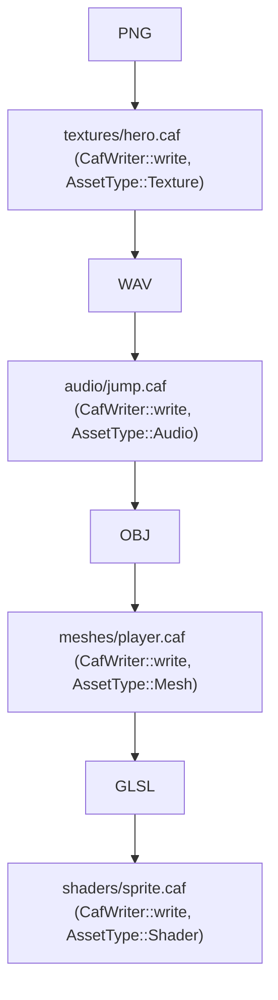

# 📄 Format .caf — Caffeine Asset Format

<div class="doc-meta">
  <span class="doc-badge doc-badge--reference">Reference</span>
  <span>Last verified: <time datetime="2026-11-18">2026-11-18</time></span>
  <span>Source: <a href="https://github.com/devscafecommunity/caffeine/blob/main/src/caffeine/core/io/CafTypes.hpp"><code>core/io/CafTypes.hpp</code></a></span>
</div>

<p class="doc-lede">The binary <code>.caf</code> layout used inside the engine: a 32-byte
header, a typed metadata block, the payload and a whole-file CRC footer.</p>

> **Phases:** 3 (foundation) + 4 (Prefabs/Scenes)
> **Namespace:** `Caffeine`, `Caffeine::IO`
> **Files:** `src/caffeine/core/io/CafTypes.hpp`, `src/caffeine/core/io/BlobLoader.hpp` / `.cpp`, `src/caffeine/core/io/CafWriter.hpp` / `.cpp`, `src/caffeine/core/io/Crc32.hpp`
> **Status:** Implemented
> **RF:** RF3.0, RF4.5

<div class="doc-callout doc-callout--note">
  <p><strong>Scope.</strong> This header still defines the engine-internal
  <code>.caf</code> used for scene and prefab serialization (magic <code>0xCAFECAFE</code>).
  Runtime asset packs (<code>.cap</code>) and imported assets use <code>caf-pack</code> as the
  single source of truth (magic <code>0x43414621</code>, <code>"CAF!"</code>); see
  <a href="../architecture/cafpack.md">Cafpack</a>.</p>
</div>

---

## Overview

O `.caf` (Caffeine Asset Format) is the native binary format of the engine. Philosophy: **Zero-parsing, Zero-copy**—the disk file is a direct mirror of RAM/VRAM memory.

There is no de-erialization: the file is read as a byte block and the pointers are adjusted. Speed limited only by SSD.

---

## File Layout

```
Offset          Tamanho  Descrição
--------------  -------  -----------
0               32       CafHeader (magic, version, type, crc32, sizes)
32              N        Metadata block (struct dependente do AssetType)
32 + N          M        Payload binário (pixels, PCM, geometry, etc.)
32 + N + M      4        Footer CRC32 (CRC32 do arquivo inteiro)
```

The 4 byte footer protects against silent corruption of the entire file. O `crc32` in the header protects only payload.

### Constantes do Formato

| Constante | Valor |
|-----------|-------|
| `CafHeader::kMagic` | `0xCAFECAFE` |
| `CafHeader::kVersionMajor` | `1` |
| `CafHeader::kVersionMinor` | `0` |
| `CafHeader::kHeaderSize` | `32` bytes |
| `CafHeader::kFooterSize` | `4` bytes |
| General alignment | `16` bytes (SIMD) |
| Alinhamento Mesh/Shader | `32` bytes (SIMD + GPU bus) |
| Endianness | Little-endian (x86/x64 nativo) |

---

## `CafHeader` — 32 bytes

```cpp
namespace Caffeine {

struct CafHeader {
    u32       magic;         // offset  0 — 0xCAFECAFE
    u16       versionMajor;  // offset  4 — breaking changes
    u16       versionMinor;  // offset  6 — backwards-compatible
    AssetType type;          // offset  8 — AssetType (u16)
    u16       flags;         // offset 10 — CafFlags bitmask
    u32       crc32;         // offset 12 — CRC32 do payload
    u64       metadataSize;  // offset 16 — bytes do bloco de metadata
    u64       dataSize;      // offset 24 — bytes do payload
};                           //            = 32 bytes total ✓

static_assert(sizeof(CafHeader) == 32);
}
```

**Layout em bytes:**
```
byte  0- 3   magic          (u32)
byte  4- 5   versionMajor   (u16)
byte  6- 7   versionMinor   (u16)
byte  8- 9   type           (u16, AssetType enum)
byte 10-11   flags          (u16, CafFlags bitmask)
byte 12-15   crc32          (u32, CRC32 do payload)
byte 16-23   metadataSize   (u64)
byte 24-31   dataSize       (u64)
```

---

## `AssetType`

```cpp
enum class AssetType : u16 {
    Unknown   = 0,
    Texture,       // RGBA8, BC7, ASTC → SDL_GPUTexture
    Audio,         // PCM, ADPCM       → SDL_AudioStream
    Mesh,          // Vertex/Index Buffers (Fase 5)
    Prefab,        // ECS Entity Template (binário)
    Scene,         // World State (Fase 4)
    Shader,        // SPIR-V / bytecode
    Animation,     // AnimationClip frames
    Font           // Bitmap/SDF font atlas
};
```

---

## `CafFlags`

```cpp
enum CafFlags : u16 {
    CAF_FLAG_NONE        = 0x0000,
    CAF_FLAG_COMPRESSED  = 0x0001,  // payload comprimido
    CAF_FLAG_ENCRYPTED   = 0x0002,  // payload encriptado
    CAF_FLAG_SRGB        = 0x0004,  // textura: espaço de cor sRGB
    CAF_FLAG_MIPCHAIN    = 0x0008,  // textura: mip-chain presente
    CAF_FLAG_STREAMED    = 0x0010,  // asset deve ser transmitido em streaming
};
```

---

## Structs de Metadata

Each type of asset has a fixed metadata structure written immediately after the `CafHeader` (offset 32).

### `TextureMetadata` — 24 bytes

```cpp
struct TextureMetadata {
    u32 width;       // largura em pixels
    u32 height;      // altura em pixels
    u32 format;      // SDL_GPUTextureFormat (0 = RGBA8)
    u32 mipLevels;   // 1 = sem mips
    u64 reserved;    // zero
};
```

**Payload:** pixels brutos (RGBA8 ou comprimido BC7/ASTC).

### `AudioMetadata` — 16 bytes

```cpp
struct AudioMetadata {
    u32 sampleRate;    // 44100, 48000, etc.
    u16 channels;      // 1 = mono, 2 = stereo
    u16 bitsPerSample; // 8, 16 ou 32
    u32 sampleCount;   // total de sample frames
    u32 reserved;      // zero
};
```

**Payload:** PCM raw.

### `SceneMetadata` — 20 bytes

```cpp
struct SceneMetadata {
    u32 entityCount;          // total de entidades
    u32 archetypeCount;       // arquétipos distintos
    u32 stringTableOffset;    // offset relativo ao início do bloco de metadata
    u32 assetRefTableOffset;  // offset relativo ao início do bloco de metadata
    u32 reserved;             // zero
};
```

Seguido por `archetypeCount × ArchetypeDesc` :

```cpp
struct ArchetypeDesc {  // 12 bytes
    u32 componentMask;  // bitmask dos tipos de componente
    u32 entityCount;    // entidades neste arquétipo
    u32 dataOffset;     // offset no payload onde os dados começam
};
```

### `ShaderMetadata` — 8 bytes

```cpp
struct ShaderMetadata {
    u32 stage;    // 0=vertex, 1=fragment, 2=compute
    u32 reserved; // zero
};
```

---

## `Crc32` — `src/caffeine/core/io/Crc32.hpp`

IEEE 802.3 CRC32 com lookup table `constexpr` . Zero external dependencies.

```cpp
namespace Caffeine::IO {

// CRC32 de um bloco de memória
constexpr u32 crc32(const void* data, usize size);

// CRC32 incremental (streaming)
constexpr u32 crc32Continue(u32 runningCrc, const void* data, usize size);

} // namespace Caffeine::IO
```

---

## `BlobLoader` — `src/caffeine/core/io/BlobLoader.hpp`

Low-level loader. One single `fread` zero seeks, zero extra copies.

```cpp
namespace Caffeine::IO {

class BlobLoader {
public:
    struct LoadResult {
        const CafHeader* header   = nullptr; // aponta para início do buffer
        const void*      metadata = nullptr; // aponta para offset 32
        const void*      payload  = nullptr; // aponta para offset 32 + metadataSize
        bool             valid    = false;
    };

    // Carrega e valida o arquivo inteiro. Aloca via allocator.
    static LoadResult load(const char* path, IAllocator* allocator);

    // Valida magic + version sem carregar o payload.
    static bool validateHeader(const char* path);

private:
    static bool verifyCRC32(const void* data, u64 size, u32 expected);
};

} // namespace Caffeine::IO
```

### Validation Sequence

- `BlobLoader::load(path, allocator)`
  - `fopen()`
  - `fread() [single shot — todo o arquivo de uma vez]`
  - `magic == 0xCAFECAFE ? ← rejeita arquivo inválido`
  - `versionMajor == 1 ? ← rejeita versão incompatível`
  - `CRC32(payload) == header.crc32 ? ← rejeita payload corrompido`
  - `CRC32(file[0..end-4]) == footer? ← rejeita arquivo corrompido`
- `▼`
- `LoadResult { header, metadata, payload, valid=true }`


---

## `CafWriter` — `src/caffeine/core/io/CafWriter.hpp`

Write a file `.caf` completo com header, metadata, payload e footer CRC32.

```cpp
namespace Caffeine::IO {

class CafWriter {
public:
    struct WriteResult {
        bool success      = false;
        u64  bytesWritten = 0;
    };

    static WriteResult write(
        const char* path,
        AssetType   type,
        u16         flags,
        const void* metadata,
        u64         metadataSize,
        const void* payload,
        u64         payloadSize);
};

} // namespace Caffeine::IO
```

### Writing Sequence

- `CafWriter::write(...)`
  - `Monta CafHeader:`
  - `magic = 0xCAFECAFE`
  - `versionMajor = 1, versionMinor = 0`
  - `type = type`
  - `flags = flags`
  - `crc32 = CRC32(payload)`
  - `metadataSize = metadataSize`
  - `dataSize = payloadSize`
  - `fwrite(header)`
  - `fwrite(metadata)`
  - `fwrite(payload)`
  - `fwrite(footer = CRC32(header + metadata + payload))`
- `▼`
- `WriteResult { success=true, bytesWritten=totalSize }`


---

## Asset Load Flow (Phase 3+)

```mermaid
flowchart TD
  R["BlobLoader::validateHeader("hero.caf")"]
  o0["── magic ✓, version ✓"]
  R --> o0
  o1["── SDL_GPUUploadTexture(device, pixels, width, height)"]
  R --> o1
  _["▼"]
  R --> _
  LinearAllocator__alloc_totalFi["LinearAllocator::alloc(totalFileSize, 16)"]
  _ --> LinearAllocator__alloc_totalFi
  _["▼"]
  LinearAllocator__alloc_totalFi --> _
  fread_file__buffer__totalFileS["fread(file, buffer, totalFileSize)   ← 1 syscall"]
  _ --> fread_file__buffer__totalFileS
  _["▼"]
  fread_file__buffer__totalFileS --> _
  BlobLoader__load_____valida_CR["BlobLoader::load() — valida CRCs"]
  _ --> BlobLoader__load_____valida_CR
  _["▼"]
  BlobLoader__load_____valida_CR --> _
  AssetResolver__resolveTexture_["AssetResolver::resolveTexture(blob, device)"]
  _ --> AssetResolver__resolveTexture_
  _["▼"]
  AssetResolver__resolveTexture_ --> _
  AssetHandle_Texture____status_["AssetHandle<Texture> { status = Loaded }"]
  _ --> AssetHandle_Texture____status_
```


---

## Creation Tool (Phase 6)

In Phase 6, [Asset Pipeline](../assets/asset-pipeline.md) will convert conventional formats:




---

## Tests

`tests/test_caf.cpp` — 27 test cases, 53 assertions:

| Categoria | Cobertura |
|-----------|-----------|
| `CafHeader` layout | `static_assert` tamanho, alinhamento, endianness |
| `CafHeader` helpers | `payloadAlignment()` , `totalFileSize()` |
| `AssetType` discrimination | Todos os 8 tipos |
| `CafFlags` bitmask | Combinations |
| `TextureMetadata` | Layout 24 bytes |
| `AudioMetadata` | Layout 16 bytes |
| `SceneMetadata` + `ArchetypeDesc` | Layout 20 + 12 bytes |
| `ShaderMetadata` | Layout 8 bytes |
| CRC32 | Vetores IEEE 802.3, streaming, continue |
| `CafWriter::write` | Round-trip completo |
| `BlobLoader::load` | Round-trip completo |
| `BlobLoader` corruption | Invalid CRC Header, invalid CRC payload, invalid CRC footer |

---

## Requisitos de Engenharia

| Categoria | Requisito | Status |
|-----------|-----------|--------|
| Endianness | Little-endian (x86/x64) — `static_assert` em compile time | ✅ |
| Alinhamento | General 16B, Mesh/Shader 32B — `payloadAlignment()` | ✅ |
| IO Pattern | Single-shot `fread` — zero seeks, zero extra copies | ✅ |
| Versioning | `versionMajor` / `versionMinor` on header — load rejection | ✅ |
| CRC32 payload | `header.crc32` — detects payload corruption | ✅ |
| CRC32 footer | 4 bytes footer — detects corruption of any byte of the file | ✅ |
| Header size | 32 bytes — 2× SIMD alignment — `static_assert` | ✅ |

---

## Dependencies

- **Upstream:** [Job System](../concurrency/job-system.md), [Memory — LinearAllocator](../memory/allocators.md)
- **Downstream:** [Asset Manager](asset-manager.md), [Phase 4 — Scene Serialization](../ecs/scene.md), [Phase 5 — Mesh Loading](mesh-loading.md), [Phase 6 — Asset Pipeline](asset-pipeline.md)

---

## 🔗 Related Topics

| Topic | Description |
|--------|-----------|
| [Assets & Pipeline]() | .caf como formato nativo de assets |

## References

- [`architecture_specs.md`](../architecture_specs.md) — §5 Scene Serialization, §7 Asset Manager
- [`HISTORY.md`](../HISTORY.md) — §4.2 Asset system — The .caf Format
- [`assets/asset-manager.md`](asset-manager.md) — use `BlobLoader` internamente
- [`assets/asset-pipeline.md`](../assets/asset-pipeline.md) — produces files `.caf`
- [Transversal Topic Index]()
