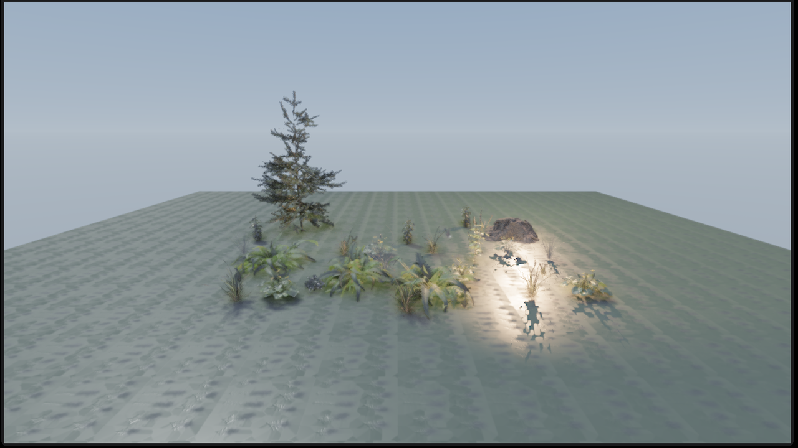
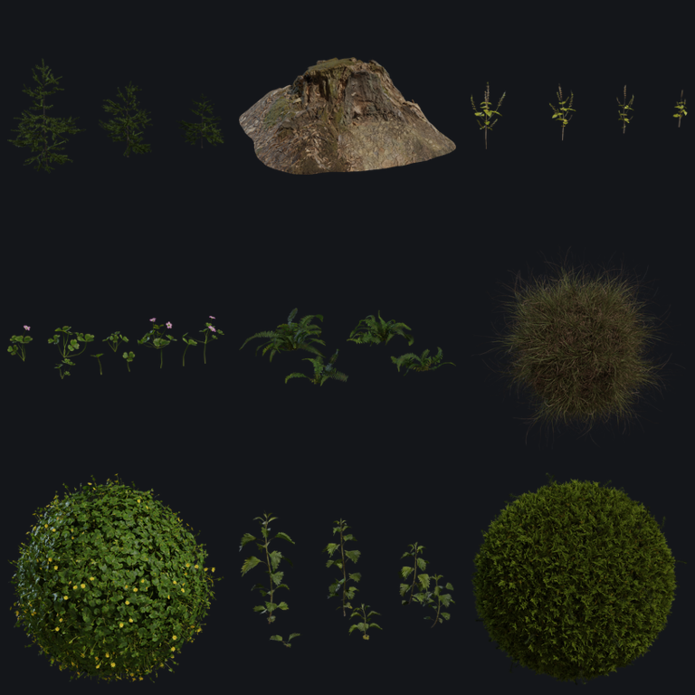

# Vegetation Kit

<div class="doc-meta">
  <span class="doc-badge doc-badge--reference">Reference</span>
  <span>Last verified: <time datetime="2026-11-18">2026-11-18</time></span>
  <span>Source: <a href="https://github.com/devscafecommunity/caffeine/blob/main/assets/vegetation-kit/manifest.json"><code>assets/vegetation-kit/manifest.json</code></a></span>
</div>

<p class="doc-lede">A nine-asset CC0 kit for exercising PBR, alpha cutout and blend foliage,
shadows, GI and LOD, plus the demo scene that wires it together.</p>

The **Vegetation Kit** is a small, self-contained set of nine CC0 assets for
exercising the renderer: PBR materials, alpha-cutout and alpha-blended foliage,
shadow casting, Photon GI, baked AO, instancing and automatic LOD.

<figure class="doc-figure">
  
  <figcaption>Vegetation kit demo scene</figcaption>
</figure>


The kit lives in `assets/vegetation-kit/` in the engine repository. Every model
is 1k PBR and every material ships the albedo, normal and ARM (AO / roughness /
metallic) maps used by the engine.

## Contents

| Asset | Role | Triangles | Alpha | Caffeine material |
|-------|------|-----------|-------|-------------------|
| `fir_sapling` | Tree | 433,021 | Opaque | `fir_sapling_branches.mat`, `fir_sapling_twigs.mat` |
| `tree_stump_01` | Stump / bark | 41,046 | Opaque | `tree_stump_01.mat` |
| `shrub_03` | Bush | 8,287 | Cutout | `shrub_03.mat` |
| `shrub_sorrel_01` | Ground shrub | 3,319 | Cutout | `shrub_sorrel_01.mat` |
| `fern_02` | Fern | 6,232 | Cutout | `fern_02.mat` |
| `grass_medium_02` | Grass | 7,842 | Blend | `grass_medium_02.mat`, `_cutout.mat` |
| `celandine_01` | Flowers | 8,966 | Blend | `celandine_01.mat`, `_cutout.mat` |
| `nettle_plant` | Tall plant | 31,304 | Cutout | `nettle_plant.mat` |
| `moss_01` | Ground cover | 204 | Cutout | `moss_01.mat`, `_blend.mat` |

A total of **540,221 triangles** across nine assets, **41.8 MB** including
textures. All assets are **CC0 1.0** from [Poly Haven](https://polyhaven.com).
The individual source URLs and authors are in `manifest.json`; a human-readable
list is in `ATTRIBUTION.txt`.

<figure class="doc-figure">
  
  <figcaption>Vegetation kit thumbnails</figcaption>
</figure>


`previews/` contains the Poly Haven thumbnails used by this page and by asset
browsers.

## Quick start

Copy the kit into the project's assets directory:

```bash
cp -r assets/vegetation-kit <project>/assets/
```

The paths in the `.gltf` and `.mat` files are project-relative
(`assets/vegetation-kit/...`), so the kit must keep that layout inside the
project.

### Demo scene

`scenes/vegetation-kit.caf` contains a ground plane, a camera, a directional
sun, a warm point light, a Photon GI component and 29 vegetation meshes. The
point light is there to exercise point shadows and local GI, and the camera uses
the same 16:9 framing as the screenshot above.

- **Doppio:** copy the kit into the project, then open
  `assets/vegetation-kit/scenes/vegetation-kit.caf`.
- **Runtime:** set the project's start scene:

```json
{
  "last_scene": "assets/vegetation-kit/scenes/vegetation-kit.caf"
}
```

then run `caffeine-runtime --project <project>`.

The scene is intentionally lit with a lower exposure (`PostProcessComponent`
exposure 0.9) than a default project. If you reuse the assets in a brighter
scene, tune the exposure rather than the material colours.

### Use one asset

1. Drag a model into the viewport, for example
   `assets/vegetation-kit/models/fern_02/fern_02.gltf`.
2. Select the entity and open **Inspector → Mesh Filter**.
3. Set **Custom Material** to the matching `.mat`, for example
   `assets/vegetation-kit/materials/fern_02.mat`.
4. Enable **Cast Shadows** and **Receive Shadows** as needed.

The full PBR path is the `.mat` file. The glTF also contains a usable base
colour material, so it renders without a `.mat`; assigning the `.mat` adds the
normal map, ARM map, alpha mode and alpha cutoff.

## What each asset tests

| Feature | Assets | What to look for |
|---------|--------|------------------|
| Opaque PBR | `tree_stump_01`, `fir_sapling` | Bark grain, normal detail and AO from the ARM map |
| Alpha cutout | `fern_02`, `shrub_03`, `shrub_sorrel_01`, `nettle_plant` | Hard leaf edges, stable shadows, no sorting |
| Alpha blend | `grass_medium_02`, `celandine_01`, `moss_01` blend variants | Soft edges and sorted transparent surfaces |
| Shadows | All assets + demo scene | Tree and stump cast onto the ground; the warm point light casts local shadows |
| Photon GI | Demo scene environment | **View → Photon Global Illumination**; try **Debug → GI only** |
| Baked AO | `tree_stump_01`, `fern_02`, `shrub_03` | Bake from the Photon panel and inspect the new ORM map |
| Instancing | `grass_medium_02`, `fern_02`, `celandine_01` | Duplicate entities and compare draw cost |
| Automatic LOD | `fir_sapling` | 433k-triangle source; the renderer builds medium/far clustered LODs |
| Multi-material | `fir_sapling` | Split into branches + twigs so each part can use a full PBR material |

`fir_sapling` is the heaviest asset in the kit and is the best stress test for
the LOD path. For a lighter tree, scale the split branches/twigs down or use
the stump as an opaque PBR control.

## Alpha modes

The glTF importer now reads `alphaMode` (`OPAQUE`, `MASK`, `BLEND`) and
`alphaCutoff` into `MeshSurfaceMaterial`, and the renderer applies the mode per
submesh. This means a tree can have an opaque trunk and a cutout leaf submesh in
the same mesh.

For this kit:

- **Cutout** is the default for ferns, shrubs and the grass/moss cutout
  variants. It writes depth and is the cheapest path for foliage shadows.
- **Blend** is the default for grass and celandine and is available as
  `moss_01_blend.mat`. It gives softer edges but requires sorting and does not
  write depth.
- The albedo PNGs contain alpha. Poly Haven publishes the diffuse and alpha
  maps separately; the kit composites them into a single RGBA albedo so the
  same texture works in the engine and in external glTF viewers.

If leaf edges shimmer, raise `alpha_cutoff` slightly (for example 0.45 → 0.55)
or use the blend variant. Very thin geometry may need `doubleSided`; the kit's
glTF materials are double-sided, and the engine currently disables back-face
culling globally.

## Tree parts

`fir_sapling` uses two materials (branches and twigs), and Caffeine custom
materials apply to a whole mesh. The kit therefore ships two single-material
glTFs:

- `models/fir_sapling/fir_sapling_branches.gltf` → `fir_sapling_branches.mat`
- `models/fir_sapling/fir_sapling_twigs.gltf` → `fir_sapling_twigs.mat`

Add both entities at the same position and scale. The demo scene already does
this. The complete `fir_sapling.gltf` is also present for viewers or pipelines
that support multi-material meshes directly.

## Baked AO and GI

The demo scene has a `PhotonGIComponent` on the **Environment** entity. Use the
native **Photon** panel to switch presets or inspect the GI-only view.

To bake static AO:

1. Select a custom mesh such as **Tree Stump** or **Fern**.
2. Open **View → Photon Global Illumination**.
3. In **Baked ambient occlusion**, choose resolution/rays and press
   **Bake selected mesh**.

The baker writes an ORM PNG under the project's processed assets and updates
the assigned `.mat`. Bake on a copy of the kit if you want to keep the original
material files unchanged. Primitive meshes (the demo ground) are not suitable
bake targets; use the stump or a kit plant.

## Feature checklist

- [x] PBR albedo, normal and ARM maps
- [x] Alpha cutout and alpha blend variants
- [x] Shadow casting and reception
- [x] Photon GI component in the demo scene
- [x] Baked AO targets with unique UVs
- [x] Instancing-friendly repeated meshes
- [x] High-poly source for automatic LOD
- [x] Multi-material tree split into single-material parts

## Licensing

All assets are **CC0 1.0 Universal** (public domain). Attribution is not
required, but the original authors are listed in `ATTRIBUTION.txt` and the
manifest for provenance:

- Poly Haven: <https://polyhaven.com>
- CC0 1.0: <https://creativecommons.org/publicdomain/zero/1.0/>

The license text is in `LICENSES/CC0-1.0.txt`.

## Troubleshooting

| Symptom | Fix |
|---------|-----|
| Model is white or untextured | Assign the matching `.mat`; the glTF alone only carries base colour |
| Textures are missing | Keep the whole `assets/vegetation-kit/` tree; the `.gltf` and `.mat` files use relative texture paths |
| Scene looks washed out | Lower `PostProcessComponent.colorGrading.exposure` or the light intensities; the demo uses 0.9 |
| Tree appears as two pieces | Add both `fir_sapling_branches.gltf` and `fir_sapling_twigs.gltf` at the same transform |
| Leaf edges are hard | Increase `alpha_cutoff` or switch to the `_blend` variant |
| Ground tiling is too visible | Edit `uv_tiling` in `materials/ground.mat` (demo uses 20×20) |
| Plant shows a yellow skeleton | The Skeleton component is present. Remove it, or keep it only if you explicitly used **Fit humanoid rig**. New imports no longer get a rig automatically. |
| LOD pops | Expected; tune the renderer's LOD distance scale or use the lower-poly plants |

## Related

- [Mesh loading](mesh-loading.md)
- [Asset pipeline](asset-pipeline.md)
- [Photon GI](../editor/photon.md)
