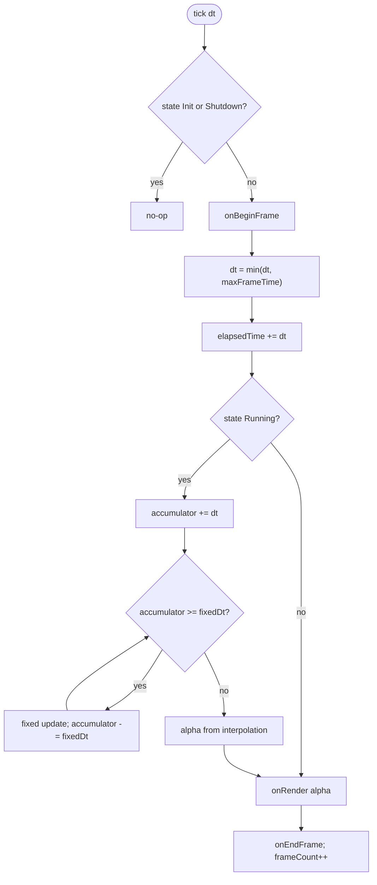
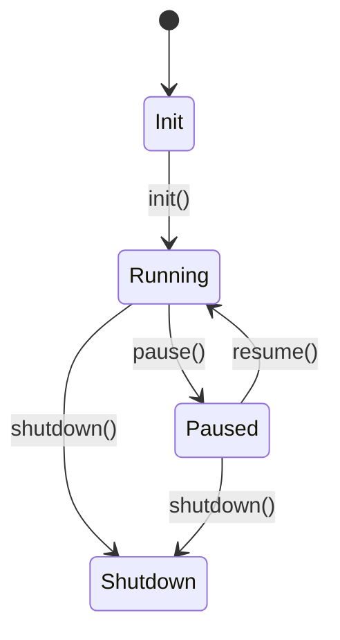

# 🎬 Game Loop

<div class="doc-meta">
  <span class="doc-badge doc-badge--stable">Stable</span>
  <span class="doc-badge">Engine</span>
  <span><strong>Namespace:</strong> <code>Caffeine</code> (not <code>Caffeine::Core</code>)</span>
  <span><strong>Files:</strong> <code>src/caffeine/core/GameLoop.hpp</code>, <code>src/caffeine/core/GameLoop.cpp</code></span>
  <span>Last verified: <time datetime="2026-11-18">2026-11-18</time></span>
</div>

<p class="doc-lede">The fixed-timestep accumulator that separates deterministic
simulation updates from variable-rate rendering, with pause/resume and
interpolation support.</p>

> **Tests:** `tests/test_gameloop.cpp` (27 cases)
> **RFs:** RF2.7, RF2.8

---

## Overview

The Game Loop is the heart of the engine — the cycle that runs from start to
finish. Caffeine implements the standard **Fixed Timestep with Accumulator**:
it decouples physics logic (which needs consistent time) from rendering (which
may vary freely).

**Pattern:** `accumulator += dt` → `while (accum >= fixedDt) update(fixedDt)` → `render(alpha)`

Inspired by [Game Programming Patterns — Game Loop](https://gameprogrammingpatterns.com/game-loop.html).

> **Caller responsibility:** `GameLoop` has no clock of its own and does not
> poll input — it receives a ready `deltaTime` through `tick(dt)`. Measuring
> real time (for example with [`Timer`](timer.md)) and pumping `SDL_PollEvent`
> is the job of the code that calls `tick()`, usually the application `main`.

---

## API

```cpp
namespace Caffeine {

enum class GameState : u8 {
    Init,      // tick() is ignored; waiting for init()
    Running,   // update + render
    Paused,    // no fixed update; rendering continues (UI, menus)
    Shutdown   // tick() is ignored
};

struct GameLoopConfig {
    f64  fixedDeltaTime = 1.0 / 60.0;  // 60 logical updates/second
    f64  maxFrameTime   = 0.25;          // dt clamp — avoids the "spiral of death"
    u32  targetFPS      = 0;             // 0 = unlimited (stored; not applied by the loop)
    bool vsync          = true;          // likewise — the RHI/window owns the real control
    bool interpolation  = true;          // computes alpha; when false, alpha = 0
};

// Alternative interface to std::function: derive and register via
// setCallbacks(). Both mechanisms coexist and BOTH are called
// (m_callbacks first, then the std::function hooks).
class IGameCallbacks {
public:
    virtual ~IGameCallbacks() = default;
    virtual void onBeginFrame() {}
    virtual void onFixedUpdate(f64 dt) { (void)dt; }
    virtual void onRender(f64 alpha) { (void)alpha; }
    virtual void onEndFrame() {}
};

class GameLoop {
public:
    explicit GameLoop(const GameLoopConfig& config = {});
    ~GameLoop();

    void init();               // Init → Running (from Init only)
    void tick(f64 deltaTime);  // one frame; ignored in Init/Shutdown
    void pause();              // Running → Paused (from Running only)
    void resume();             // Paused → Running (from Paused only)
    void shutdown();           // Running/Paused → Shutdown

    GameState state()              const { return m_state; }
    f64       elapsedTime()        const { return m_elapsedTime; }
    f64       interpolationAlpha() const { return m_alpha; }
    u64       frameCount()         const { return m_frameCount; }
    f64       accumulator()        const { return m_accumulator; }

    void setCallbacks(IGameCallbacks* callbacks);
    const GameLoopConfig& config() const { return m_config; }

    // Free hooks (called AFTER IGameCallbacks when both exist)
    std::function<void(f64 dt)>    onFixedUpdate;
    std::function<void(f64 alpha)> onRender;
    std::function<void()>          onBeginFrame;
    std::function<void()>          onEndFrame;

private:
    void processFixedUpdate(f64 dt);

    GameLoopConfig  m_config;
    IGameCallbacks* m_callbacks   = nullptr;
    GameState       m_state       = GameState::Init;
    f64             m_accumulator = 0.0;
    f64             m_elapsedTime = 0.0;
    f64             m_alpha       = 0.0;
    u64             m_frameCount  = 0;
};

}  // namespace Caffeine
```

---

## Per-frame flow (`tick(dt)`)



Behaviour confirmed by the code and tests:
- **Paused:** `onRender` / `onBeginFrame` / `onEndFrame` still run;
  `accumulator` stays frozen and pending steps fire on `resume()`.
- **`targetFPS` / `vsync`:** only stored — the loop does not sleep or
  synchronize; the caller/RHI applies throttling and vsync.
- **`shutdown()`** from `Init` is ignored (no transition).

---

## Spiral of Death Prevention

```cpp
deltaTime = std::min(deltaTime, m_config.maxFrameTime);  // default 250ms
```

**Effect:** on slow hardware the game temporarily enters slow motion instead of
locking into an infinite catch-up loop.

---

## Rendering Interpolation

Without interpolation, entities "teleport" between positions at every fixed
step:

```cpp
Caffeine::Vec2 renderPos = Caffeine::Math::lerp(entity.prevPos, entity.currPos, alpha);
// alpha = 0.0 → start of the current step
// alpha = 1.0 → end of the current step
```

**Requirement:** physics systems must save `prevPos` before updating `currPos`.
With `interpolation = false`, `alpha` is always `0.0`.

---

## Usage Examples

```cpp
// ── Basic setup ───────────────────────────────────────────────
Caffeine::GameLoopConfig cfg;
cfg.fixedDeltaTime = 1.0 / 60.0;
cfg.interpolation  = true;

Caffeine::GameLoop loop(cfg);

loop.onFixedUpdate = [&](Caffeine::f64 dt) {
    world.update(dt);
    eventBus.dispatch();
};

loop.onRender = [&](Caffeine::f64 alpha) {
    renderer.render(alpha);
};

loop.init();

// ── Main loop (the caller measures time and pumps input) ──────
Caffeine::Core::Timer timer;
timer.start();
while (loop.state() != Caffeine::GameState::Shutdown) {
    SDL_PumpEvents();  // or InputManager::beginFrame(), depending on the app
    Caffeine::Core::Duration dt = timer.tick();
    loop.tick(dt.seconds);
}
```

With `IGameCallbacks` instead of lambdas:

```cpp
class MyGame : public Caffeine::IGameCallbacks {
    void onFixedUpdate(Caffeine::f64 dt) override { world.update(dt); }
    void onRender(Caffeine::f64 alpha) override { renderer.render(alpha); }
};
MyGame game;
loop.setCallbacks(&game);
```

---

## Loop States



| State | Behaviour |
|--------|-------------|
| `Init` | `tick()` ignored; `pause()` / `resume()` / `shutdown()` ignored |
| `Running` | Normal loop: begin → N×fixed update → render(alpha) → end |
| `Paused` | No fixed update; `elapsedTime` and `frameCount` advance; render continues |
| `Shutdown` | Terminal; `tick()` ignored |

---

## Design Decisions

| Decision | Rationale |
|---------|---------------|
| Fixed timestep for logic | Deterministic physics, replay, multiplayer |
| Accumulator with clamp (`min`) | Avoids the "spiral of death" on slow hardware |
| Loop without its own clock/input | Testable (`tick(dt)` is deterministic) and not coupled to SDL |
| `IGameCallbacks` + `std::function` | Game class or lambdas, caller's choice |
| `targetFPS` / `vsync` only stored | Real throttling belongs to the RHI/window, not the loop |

---

## Acceptance Criteria

- [x] `tests/test_gameloop.cpp`: defaults, state transitions, frame count, fixed-update rate, anti-spiral clamp, `alpha ∈ [0,1)`
- [x] Spiral of death does not occur: FPS may fall but the loop does not lock
- [x] `state()` transitions Init → Running ⇄ Paused → Shutdown (invalid transitions ignored)
- [ ] 3600 frames with `fixedDt` accumulated = 60.0 ± 0.001 (no drift) — long-duration test still pending

---

## Dependencies

- **Upstream:** [Timer](timer.md) (the caller measures `dt`), types from [`src/caffeine/core/Types.hpp`](https://github.com/devscafecommunity/caffeine/blob/main/src/caffeine/core/Types.hpp)
- **Downstream:** ECS World ([`../ecs/core.md`](../ecs/core.md)), Renderer, Input ([`../input/input-system.md`](../input/input-system.md)) — all through callbacks, no coupling

---

## References

- [`src/caffeine/core/GameLoop.hpp`](https://github.com/devscafecommunity/caffeine/blob/main/src/caffeine/core/GameLoop.hpp) / [`src/caffeine/core/GameLoop.cpp`](https://github.com/devscafecommunity/caffeine/blob/main/src/caffeine/core/GameLoop.cpp)
- [`tests/test_gameloop.cpp`](https://github.com/devscafecommunity/caffeine/blob/main/tests/test_gameloop.cpp)
- [`docs/architecture_specs.md`](../architecture_specs.md) — §1 Game Loop
- [`core/timer.md`](timer.md) — measures the `dt` fed to the loop
- [Game Programming Patterns — Game Loop](https://gameprogrammingpatterns.com/game-loop.html)
