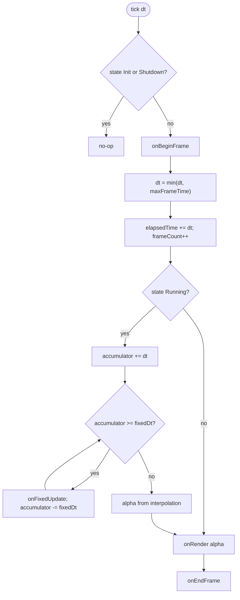
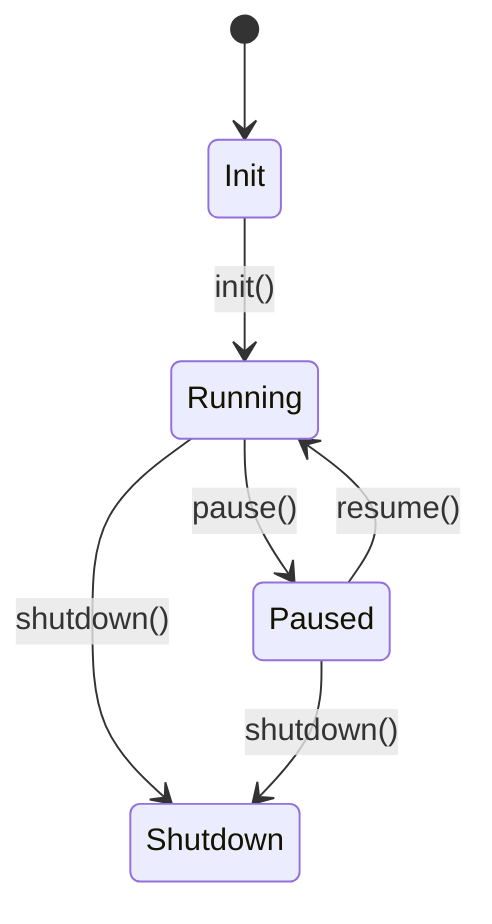

# 🎬 Game Loop

> **Phase:** 2 — Pulse and Competition
> **Namespace:** `Caffeine` (no `Caffeine::Core` ) 
> **Files:** `src/core/GameLoop.hpp` , `src/core/GameLoop.cpp` 
> **Status: ** Implemented
> ** Tests:** `tests/test_gameloop.cpp` 
> **RFs:** RF2.7, RF2.8

---

## Overview

Game Loop is the heart of the engine — the cycle running from start to finish. Caffeine implements the standard **Fixed Timestep with Accumulator**: unlinks the physics logic (which needs consistent time) of rendering (which can vary freely).

** Standard:** `accumulator += dt` → `while (accum >= fixedDt) update(fixedDt)` → `render(alpha)`

Inspirado em [Game Programming Patterns — Game Loop](https://gameprogrammingpatterns.com/game-loop.html).

> **Responsabilidade do chamador:** o `GameLoop` does not have its own clock and does not
> makes polling of input — he receives `deltaTime` pronto via `tick(dt)` . Medir o
> tempo real (ex: com [`Timer`](timer.md)) e bombear `SDL_PollEvent` is the task of
> code you call `tick()` , normalmente o `main` the application.

---

## API Real

```cpp
namespace Caffeine {

enum class GameState : u8 {
    Init,      // tick() é ignorado; aguardando init()
    Running,   // update + render
    Paused,    // sem fixed update; render continua (UI, menu)
    Shutdown   // tick() é ignorado
};

struct GameLoopConfig {
    f64  fixedDeltaTime = 1.0 / 60.0;  // 60 updates lógicos/segundo
    f64  maxFrameTime   = 0.25;          // clamp do dt — evita "spiral of death"
    u32  targetFPS      = 0;             // 0 = unlimited (armazenado; não aplicado pelo loop)
    bool vsync          = true;          // idem — controle real é do RHI/janela
    bool interpolation  = true;          // calcula alpha; se false, alpha = 0
};

// ============================================================================
// @brief  Interface alternativa aos std::function: derive e registre via
//  setCallbacks(). Os dois mecanismos coexistem e AMBOS são chamados
//  (primeiro m_callbacks, depois os std::function).
// ============================================================================
class IGameCallbacks {
public:
    virtual ~IGameCallbacks() = default;
    virtual void onBeginFrame() {}
    virtual void onFixedUpdate(f64 dt) { (void)dt; }
    virtual void onRender(f64 alpha) { (void)alpha; }
    virtual void onEndFrame() {}
};

class GameLoop {
public:
    explicit GameLoop(const GameLoopConfig& config = {});
    ~GameLoop();

    void init();            // Init → Running (só a partir de Init)
    void tick(f64 deltaTime);  // um frame; ignorado em Init/Shutdown
    void pause();           // Running → Paused (só a partir de Running)
    void resume();          // Paused → Running (só a partir de Paused)
    void shutdown();        // Running/Paused → Shutdown

    GameState state()              const { return m_state; }
    f64       elapsedTime()        const { return m_elapsedTime; }
    f64       interpolationAlpha() const { return m_alpha; }
    u64       frameCount()         const { return m_frameCount; }
    f64       accumulator()        const { return m_accumulator; }

    void setCallbacks(IGameCallbacks* callbacks);
    const GameLoopConfig& config() const { return m_config; }

    // Hooks livres (chamados DEPOIS do IGameCallbacks, se ambos existirem)
    std::function<void(f64 dt)>    onFixedUpdate;
    std::function<void(f64 alpha)> onRender;
    std::function<void()>          onBeginFrame;
    std::function<void()>          onEndFrame;

private:
    void processFixedUpdate(f64 dt);

    GameLoopConfig  m_config;
    IGameCallbacks* m_callbacks   = nullptr;
    GameState       m_state       = GameState::Init;
    f64             m_accumulator = 0.0;
    f64             m_elapsedTime = 0.0;
    f64             m_alpha       = 0.0;
    u64             m_frameCount  = 0;
};

}  // namespace Caffeine
```

---

## Fluxo Detalhado por Frame ( `tick(dt)` )




Behavioral notes (confirmed by code and tests):
- **Pausado:** `onRender` / `onBeginFrame` / `onEndFrame` continuam; `accumulator`
fica congelado e os steps pendentes disparam ao dar `resume()` .
- ** `targetFPS` / `vsync` :** only stored — the loop does not sleep or sync;
cabe ao chamador/RHI aplicar throttling e vsync.
- ** `shutdown()` ** a partir de `Init` is ignored (without transition).

---

## Spiral of Death Prevention

```cpp
deltaTime = std::min(deltaTime, m_config.maxFrameTime);  // default 250ms
```

** Effect:** on slow hardware, the game enters temporary slow motion instead of locking into an infinite catch-up loop.

---

## Rendering Interpolation

Without interpolation, entities "teleport" between positions at each fixed step:

```cpp
Vec2 renderPos = lerp(entity.prevPos, entity.currPos, alpha);
// alpha = 0.0 → início do step atual
// alpha = 1.0 → fim do step atual
```

**Requirement:** Physics systems must save `prevPos` antes de atualizar `currPos` . Com `interpolation = false` , `alpha` It's always `0.0` .

---

## Exemplos de Uso

```cpp
// ── Setup básico ──────────────────────────────────────────────
Caffeine::GameLoopConfig cfg;
cfg.fixedDeltaTime = 1.0 / 60.0;
cfg.interpolation  = true;

Caffeine::GameLoop loop(cfg);

loop.onFixedUpdate = [&](f64 dt) {
    world.update(dt);
    eventBus.dispatch();
};

loop.onRender = [&](f64 alpha) {
    renderer.render(alpha);
};

loop.init();

// ── Main loop (o chamador mede o tempo e bombeia input) ───────
Caffeine::Core::Timer timer;
timer.start();
while (loop.state() != Caffeine::GameState::Shutdown) {
    SDL_PumpEvents();  // ou InputManager::beginFrame(), conforme o app
    Caffeine::Core::Duration dt = timer.tick();
    loop.tick(dt.seconds);
}
```

Com `IGameCallbacks` em vez de lambdas:

```cpp
class MyGame : public Caffeine::IGameCallbacks {
    void onFixedUpdate(f64 dt) override { world.update(dt); }
    void onRender(f64 alpha) override { renderer.render(alpha); }
};
MyGame game;
loop.setCallbacks(&game);
```

---

## Estados do Loop



| Estado | Comportamento |
|--------|-------------|
| `Init` | `tick()` ignorado; `pause()` / `resume()` / `shutdown()` ignorados |
| `Running` | Normal loop: beginning → N×fixed update → render(alpha) → end |
| `Paused` | Sem fixed update; `elapsedTime` e `frameCount` advance; render continues |
| `Shutdown` | Terminal; `tick()` ignorado |

---

## Design Decisions

| Decision | Justificativa |
|---------|---------------|
| Fixed timestep for logic | deterministic physics, replay, multiplayer |
| Acumulador com clamp ( `min` ) | Evita "spiral of death" em hardware lento |
| Loop without own clock/input | Testable ( `tick(dt)` deterministic) and without SDL coupling |
| `IGameCallbacks` + `std::function` | Game class or lambdas, caller choice |
| `targetFPS` / `vsync` only stored | Real Throttling belongs to RHI/window, not the loop |

---

## Acceptance Criteria

- [x] `tests/test_gameloop.cpp` : defaults, state transitions, frame count, fixed update rate, anti-spiral clamp, `alpha ∈ [0,1)`
- [x] Spiral of death does not occur: FPS may fall but loop does not lock
- [x] `state()` transition Init → Running 
- [ ] 3600 frames com `fixedDt` accumulated = 60.0 ± 0.001 (without drift) — long-term test still pending

---

## Dependencies

- **Upstream:** [Timer](timer.md) (chamador mede `dt` ), tipos de [`src/core/Types.hpp`](../../src/core/Types.hpp)
- **Downstream:** ECS World ([`../ecs/core.md`](../ecs/core.md)), Renderer, Input ([`../input/input-system.md`](../input/input-system.md)) — all via callbacks without coupling

---

## References

- [`src/core/GameLoop.hpp`](../../src/core/GameLoop.hpp) / [`src/core/GameLoop.cpp`](../../src/core/GameLoop.cpp)
- [`tests/test_gameloop.cpp`](../../tests/test_gameloop.cpp)
- [`docs/architecture_specs.md`](../architecture specs.md) — §1 Game Loop
- [`core/timer.md`](timer.md) — Measure the `dt` alimentado ao loop
- [Game Programming Patterns — Game Loop](https://gameprogrammingpatterns.com/game-loop.html)
