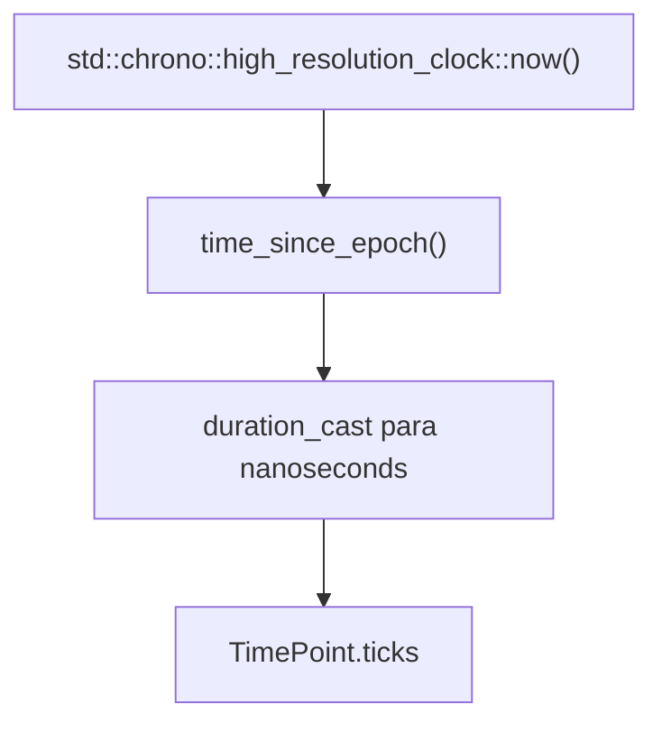

# ⏱️ High-Resolution Timer

<div class="doc-meta">
  <span class="doc-badge doc-badge--stable">Stable</span>
  <span class="doc-badge">Engine</span>
  <span><strong>Namespace:</strong> <code>Caffeine::Core</code></span>
  <span><strong>Files:</strong> <code>src/caffeine/core/Timer.hpp</code>, <code>src/caffeine/core/Timer.cpp</code></span>
  <span>Last verified: <time datetime="2026-11-18">2026-11-18</time></span>
</div>

<p class="doc-lede">A small start/stop stopwatch and duration type used to
measure frame deltas for the game loop and to instrument engine scopes.</p>

> **Tests:** `tests/test_timer.cpp` (31 cases)

---

## Overview

The Timer provides high-precision time measurements for the
[Game Loop](game-loop.md) and for manual performance instrumentation. The
implementation uses `std::chrono::high_resolution_clock` — **not** SDL — with
ticks in **nanoseconds since the epoch**.

**Main purpose:**
- Measure `deltaTime` between frames for the Game Loop (`Timer::tick()`)
- Measure cumulative duration with start/stop cycles (`Timer::elapsed()`)
- Mark RAII scopes (`ScopeTimer`)

---

## API

```cpp
namespace Caffeine::Core {

// Time point. Ticks are nanoseconds (see Timer.cpp).
// Direct comparisons; no clock of its own (there is no TimePoint::now()).
struct TimePoint {
    u64 ticks = 0;

    TimePoint() = default;
    explicit TimePoint(u64 t) : ticks(t) {}

    bool operator<(const TimePoint&) const;
    bool operator<=(const TimePoint&) const;
    bool operator>(const TimePoint&) const;
    bool operator>=(const TimePoint&) const;
    bool operator==(const TimePoint&) const;
    bool operator!=(const TimePoint&) const;
};

// ABSOLUTE difference between two TimePoints.
//
// Warning: this operator treats ticks as MICROSECONDS (divides by 1e6).
// Timer produces ticks in nanoseconds, so it is not consistent with
// TimePoints returned by the Timer — use Timer::elapsed()/tick() for real
// measurements.
inline Duration operator-(const TimePoint& a, const TimePoint& b);

// Duration in seconds (f64), with factories and arithmetic.
struct Duration {
    f64 seconds = 0.0;

    Duration() = default;
    explicit Duration(f64 s) : seconds(s) {}

    static Duration fromSeconds(f64 s);
    static Duration fromMillis(f64 ms);
    static Duration fromMicros(f64 us);
    static Duration fromNanos(f64 ns);

    f64 millis() const;   // seconds * 1e3
    f64 micros() const;   // seconds * 1e6
    f64 nanos()  const;   // seconds * 1e9 (returns f64, not u64)

    Duration operator+(const Duration&) const;
    Duration operator-(const Duration&) const;
    Duration operator*(f64 scalar) const;   // plus the free scalar * Duration form
    Duration operator/(f64 scalar) const;

    bool operator<(const Duration&) const;
    bool operator<=(const Duration&) const;
    bool operator>(const Duration&) const;
    bool operator>=(const Duration&) const;
    bool operator==(const Duration&) const;  // equality with 1e-15 epsilon
    bool operator!=(const Duration&) const;
};

// Start/stop stopwatch with an accumulator.
//
//  - Starts stopped (isRunning() == false).
//  - elapsed() accumulates every start/stop cycle since the last reset().
//  - tick() returns the time since the last tick/start and re-arms the
//    reference; returns Duration(0) while stopped.
class Timer {
public:
    Timer();
    ~Timer();

    void start();   // idempotent: a second start() without stop() is ignored
    void stop();    // accumulates ticks; while stopped the total is kept
    void reset();   // clears the accumulator and stops the timer

    Duration elapsed() const;  // does not re-arm (peek)
    Duration tick();           // re-arms the internal reference

    bool isRunning() const;

private:
    TimePoint m_start_time;
    TimePoint m_stop_time;
    u64 m_accumulated_ticks;   // nanoseconds
    bool m_is_running;
};

// RAII: start() in the constructor, stop() in the destructor.
//
// Current limitation: the measurement is NOT recorded anywhere (no log, no
// Profiler) and m_name is unused. It only marks a scope today; Profiler
// integration is still pending.
class ScopeTimer {
public:
    explicit ScopeTimer(const char* name);
    ~ScopeTimer();

private:
    const char* m_name;
    Timer m_timer;
};

}  // namespace Caffeine::Core
```

---

## Usage Examples

```cpp
// --- deltaTime per frame ---
Caffeine::Core::Timer timer;
timer.start();
while (running) {
    Caffeine::Core::Duration dt = timer.tick();
    update(dt.seconds);
}

// --- accumulated time with pauses ---
Caffeine::Core::Timer t;
t.start();
/* ... */ t.stop();   // pause: elapsed() freezes
/* ... */ t.start();  // resume accumulating
Caffeine::Core::Duration total = t.elapsed();

// --- factories and conversions ---
auto d = Caffeine::Core::Duration::fromMillis(16.666);
CF_INFO("Timer", "dt = %.2f ms", d.millis());

// --- ScopeTimer (today: marks the scope, produces no output) ---
{
    Caffeine::Core::ScopeTimer timer("ECS::update");
    world.update(dt);
}
```

---

## Internal Implementation



No SDL dependency. `Timer` is not thread-safe (no mutex or atomics). When
several systems need timings, each system should own an instance or access must
be serialized by the Game Loop.

---

## Design Decisions

| Decision | Rationale |
|---------|---------------|
| `std::chrono` instead of SDL | Timer is a core module without an SDL dependency |
| Internal `u64 ticks` (ns) | No premature conversion to f64 |
| `elapsed()` does not re-arm | Allows repeated peeks (see tests) |
| Accumulator on start/stop | Supports pause/resume without losing time |
| `Duration::operator==` with epsilon | Exact f64 comparison is unstable |

---

## Acceptance Criteria

- [x] `tests/test_timer.cpp`: TimePoint, Duration, Timer, ScopeTimer and integration (31 cases)
- [x] Microsecond accuracy verified (`sleep 1000us` → `millis() > 0.5`)
- [ ] `ScopeTimer` integrated with the Profiler (it records nothing today)
- [ ] Fix the unit inconsistency in `operator-(TimePoint, TimePoint)` (assumes µs; Timer produces ns)
- [ ] Make `tick()` thread-safe for multiple readers

---

## Dependencies

- **Upstream:** `Caffeine::Core::Types` ([`src/caffeine/core/Types.hpp`](https://github.com/devscafecommunity/caffeine/blob/main/src/caffeine/core/Types.hpp))
- **Downstream:** [Game Loop](game-loop.md); Profiler ([`../debug/debug-tools.md`](../debug/debug-tools.md))
- **External:** only `<chrono>` from the standard library

---

## References

- [`src/caffeine/core/Timer.hpp`](https://github.com/devscafecommunity/caffeine/blob/main/src/caffeine/core/Timer.hpp) / [`src/caffeine/core/Timer.cpp`](https://github.com/devscafecommunity/caffeine/blob/main/src/caffeine/core/Timer.cpp)
- [`tests/test_timer.cpp`](https://github.com/devscafecommunity/caffeine/blob/main/tests/test_timer.cpp)
- [`docs/architecture_specs.md`](../architecture_specs.md) — §1 Game Loop
- [`core/game-loop.md`](game-loop.md) — uses Timer internally
