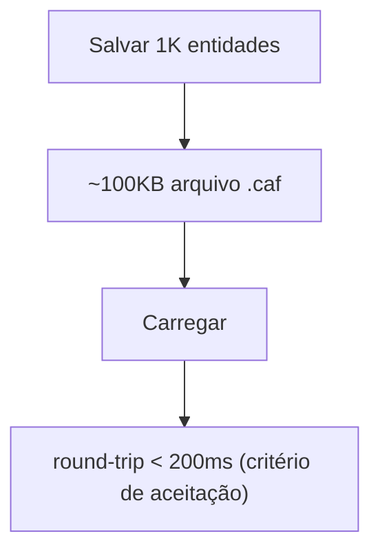

# 🗺️ Scene Manager

> **Phase:**4 — The Brain
> **Namespace:** `Caffeine::Scene` 
> **Files:** `src/scene/SceneManager.hpp` , `src/scene/SceneSerializer.hpp` 
> **Status: ** Implemented
> **RF:** RF4.5

---

## Overview

Scene Manager organizes parent/child hierarchy entities for local transformations, and allows you to save/load the full state of the scene in binary format `.caf` .

**Componentes chave:**
- `Parent` — hierarchical link between entities
- `WorldTransform` — calculated overall processing matrix
- `SceneSerializer` — serialisation to `.caf` binary
- `SceneManager` — stack of scenes and transitions

---

## API

```cpp
namespace Caffeine::Scene {

// ============================================================================
// @brief  Componente de hierarquia parent/child.
// ============================================================================
struct Parent {
    ECS::Entity parent = ECS::Entity::INVALID;
    bool        dirty  = true;  // world transform precisa recalcular
};

// ============================================================================
// @brief  World transform — matrix resultante da hierarquia.
//
//  Calculado pelo TransformSystem: acumula transforms parent → child.
// ============================================================================
struct WorldTransform {
    Mat4 matrix = Mat4::identity();
};

// ============================================================================
// @brief  Serializa e deserializa uma cena (ECS::World) para .caf.
//
//  Formato .caf de cena:
//  - Header (32 bytes)
//  - Entity count + Archetype table
//  - Component data packed per archetype (binary)
//  - String table (entity names)
//  - Asset reference table (paths das texturas, áudios, etc.)
// ============================================================================
class SceneSerializer {
public:
    explicit SceneSerializer(ECS::World& world);

    // Binário .caf — produção
    bool serialize(const char* path) const;
    bool deserialize(const char* path);

    // JSON — dev/debug (legível por humanos)
    bool serializeJson(const char* path) const;
    bool deserializeJson(const char* path);

    // Exporta estado atual para bytes (sem arquivo)
    bool serializeToMemory(std::vector<u8>& out) const;
    bool deserializeFromMemory(const std::vector<u8>& data);

private:
    ECS::World& m_world;
};

// ============================================================================
// @brief  Gerenciador de cenas.
//
//  Suporta:
//  - Single scene (switch)
//  - Scene stack (push/pop para menus sobre gameplay)
//  - Transições animadas (fade, slide)
//  - Async loading em background
// ============================================================================
class SceneManager {
public:
    enum class TransitionType : u8 {
        None,    // Instantâneo
        Fade,    // Fade out → Fade in
        Slide,   // Slide lateral
        Custom   // Callback customizado
    };

    struct TransitionConfig {
        TransitionType type     = TransitionType::Fade;
        f32            duration = 0.5f;
        Color          fadeColor = Color::BLACK;
    };

    // ── Carregamento ───────────────────────────────────────────
    Assets::LoadHandle loadScene(const char* path, bool async = false);

    // ── Navegação ──────────────────────────────────────────────
    void switchScene(const char* path,
                     TransitionConfig trans = {});

    // Stack para menus sobre gameplay:
    void pushScene(const char* path);
    void popScene();

    // ── Consultas ──────────────────────────────────────────────
    ECS::World* activeWorld() const { return m_activeWorld; }
    bool        isTransitioning() const { return m_transitioning; }

    // ── Update (processa transições) ───────────────────────────
    void update(f64 dt);

private:
    ECS::World*                     m_activeWorld    = nullptr;
    std::vector<std::unique_ptr<ECS::World>> m_sceneStack;
    bool                            m_transitioning  = false;
    TransitionConfig                m_currentTrans;
    f32                             m_transProgress  = 0.0f;
};

}  // namespace Caffeine::Scene
```

---

## Serialization Format (.caf Scene)

```
[CafHeader]         (32 bytes — magic, version, type=Scene)
[SceneHeader]       (20 bytes — entityCount, archetypeCount, offsets)
[Archetype Table]   [N × ArchetypeDesc]
[Entity Data]       [componentes packed por archetype]
[String Table]      [nomes de entidades, null-terminated]
[Asset Ref Table]   [paths de assets referenciados]
[CRC32]             (4 bytes — verificação de integridade)
```

**Exemplo de salvamento:**



---

## Sistema de Hierarquia (TransformSystem)

```cpp
// TransformSystem (ECS::ISystem, priority = 50 — antes de tudo):
world.query(parentQuery, [](WorldTransform& wt, Position2D& pos,
                            const Parent& parent) {
    if (parent.dirty) {
        Mat4 localTransform = Mat4::translate(pos.x, pos.y);
        if (parent.parent.isValid()) {
            auto* parentWT = world.get<WorldTransform>(parent.parent);
            wt.matrix = parentWT->matrix * localTransform;
        } else {
            wt.matrix = localTransform;
        }
    }
});
```

---

## Exemplos de Uso

```cpp
// ── Salvar cena ───────────────────────────────────────────────
Caffeine::Scene::SceneSerializer serializer(world);
if (!serializer.serialize("saves/level1.caf")) {
    CF_ERROR("Scene", "Failed to save level1");
}

// ── Carregar cena ─────────────────────────────────────────────
if (!serializer.deserialize("assets/scenes/level1.caf")) {
    CF_FATAL("Scene", "Could not load level1");
}

// ── Transição de cena ─────────────────────────────────────────
Caffeine::Scene::SceneManager sceneManager;

// Vai para próximo nível com fade
sceneManager.switchScene("assets/scenes/level2.caf",
    { .type = SceneManager::TransitionType::Fade,
      .duration = 0.5f });

// Abre menu pause (preserva gameplay por baixo)
sceneManager.pushScene("assets/scenes/pause_menu.caf");
// ...volta ao jogo
sceneManager.popScene();

// ── Hierarquia ────────────────────────────────────────────────
Entity sword = world.create("Sword");
world.add<Position2D>(sword, {15, -5});  // local ao player
world.add<Parent>(sword, { .parent = playerEntity });
// WorldTransform do sword = WorldTransform do player * Mat4::translate(15, -5)
```

---

## Design Decisions

| Decision | Justificativa |
|---------|-------------|
| Scene stack | Menus sobre gameplay sem destruir o mundo |
| .caf binary format | Zero-parsing — SSD speed-limited load |
| JSON opcional | Legibilidade em debug sem comprometer performance |
| `dirty` flag no Parent | Avoid recalculating WorldTransform when not changed |
| Async loading | Freeze-free level transitions |

---

## Acceptance Criteria

- [x] Serialize + deserialize 1K entidades round-trip < 200ms
- [x] Scene stack push/pop sem memory leaks
- [x] Functional Fade Transition (no visual artifacts)
- [x] Hierarchy: WorldTransform correctly calculated for 3+ levels of depth

---

## Dependencies

- **Upstream:** [ECS Core](ecs.md), [Format .caf](../assets/caf-format.md), [Phase 1 — Mat4](../math/vectors.md)
- **Downstream:** [Phase 6 — Scene Editor](../editor/scene-editor.md)

---

## 🔗 Related Topics

| Topic | Description |
|--------|-----------|
| [Sistemas de Jogo]() | Scene Manager como orquestrador de fases |
| [Assets & Pipeline]() | Serialization of scenes in .caf |

## References

- [`docs/architecture_specs.md`](../architecture specs.md) — §5 Scene Graph & Serialization
- [`assets/caf-format.md`](../assets/caf-format.md) — binary format
- [`ecs/core.md`](ecs.md) — ECS World used internally
- [Transversal Topic Index]()
