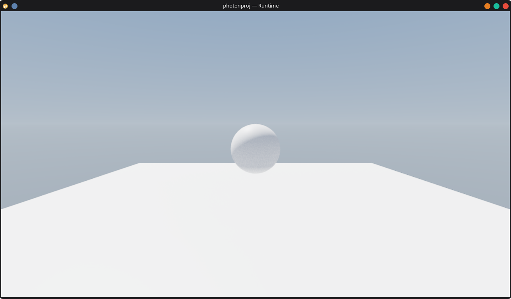

# Photon — native hybrid radiance-cascade GI

Photon is a **native Doppio and runtime system**: it is compiled into the editor and
runtime binaries, not loaded as a plugin. It provides real-time global illumination
without hardware ray tracing.

## v0.1 scope

| Photon spec | v0.1 status |
|-------------|-------------|
| Screen-anchored near field | **Implemented**: K exponentially growing intervals traced against the depth buffer |
| Interval merge | **Implemented**: front-to-back radiance accumulation |
| Far field | **Approximated**: sky + ambient fallback when a ray leaves the screen |
| World-anchored probe field | Not yet |
| Multi-bounce feedback | Not yet |
| Glossy reflection pass | Not yet |
| Temporal denoiser | Provided by the engine's TAA: Photon runs before it |

The full specification is the design target. This native slice is intentionally
labelled v0.1 wherever it differs from the reference design.

## Presets

| Preset | Quality | Cascades | Radius |
|--------|---------|----------|--------|
| **Performance** | Low | 3 | 10 m |
| **Balanced** | Medium | 4 | 14 m |
| **High** | High | 5 | 22 m |
| **Cinematic** | High | 6 | 32 m |

## Parameters

| Parameter | Meaning |
|-----------|---------|
| **Intensity** | Indirect-light multiplier |
| **Cascades** | Number of distance intervals |
| **Radius** | Near-field reach in world units |
| **Thickness** | Depth tolerance for accepting a screen hit |
| **Sky intensity** | Far-field fallback when a ray leaves the screen |
| **Ambient** | Constant bounce term |
| **Tint RGB** | Albedo approximation applied to gathered radiance |
| **Debug** | Lit scene, GI only, or fallback only |

## Use it

1. Open a scene with a Camera 3D and geometry.
2. Open **View → Photon Global Illumination**, or run **Photon GI** in the command
   palette.
3. Press **Create Photon GI** if the scene has no component yet.
4. Pick a preset and tune radius/thickness for the scene scale.
5. Switch **Debug → GI only** to inspect the cascade result.

The component is `ECS::PhotonGIComponent`; the Inspector has a full drawer as well.

## Baked ambient occlusion (no RTX)

The native **Baked ambient occlusion** section precomputes static AO into the
selected mesh material:

1. Select a static mesh entity (or use **Bake scene**).
2. Choose resolution (256/512/1024), rays, max distance and bias.
3. Press **Bake selected mesh**.

The baker uses **GPU compute** when the render device exposes compute, and falls
back to the CPU BVH otherwise. The CPU only rasterises UVs and builds the triangle
list; the expensive ray tests run on the GPU. Scenes above 8192 triangles use the
CPU path.

The baker:

- gathers every static mesh triangle as an occluder,
- rasterises the target mesh in UV space,
- casts cosine-weighted rays,
- writes an **ORM PNG** with AO in R (roughness/metallic preserved in G/B),
- updates the material's `orm_map` and `ao_strength`.

The runtime shader already samples ORM.R as ambient occlusion, so the result is
applied with **no ray-tracing hardware** and no screen-space noise. Re-bake after
changing static geometry.

> Baked AO is for static meshes. Moving objects should keep using the screen-space
> Photon pass. Meshes with overlapping UVs average their faces; use unique UVs for
> per-face AO.

## Performance

- Low: 4 rays × 2 steps per interval
- Medium: 8 rays × 2 steps
- High: 12 rays × 3 steps

Photon runs **before TAA**, so the temporal resolve cleans the stochastic ray
pattern. Start at Balanced for editing and High/Cinematic for captures.

## Limitations

- No world-anchored radiance probe field: off-screen light falls back to a constant
  sky + ambient term.
- Single bounce: the previous frame's indirect irradiance is not fed back yet.
- Screen-space occlusion can leak on thin geometry; raise **Thickness** or use a
  smaller **Radius**.
- Glossy reflections are not part of v0.1.

## Related

- [Scene viewport](scene-viewport.md)
- [Workspace and theme](workspace-and-theme.md)
- [Plugin catalog](../plugins/README.md)
