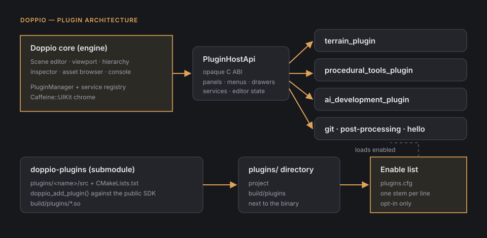
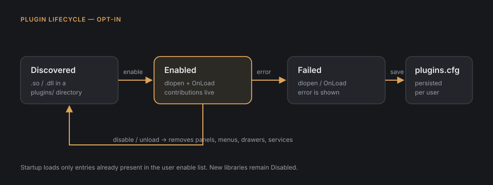

# Plugin Manager (legacy host)

<div class="doc-meta">
  <span class="doc-badge doc-badge--reference">Reference</span>
  <span>Last updated: <time datetime="2026-11-18">2026-11-18</time></span>
</div>

<p class="doc-lede">How the legacy C++ host discovers and enables plugin libraries, and why the Rust Doppio does not load them.</p>

<div class="doc-callout doc-callout--warning">
  <p><strong>Legacy host.</strong> The active Rust/Iced Doppio does not load C++ plugins.
  These pages document the C++/ImGui plugin SDK and its host in
  <code>caffeine-runtime</code> / <code>doppio-archived</code>. The engine still builds
  every plugin from the submodule so the SDK stays compile-tested.</p>
</div>


The engine build compiles **every** plugin from the `doppio-plugins` submodule into
`build/plugins/`, but the **legacy C++ host** does not load them until the user enables each
one in its Plugin Manager. The editor core only provides the host (`PluginManager` +
`PluginServiceRegistry`); no feature plugin is hardcoded.

<figure class="doc-figure">
  
  <figcaption>Doppio plugin architecture</figcaption>
</figure>


<figure class="doc-figure">
  
  <figcaption>Plugin lifecycle</figcaption>
</figure>


## Where plugins live

Plugin sources are maintained in the separate
[doppio-plugins](https://github.com/devscafecommunity/doppio-plugins) repository and
added to the engine as a git submodule:

```bash
./scripts/submodules.sh
```

The normal engine build compiles **every** plugin and writes the libraries to
`build/plugins/`:

```bash
cmake -S . -B build -DCMAKE_BUILD_TYPE=Release
cmake --build build -j
```

There is no second build step. `CAFFEINE_BUILD_DOPPIO_PLUGINS=OFF` is the only way
to skip plugin compilation, for minimal/headless builds.

## Install

Copy the libraries into any discovered plugin directory:

| Scope | Directory |
|-------|-----------|
| Project | `<project>/plugins/` |
| Doppio build | `<caffeine>/build/plugins/` |
| Next to the binary | `<doppio-dir>/plugins/` |

## Enable only what you need

Open **Plugins → Plugin Manager**. Discovered libraries start **disabled**:

- Toggling **Enabled** loads the shared library immediately and calls `OnLoad()`.
- Unloading removes its panels, menu actions, component drawers and services.
- The choice is persisted in `~/.config/caffeine/plugins.cfg` (or
  `$XDG_CONFIG_HOME/caffeine/plugins.cfg`).

Nothing is loaded at startup unless it appears in that enable list. A library that
is copied into the folder later stays disabled until you enable it.

## Why this matters

| Before | Now |
|--------|-----|
| Plugins built inside the engine tree | Built from the `doppio-plugins` submodule against the public SDK |
| Every `.so` loaded on startup | Only user-enabled plugins load |
| Core referenced plugin identifiers | Core exposes generic host services only |
| Plugin UI coupled to Doppio internals | Plugin UI uses `Caffeine::UIKit` and opaque host callbacks |

## Troubleshooting

- **Plugin is listed but does not load:** check the status column for the
  `dlopen` error. On Linux the plugin must be built with the same compiler ABI as
  Doppio.
- **Panel disappeared after disabling:** unloading intentionally removes all of the
  plugin's contributions. Re-enable it to register them again.
- **Want a plugin enabled by default for a team:** ship a `plugins.cfg` in the
  project documentation and have developers copy it to their user config; the
  format is one library stem per line.
