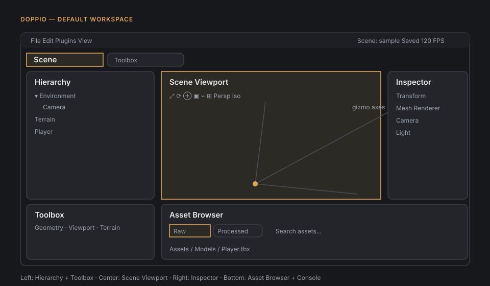
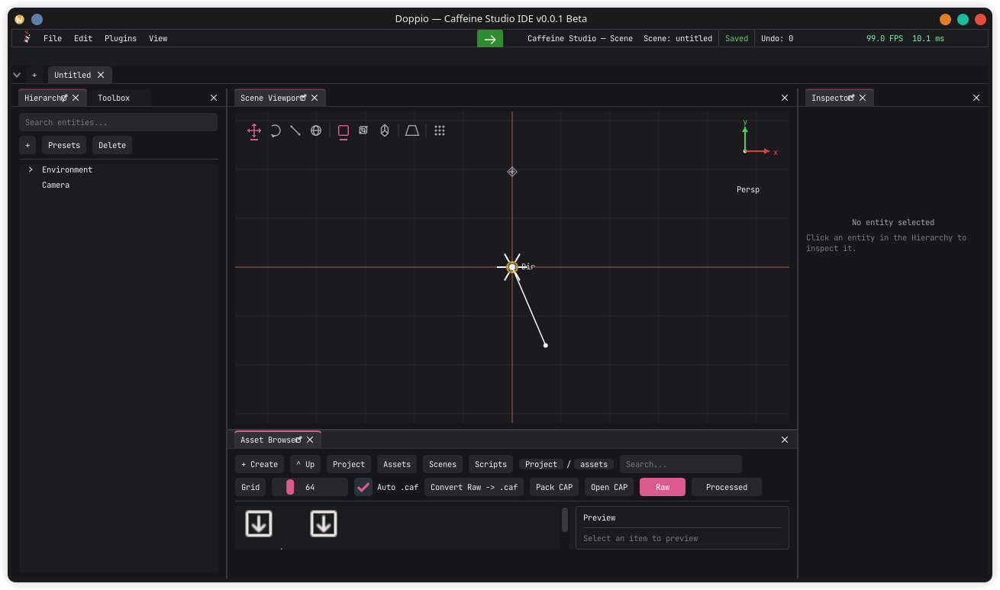
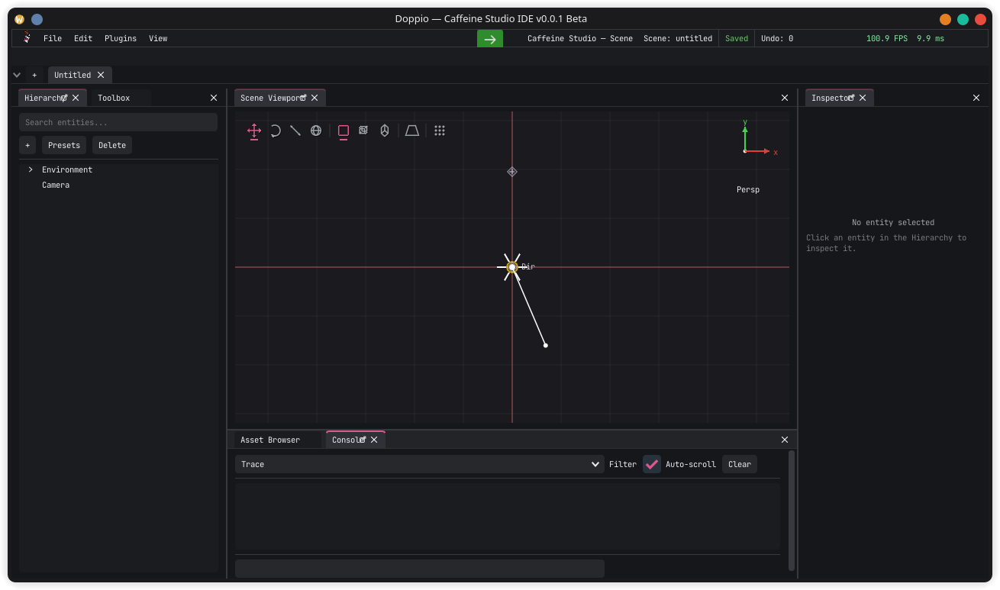

# Editor UI gallery

Doppio uses the shared **Caffeine::UIKit** library for its chrome, so panels, docking,
toolbars and themes look consistent across the editor and plugin windows.


The startup dialog creates or reopens a project. Templates preconfigure 2D or 3D
projects; **Empty** starts with a blank scene.

## Editor layout





The default workspace is docked in four regions:

| Region | Default panels |
|--------|----------------|
| Left | Hierarchy, Toolbox |
| Center | Scene Viewport |
| Right | Inspector |
| Bottom | Asset Browser, Console |

Every panel is registered by a stable id in `UIKit::PanelRegistry`. The docking tree
lives in `assets/ui/workspace.json`, the palette in `assets/ui/theme.json`, and both
can be reloaded at runtime without restarting Doppio.

## Scene viewport



The viewport toolbar is intentionally **icon-only and background-free** so it floats
over the rendered image. Tools are grouped as:

1. Selection and transform tools (select, move, rotate, scale).
2. View modes (2D, 3D, isometric) and projection (perspective / orthographic).
3. Visualization toggles (grid, gizmos, lighting).

The navigation gizmo in the top-right corner also toggles perspective and
orthographic projection. **Isometric** is a first-class 3D view: it sets the fixed
45° / 35.264° camera angles and switches to orthographic projection, and the same
view-projection matrix is used by the GPU renderer, CPU picking, overlays and the grid.

## Theme and density

- Neutral graphite dark palette with a single warm accent.
- Accent overline on active tabs, subtle separators, no heavy borders.
- Compact controls and property grids keep the viewport dominant.
- Light palette and user overrides are supported through `theme.json`.

## Capturing screenshots

The screenshots above are generated from the repository itself:

```bash
python3 scripts/capture_doppio_ui.py
```

The shot list lives in [`caffeine-website/captures/shots.json`](https://github.com/devscafecommunity/caffeine-website/blob/main/captures/shots.json)
and images land in `caffeine-website/content/en/docs/images/captures/`.
