# Doppio UI reference

Generated by `cargo test -p doppio-ui capture_ui_gallery -- --ignored`. Descriptions live in `doppio/docs/ui-captions.json`.

## `editor.menu.scene`

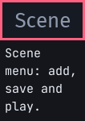

Scene menu: add, save and play.

## `editor.menu.edit`

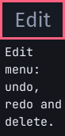

Edit menu: undo, redo and delete.

## `editor.menu.view`

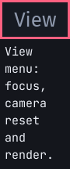

View menu: focus, camera reset and render.

## `editor.pane.hierarchy`

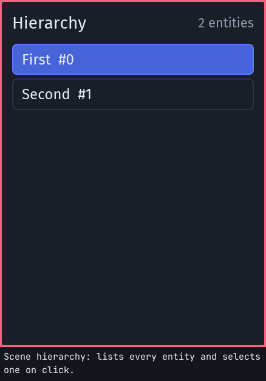

Scene hierarchy: lists every entity and selects one on click.

## `editor.pane.assets`

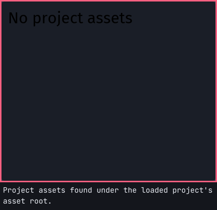

Project assets found under the loaded project's asset root.

## `editor.pane.viewport`

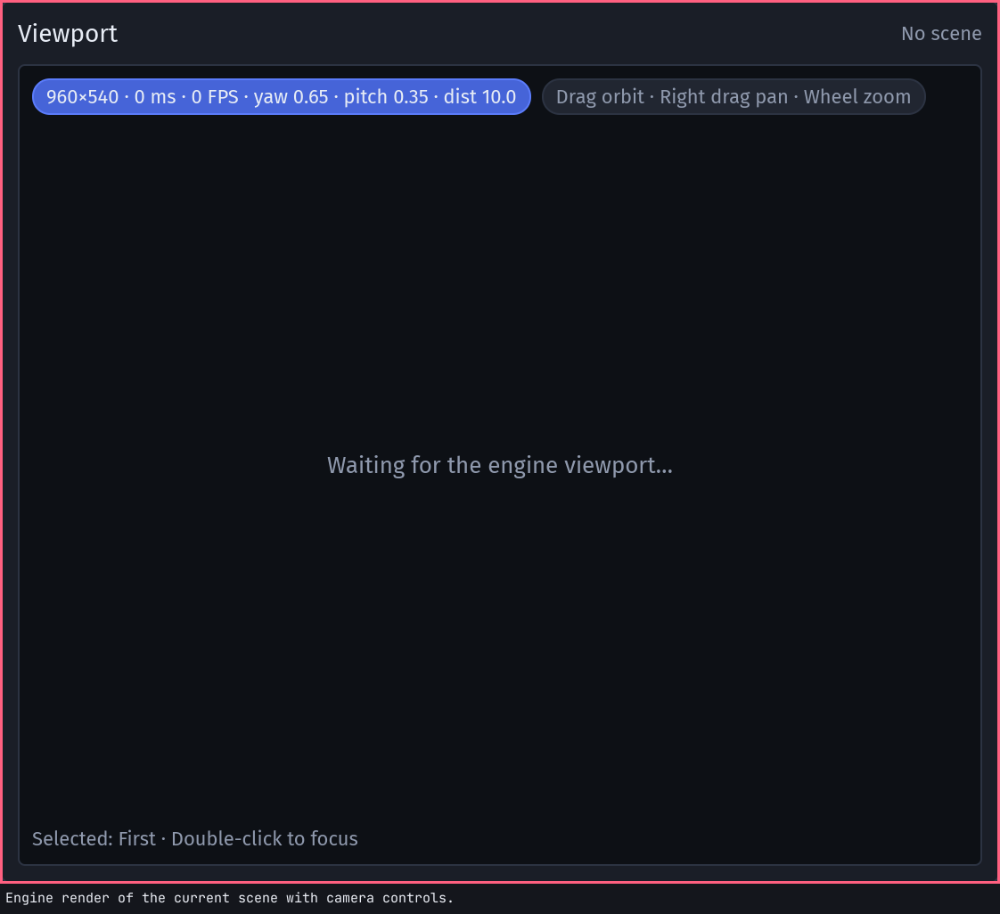

Engine render of the current scene with camera controls.

## `editor.pane.inspector`

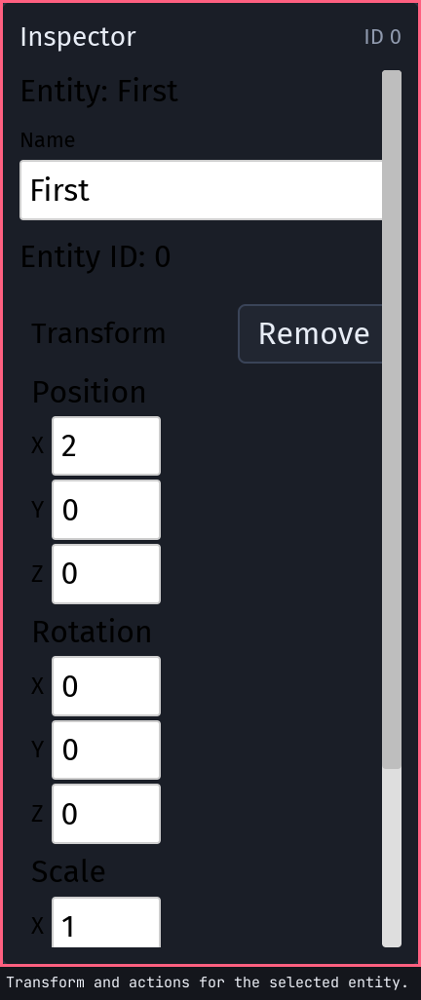

Transform and actions for the selected entity.

## `editor.pane.console`

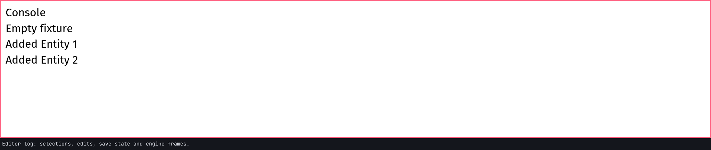

Editor log: selections, edits, save state and engine frames.

## `viewport.canvas.surface`

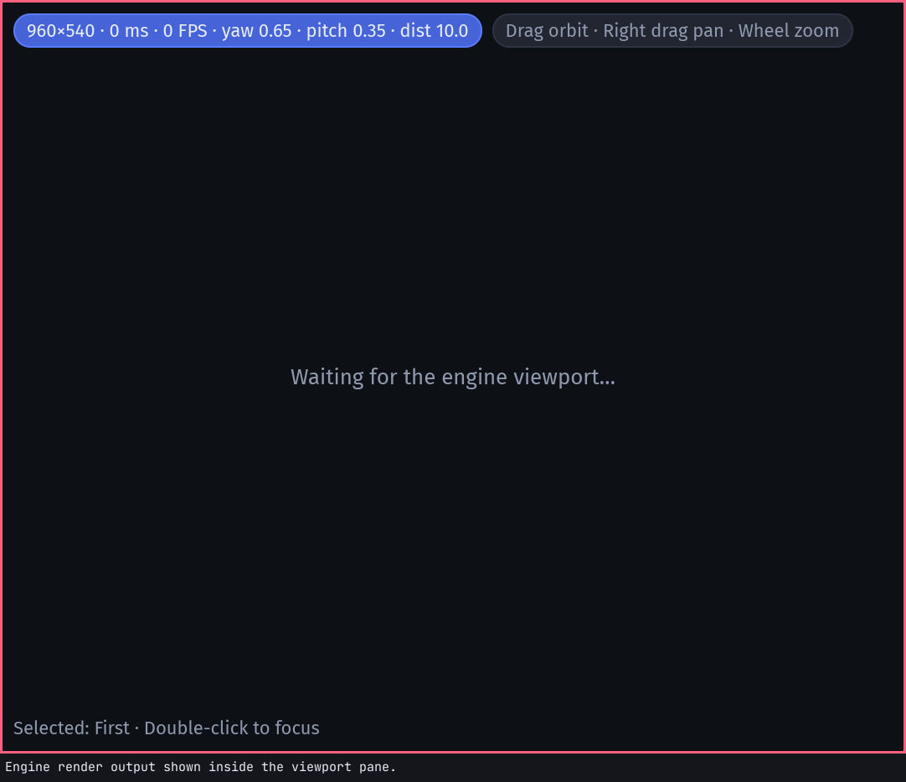

Engine render output shown inside the viewport pane.

## `inspector.entity.name`

Editable name of the selected entity; edits reach the engine.

## `inspector.add_component`

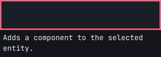

Adds a component to the selected entity.

## `hierarchy.list.entity_row.0`

A row in the hierarchy list; rows use the .N suffix.

## `hierarchy.list.entity_row.1`

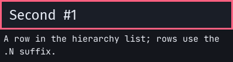

A row in the hierarchy list; rows use the .N suffix.

## `annotated.inspector`

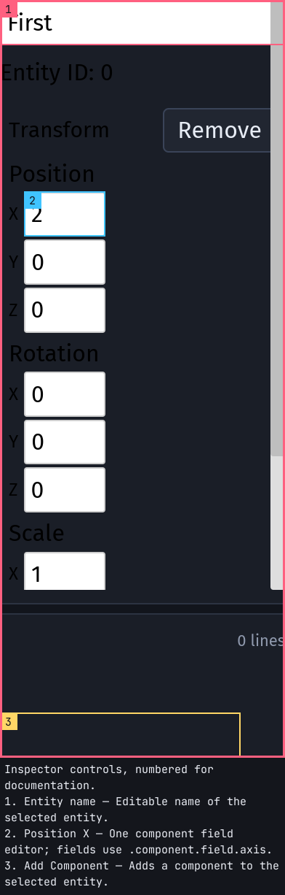

Inspector controls, numbered for documentation.

