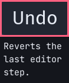
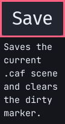
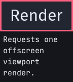
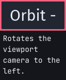
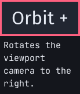
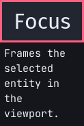
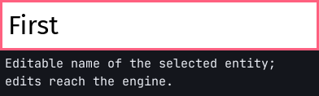
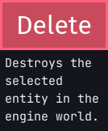

# Doppio UI reference

Generated by `cargo test -p doppio-ui capture_ui_gallery -- --ignored`. Descriptions live in `doppio/docs/ui-captions.json`.

## `editor.toolbar.undo`

Reverts the last editor step.

## `editor.toolbar.redo`

Reapplies the last undone editor step.

## `editor.toolbar.add_entity`

Creates a new entity in the current scene and selects it.

## `editor.toolbar.toggle_play`

Starts or stops play mode and ticks the engine.

## `editor.toolbar.save`

Saves the current .caf scene and clears the dirty marker.

## `editor.toolbar.render`

Requests one offscreen viewport render.

## `editor.toolbar.log`

Writes a sample line to the console (test aid).

## `editor.pane.hierarchy`

Scene hierarchy: lists every entity and selects one on click.

## `editor.pane.assets`

Project assets found under the loaded project's asset root.

## `editor.pane.viewport`

Engine render of the current scene with camera controls.

## `editor.pane.inspector`

Transform and actions for the selected entity.

## `editor.pane.console`

Editor log: selections, edits, save state and engine frames.

## `viewport.canvas.surface`

Engine render output shown inside the viewport pane.

## `viewport.camera.orbit_left`

Rotates the viewport camera to the left.

## `viewport.camera.orbit_right`

Rotates the viewport camera to the right.

## `viewport.camera.zoom_in`

Moves the camera closer to its focus point.

## `viewport.camera.zoom_out`

Moves the camera away from its focus point.

## `viewport.camera.focus_selection`

Frames the selected entity in the viewport.

## `viewport.camera.reset`

Restores the default camera position.

## `inspector.entity.name`

Editable name of the selected entity; edits reach the engine.

## `inspector.entity.delete`

Destroys the selected entity in the engine world.

## `inspector.add_component`

Adds a component to the selected entity.

## `hierarchy.list.entity_row.0`

A row in the hierarchy list; rows use the .N suffix.

## `hierarchy.list.entity_row.1`

A row in the hierarchy list; rows use the .N suffix.

## `annotated.inspector`

Inspector controls, numbered for documentation.

