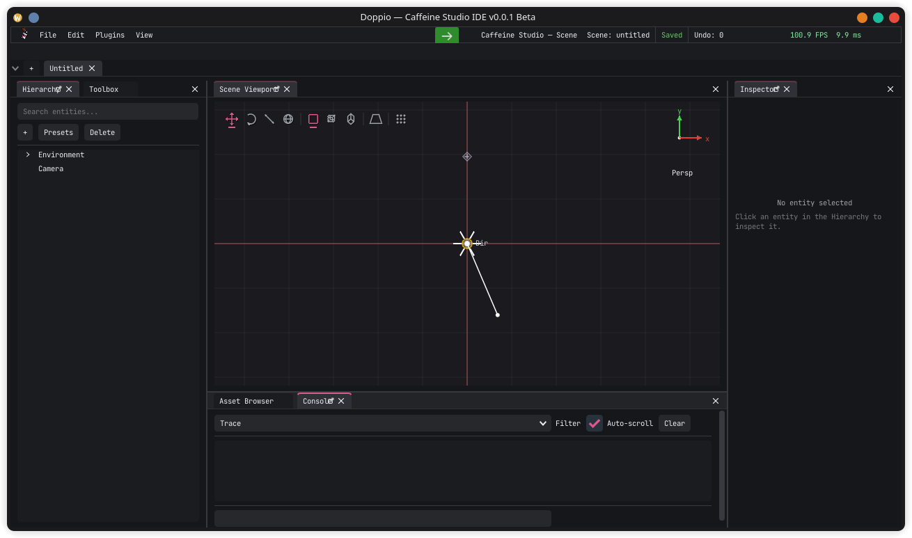

# Viewport toolbar, projection and isometric view

The scene viewport has a compact toolbar that floats over the rendered image. It is
**icon-only and background-free** so it never covers the scene with a chrome bar.



## Tool groups

| Group | Tools |
|-------|-------|
| **Selection / transform** | Select, move, rotate, scale |
| **View mode** | 2D, 3D, Isometric |
| **Projection** | Perspective, Orthographic |
| **Visualization** | Grid, gizmos, lighting overlays |

Each icon has a tooltip. The active tool uses the accent colour and a short underline;
there is no filled button background.

## Projection

Projection is real editor state, not a label:

```cpp
enum class ViewProjection { Perspective, Orthographic };
ViewProjection projection = ViewProjection::Perspective;
```

It lives in `EditorContext::projection`. The **same view-projection matrix** is used
by:

- the GPU scene renderer,
- CPU picking (selection and gizmo raycasts),
- overlays, gizmos and light helpers,
- the editor grid.

Switching projection therefore changes what you see and what you can click, with no
drift between the two.

The orthographic half-height is derived from the camera distance and the perspective
FOV, so zoom keeps roughly the same framing when you toggle projection.

## Isometric

**Isometric** is a first-class 3D view mode, not a 2D projection trick:

- camera yaw = `45°` (`0.7853982 rad`),
- camera pitch = `35.264°` (`0.6154797 rad`),
- projection = **Orthographic**,
- grid and overlays use the same 3D matrix.

This gives the classic 2:1-style game view while keeping full 3D editing, picking and
gizmos.

## Navigation

| Input | Action |
|-------|--------|
| Right-drag | Orbit (3D / isometric) |
| Middle-drag | Pan |
| Wheel | Zoom |
| Right-drag horizontally | Orbit yaw in isometric |
| F | Frame selection |
| Double-click entity | Focus camera |

## Status labels

The navigation gizmo in the top-right corner shows the current projection
(**Persp** / **Ortho**) and can toggle it directly. The viewport also keeps the
selected view mode visible in the toolbar.

## Implementation notes

- `SceneViewport::computeVP3D` builds the shared matrix.
- `GpuSceneRenderer` accepts `GpuSceneRenderOptions::orthographic`.
- Picking functions take the same `Mat4` as the renderer.
- `is3DViewMode()` treats `Mode3D` and `Isometric` identically for runtime paths.

## Related

- [Scene viewport](scene-viewport.md) for the render pipeline.
- [Workspace and theme](workspace-and-theme.md) for the surrounding UI.
