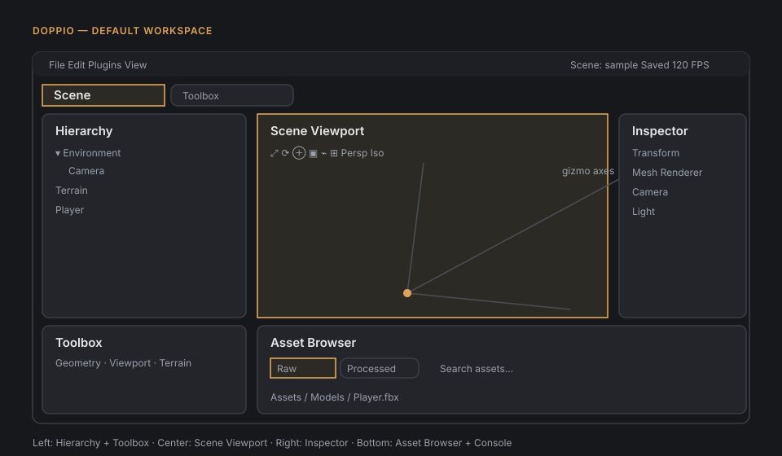

# Workspace, theme and the UI kit

Doppio's editor chrome is built with **Caffeine::UIKit**, a small immediate-mode UI
library in the public headers (`include/caffeine/ui/`). The same vocabulary is used
by built-in panels and by plugin panels, so the editor stays visually consistent
even when features move out of the core.



## Layers

| Layer | Header | Responsibility |
|-------|--------|----------------|
| **Theme** | `caffeine/ui/Theme.hpp` | Palette, metrics, spacing, typography |
| **Widgets** | `caffeine/ui/Widgets.hpp` | Buttons, property grids, section headers, empty states |
| **Icons** | `caffeine/ui/Icons.hpp` | Vector glyphs used by toolbars and panel titles |
| **PanelRegistry** | `caffeine/ui/PanelRegistry.hpp` | Stable panel ids, categories, visibility |
| **Workspace** | `caffeine/ui/Workspace.hpp` | JSON docking layout, persistence, hot reload |

The library has no dependency on Doppio internals. Plugins include
`caffeine/plugin/PluginUI.hpp` and draw their panels with the same widgets.

## Theme

`assets/ui/theme.json` stores the palette and metrics:

```json
{
  "name": "Graphite",
  "accent": "#e0a458",
  "background": "#17181c",
  "panel": "#23252b",
  "text": "#e8e8ea",
  "textMuted": "#9aa0aa",
  "rounding": 6,
  "spacing": 8
}
```

- Dark graphite palette with a single warm accent.
- Active panel tabs get an accent overline instead of a heavy fill.
- Docking separators are subtle; borders are avoided unless they carry meaning.
- A light palette is included, and user overrides are merged on load.

The file is watched at runtime: save it and the editor re-applies the palette
without restarting.

## Workspace layout

`assets/ui/workspace.json` describes the dock tree:

```json
{
  "version": 1,
  "docks": {
    "left":   { "size": 0.20, "panels": ["editor.hierarchy", "editor.toolbox"] },
    "center": { "panels": ["editor.viewport"] },
    "right":  { "size": 0.22, "panels": ["editor.inspector"] },
    "bottom": { "size": 0.26, "panels": ["editor.assets", "editor.console"] }
  }
}
```

Rules:

1. The **user layout** wins if it exists (`~/.config/caffeine/ui/workspace.json`).
2. Otherwise the **project layout** (`<project>/ui/workspace.json`) is loaded.
3. Otherwise the **bundled default** (`assets/ui/workspace.json`) is used.

User edits are written only to the per-user config; the asset tree is never
modified. Use **View → Save UI layout** and **View → Reset UI layout**.

## Panels

Every panel registers a stable id, category and default dock:

```cpp
UIKit::PanelDesc desc;
desc.id = "editor.inspector";
desc.title = "Inspector";
desc.icon = "inspect";
desc.category = "Scene";
desc.dock = UIKit::DockArea::Right;
desc.size = 0.22f;
desc.defaultOpen = true;
UIKit::PanelRegistry::instance().add(std::move(desc));
```

Registration is idempotent: a plugin can re-register after a hot reload without
duplicating tabs or resetting a user's dock position.

## Plugin UI

Plugin panels receive no `EditorContext*`. The host exposes opaque callbacks through
`PluginHostApi`, and the public `PluginUI.hpp` helpers wrap them:

```cpp
#include "caffeine/plugin/PluginUI.hpp"

void renderPanel(void* userData) {
    using namespace Caffeine::UIKit;
    PanelHeader("My Tool", "Short description", "settings");
    if (Section("Options")) {
        // property grid, buttons, fields…
    }
    if (PrimaryButton("Apply")) { /* host callback */ }
}
```

This keeps the plugin ABI stable while still giving plugins the editor's full widget
vocabulary.

## Validation

- `CaffeineTest "[ui]"` covers theme tokens, widgets, panel registry and workspace
  persistence.
- `audit-plugin-coupling` verifies plugins include no Doppio editor internals.

## Related

- [UI gallery](ui-gallery.md) for screenshots.
- [Scene viewport](scene-viewport.md) and [viewport toolbar](viewport-toolbar.md).
- [Plugin SDK](plugin-sdk.md) and [Plugin Manager](plugin-manager.md).
