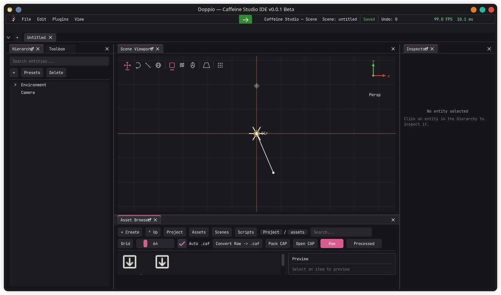

# Quick start

This page takes you from a fresh build to a saved scene in a few minutes.


## 1. Create a project

Launch Doppio without arguments:

```bash
./build/doppio
```

In the **Project Manager** choose **Create New**, type a name, pick a template
(**Empty**, **2D** or **3D**) and press **Create & Open**. Doppio creates the project
folders (`assets/`, `scenes/`, `scripts/`, `plugins/`) and stores the project file as
`project.caffeine`.

## 2. Meet the workspace



| Panel | What it does |
|-------|--------------|
| **Hierarchy** | Lists entities in the active scene |
| **Toolbox** | Adds geometry and switches viewport tools |
| **Scene Viewport** | Renders and edits the scene |
| **Inspector** | Edits components on the selected entity |
| **Asset Browser** | Raw and processed project assets |
| **Console** | Logs, errors and plugin output |

Drag panel tabs to redock them. Use **View → Save UI layout** to persist the
workspace; **View → Reset UI layout** restores the defaults.

## 3. Add an entity

1. Select a scene in the **Hierarchy**.
2. Use **Toolbox → Geometry** to add a cube or plane.
3. Select the new entity; the **Inspector** shows its transform and components.
4. Drag the move/rotate/scale gizmo in the viewport to edit it.

## 4. Switch views

The viewport toolbar is icon-only:

- **2D / 3D / Iso** change the editing space.
- **Persp / Ortho** toggles the projection.
- **Isometric** fixes the camera at 45° / 35.264° with orthographic projection.

Right-drag orbits the camera in 3D, middle-drag pans, and the wheel zooms.

## 5. Save

Press **Ctrl+S** or use **File → Save**. Scenes are stored as `.caf` files under the
project `scenes/` directory. The title bar shows the scene name and a **Saved** badge.

## Next steps

- [Editor UI gallery](../editor/ui-gallery.md) for a visual tour.
- [Plugin Manager](../editor/plugin-manager.md) to add terrain, Git or AI tools.
- [Scene viewport](../editor/scene-viewport.md) for rendering details.
