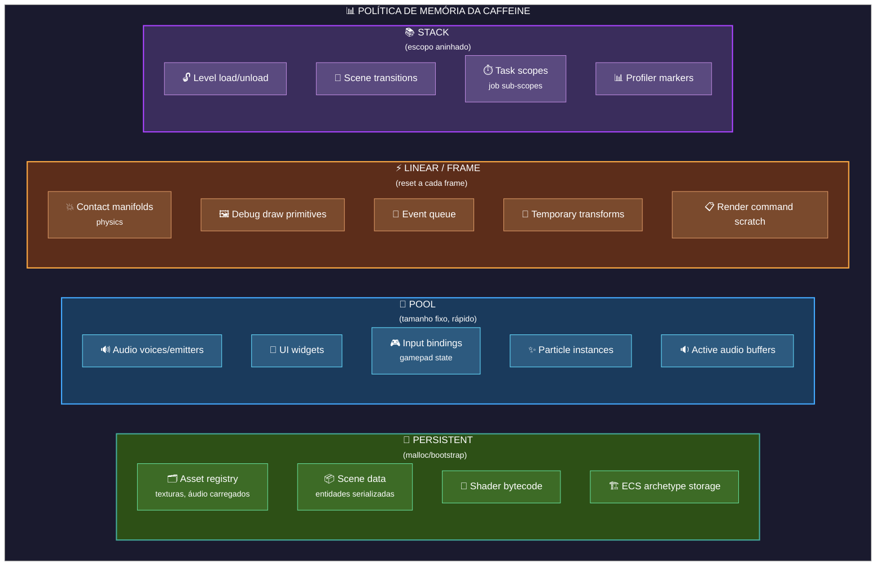
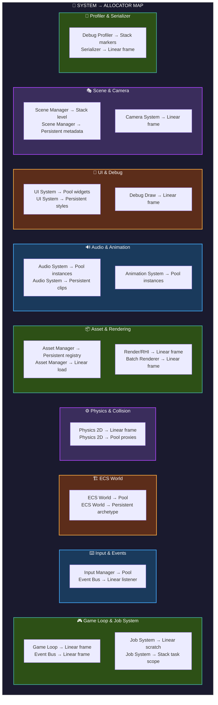

# 🧠 Memory Model — Allocator Specification

> ⚠️ **Status:** Revisado contra o código em 2026-09-21.
> Sections A–B.1–B.3 and F describe real code ( `src/memory/` ). 
> **ProxyAllocator (§B.4) and AllocatorRegistry (§C) DO NOT exist in the code** —
> They're marked as planned.
> Para contexto completo, consulte [`../MASTER.md`](../MASTER.md) e
> [`../architecture_specs.md`](../architecture_specs.md).

This document contains the detailed technical specifications** of Caffeine Engine memory management systems.

---

## 📋 Contents

| Allocator | Phase | Status | Uso |
|---|---|---|---|
| **IAllocator (Interface)** | 1 | ✅ Completo | Base para todos os allocators |
| **Linear Allocator** | 1 | ✅ Completo | Scratch space por frame |
| **Pool Allocator** | 1 | ✅ Completo | Blocos de tamanho fixo |
| **Stack Allocator** | 1 | ✅ Completo | Escopos aninhados |
| **Proxy Allocator** | 1 | 📅 Planejado | Wrappers com logging/debug |
| **TLSF Allocator** | TBD | 💡 Ideia | Fallback for general allocations |
| **Buddy Allocator** | TBD | 💡 Ideia | Para o sistema de levels |

---

## A. Overview — Memory Policy

### A.1 The Golden Rule

> REGRA: hot paths da engine usam Custom Allocators.
> Every system allocation must accept IAllocator*.


> Verified reality: the rule applies to the core (ECS) `World` / `Archetype` /
> `CommandBuffer` , `AssetManager` com `LinearAllocator` itself, `BlobLoader` ,
> `Vector<T>` com `IAllocator*` opcional). `Vector` sem allocator usa
> `new` / `delete` global, allocators themselves allocate the initial buffer with
> `new u8[]` , e subsistemas de ferramenta/editor usam STL livremente. Ou seja:
> the policy is "allocator injecting in the systems", not "zero" `new` in the repository."

### A.2 Map of Allocators by Use (target policy)

> The diagram below is the desired policy**, not the verified use.
> The actual use confirmed in code is in the table "Real use checked" right after.



### A.2b Actual verified use (code, 2026-09-21)

| Sistema | Uso real | File |
|---|---|---|
| **ECS** | `World` , `Archetype` / `ComponentPool` , `CommandBuffer` aceitam `IAllocator*` (opcional, pode ser `nullptr` ) | `src/ecs/World.hpp` , `Archetype.hpp` , `CommandBuffer.hpp` |
| **Assets** | `AssetManager` possui `LinearAllocator` own (asset arena) | `src/assets/AssetManager.hpp` |
| **IO** | `BlobLoader::load(path, IAllocator*)` loads binary in given allocator | `src/core/io/BlobLoader.hpp` |
| **Containers** | `Vector<T>` aceita `IAllocator*` ; sem allocator usa `new` / `delete` global | `src/containers/Vector.hpp` |
| **Tests/bench** | `tests/test_allocators.cpp` , `BENCHMARK` s em `tests/benchmarks.cpp` | `tests/` |

Physics, EventBus, Render, JobSystem, Audio, UI and Debug ♪ Don't use these ♪
allocators today (use std/malloc) — migration to the above target map is pending.

### A.3 Interface Base

> Namespace real: `Caffeine` (no `Caffeine::Memory` ).

```cpp
namespace Caffeine {

// ============================================================================
// @brief  Interface base para todos os allocators.
//
//  Todos os allocators da Caffeine implementam esta interface.
//  Isso permite trocar allocators em runtime e usar patterns como
//  ProxyAllocator para debug.
// ============================================================================
class IAllocator {
public:
    virtual ~IAllocator() = default;

    // -----------------------------------------------------------------------
    // @brief  Aloca memória alinhada.
    // @param  size      Tamanho em bytes.
    // @param  alignment Alinhamento (deve ser potência de 2).
    // @return Ponteiro para a memória alocada ou nullptr se falhou.
    // -----------------------------------------------------------------------
    virtual void* alloc(usize size, usize alignment = 8) = 0;

    // -----------------------------------------------------------------------
    // @brief  Libera memória alocada.
    // @note   Para Linear e Stack, free() pode não fazer nada (reset limpa tudo).
    // -----------------------------------------------------------------------
    virtual void free(void* ptr) = 0;

    // -----------------------------------------------------------------------
    // @brief  Para Linear/Stack: volta ao início.
    //          Para Pool: não faz nada.
    // -----------------------------------------------------------------------
    virtual void reset() = 0;

    // -----------------------------------------------------------------------
    // @brief  Retorna a memória atualmente em uso (bytes).
    // -----------------------------------------------------------------------
    virtual usize usedMemory() const = 0;

    // -----------------------------------------------------------------------
    // @brief  Retorna a memória total alocada pelo allocator (bytes).
    // -----------------------------------------------------------------------
    virtual usize totalSize() const = 0;

    // -----------------------------------------------------------------------
    // @brief  Retorna o pico de memória já usado (bytes).
    // -----------------------------------------------------------------------
    virtual usize peakMemory() const = 0;

    // -----------------------------------------------------------------------
    // @brief  Retorna o número de alocações feitas.
    // -----------------------------------------------------------------------
    virtual usize allocationCount() const = 0;

    // -----------------------------------------------------------------------
    // @brief  Retorna o nome do allocator (para debugging).
    // -----------------------------------------------------------------------
    virtual const char* name() const = 0;
};

// Helpers livres (Allocator.hpp)
inline usize calculatePadding(void* ptr, usize alignment);
inline usize calculateAlignedSize(usize size, usize alignment);

}  // namespace Caffeine
```

---

## B. Allocators Detalhados

---

## 1. Linear Allocator

**Phase:**1

### Purpose

| Quando usar | When NOT to use |
|---|---|
| Volatile memory by frame | Persistence between frames |
| Scratch space for calculations | Variable size allocations that need individual free |
| Temporary buffers (contact handlers, events) | Allocations that survive the scope |

### Interface

```cpp
namespace Caffeine {

// ============================================================================
// @brief  Allocator linear — aloca do início ao fim, reset limpa tudo.
//
//  Algoritmo:
//
//  ┌─────────────────────────────────────────────────────────────┐
//  │  [ Usado │............. Livre ...................] [ Fim ]   │
//  │          ▲                                          ▲      │
//  │        m_cursor                                    m_end  │
//  └─────────────────────────────────────────────────────────────┘
//
//  alloc() avança m_cursor e retorna ponteiro.
//  reset() volta m_cursor para m_start.
//
//  Performance: O(1) para todas as operações.
//
//  Thread Safety: NÃO thread-safe. Usar apenas na main thread.
// ============================================================================
class LinearAllocator final : public IAllocator {
public:
    // -----------------------------------------------------------------------
    // @brief  Constrói com um buffer pré-alocado.
    // @param  buffer  Ponteiro para o buffer (ownership não é transferido).
    // @param  size    Tamanho do buffer em bytes.
    // @note   O buffer deve permanecer válido durante a vida do allocator.
    // -----------------------------------------------------------------------
    LinearAllocator(void* buffer, usize size);

    // -----------------------------------------------------------------------
    // @brief  Constrói e aloca buffer internamente (via new u8[]).
    // -----------------------------------------------------------------------
    explicit LinearAllocator(usize size);

    ~LinearAllocator() override;

    void* alloc(usize size, usize alignment = 8) override;
    void  free(void* ptr) override;   // No-op (reset limpa tudo)
    void  reset() override;           // Volta ao início (zera allocCount)

    usize usedMemory()   const override { return m_cursor - m_start; }
    usize totalSize()    const override { return m_end - m_start; }
    usize peakMemory()   const override { return m_peak; }
    usize allocationCount() const override { return m_allocCount; }
    const char* name()    const override { return "Linear"; }

    // -----------------------------------------------------------------------
    // @brief  Retorna a memória livre disponível.
    // -----------------------------------------------------------------------
    usize availableMemory() const { return m_end - m_cursor; }

    // -----------------------------------------------------------------------
    // @brief  Retorna o cursor atual (para debugging).
    // -----------------------------------------------------------------------
    void* currentPointer() const { return m_cursor; }

private:
    u8*  m_start;
    u8*  m_end;
    u8*  m_cursor;
    usize m_peak = 0;
    usize m_allocCount = 0;
    bool  m_ownsBuffer = false;
};

}  // namespace Caffeine
```

### Implementation

```cpp
void* LinearAllocator::alloc(usize size, usize alignment) {
    // Align up cursor
    usize padding = calculatePadding(m_cursor, alignment);
    usize totalSize = size + padding;

    // Check overflow
    if (m_cursor + totalSize > m_end) {
        return nullptr;  // Out of memory
    }

    void* ptr = m_cursor + padding;
    m_cursor += totalSize;

    // Track stats
    usize used = usedMemory();
    if (used > m_peak) m_peak = used;
    ++m_allocCount;

    return ptr;
}
```

### System Use (target — see §A.2b for actual current use)

| Sistema | Uso | Typical size |
|---|---|---|
| **Physics** | Contact manifolds, collision pairs | 64KB - 256KB |
| **Events** | Temporary event | 32KB |
| **Debug Draw** | Primitive lists | 128KB |
| **Render** | Vertex buffer staging | 1MB |
| **Job System** | Task scratch memory | 64KB por worker |

---

## 2. Pool Allocator

**Phase:**1

### Purpose

| Quando usar | When NOT to use |
|---|---|
| Objetos de tamanho fixo | Variable sizes |
| Common | Dados que precisam sobreviver ao reset |
| Emitters, particles, audio voices | Assets carregados |

### Interface

```cpp
namespace Caffeine {

// ============================================================================
// @brief  Pool Allocator — aloca blocos de tamanho fixo.
//
//  Algoritmo:
//
//  ┌─────────────────────────────────────────────────────────────┐
//  │  Slot[0] │ Slot[1] │ Slot[2] │ ... │ Slot[N-1]          │
//  │    ●      │    ○    │    ●    │     │    ○               │
//  │  (usado)  │ (livre) │ (usado) │     │   (livre)         │
//  └─────────────────────────────────────────────────────────────┘
//       ▲
//     m_freeList ──── free list intrusiva (cada slot livre guarda
//                     o ponteiro do próximo; slot mínimo: 8 bytes)
//
//  Performance: O(1) para alloc e free.
//  Thread Safety: NÃO thread-safe. Usar TLS se necessário.
// ============================================================================
class PoolAllocator final : public IAllocator {
public:
    // -----------------------------------------------------------------------
    // @brief  Constrói com buffer e tamanho de slot.
    // @param  buffer    Ponteiro para o buffer (sem ownership).
    // @param  poolSize  Tamanho total do buffer.
    // @param  slotSize  Tamanho de cada slot (mínimo 8 bytes).
    // @param  alignment Alinhamento (padrão 8; exige >= 8 e potência de 2,
    //         verificado com CF_ASSERT no construtor).
    // -----------------------------------------------------------------------
    PoolAllocator(void* buffer, usize poolSize, usize slotSize,
                  usize alignment = 8);

    // -----------------------------------------------------------------------
    // @brief  Constrói e aloca buffer internamente (via new u8[]).
    // -----------------------------------------------------------------------
    explicit PoolAllocator(usize poolSize, usize slotSize, usize alignment = 8);
    ~PoolAllocator() override;

    // @note  alloc() IGNORA size/alignment e retorna sempre 1 slot fixo.
    //        Em debug, CF_ASSERT(size <= m_slotSize). Retorna nullptr se
    //        o pool estiver exausto.
    void* alloc(usize size, usize alignment = 8) override;
    // @note  free(nullptr) é seguro (no-op). NÃO há detecção de double-free:
    //        liberar 2x o mesmo slot corrompe silenciosamente a free list.
    void  free(void* ptr) override;
    void  reset() override;  // Reconstrói a free list, zera usados

    usize usedMemory()    const override { return m_usedCount * m_slotSize; }
    usize totalSize()     const override { return m_poolSize; }
    usize peakMemory()   const override { return m_peakSlots * m_slotSize; }
    usize allocationCount() const override { return m_usedCount; }
    const char* name()    const override { return "Pool"; }

    // -----------------------------------------------------------------------
    // @brief  Retorna quantos slots estão livres.
    // -----------------------------------------------------------------------
    usize freeSlots() const { return m_maxSlots - m_usedCount; }

    // -----------------------------------------------------------------------
    // @brief  Retorna o tamanho de cada slot.
    // -----------------------------------------------------------------------
    usize slotSize() const { return m_slotSize; }

    // -----------------------------------------------------------------------
    // @brief  Retorna o número máximo de slots (poolSize / slotSize).
    // -----------------------------------------------------------------------
    usize maxSlots() const { return m_maxSlots; }

private:
    void initializeFreeList();  // Reconstrói a free list (usado no ctor/reset)

    u8*    m_freeList = nullptr;
    u8*    m_poolStart = nullptr;
    usize  m_poolSize = 0;
    usize  m_slotSize = 0;
    usize  m_alignment = 8;
    usize  m_maxSlots = 0;
    usize  m_usedCount = 0;
    usize  m_peakSlots = 0;
    bool   m_ownsBuffer = false;
};

}  // namespace Caffeine
```

### Implementation

```cpp
void* PoolAllocator::alloc(usize size, usize alignment) {
    // Pool allocator ignora size — usa slotSize fixo
    CF_ASSERT(size <= m_slotSize, "Requested size exceeds slot size");

    if (!m_freeList) {
        return nullptr;  // Pool exausto
    }

    void* ptr = m_freeList;
    m_freeList = *static_cast<void**>(ptr);  // Pop do free list
    ++m_usedCount;
    if (m_usedCount > m_peakSlots) m_peakSlots = m_usedCount;

    return ptr;
}

void PoolAllocator::free(void* ptr) {
    if (!ptr) return;

    // Push para o free list
    *static_cast<void**>(ptr) = m_freeList;
    m_freeList = ptr;
    --m_usedCount;
}
```

### System Use (target — see §A.2b for actual current use)

| Sistema | Uso | Tamanho de slot |
|---|---|---|
| **Audio** | AudioSource/voice instances | 128 bytes |
| **Particles** | Particle instances | 64 bytes |
| **UI** | Widget instances | 256 bytes |
| **ECS** | Component arrays (internal) | varies |
| **Input** | Gamepad state records | 64 bytes |

---

## 3. Stack Allocator

**Phase:**1

### Purpose

| Quando usar | When NOT to use |
|---|---|
| Escopos aninhados (levels) | Reset Persistence |
| Frames with allocations that need free order | Free fora de ordem |
| Temporary task scopes | Different thread allocations |

### Interface

```cpp
namespace Caffeine {

// Marker = offset em bytes a partir do início do buffer (usize, não ponteiro).
using Marker = usize;

// ============================================================================
// @brief  Stack Allocator — aloca em pilha com marcadores.
//
//  Algoritmo:
//
//  1. Allocate: avança cursor como LinearAllocator
//  2. SetMarker: salva posição atual (offset)
//  3. FreeToMarker: libera tudo após o marker
//
//  ┌─────────────────────────────────────────────────────────────┐
//  │  [ Usado A ] │ [ Marker ] │ [ Usado B ] │.....│ Livre   │
//  │                          ▲           ▲                    │
//  │                       marker1      cursor                │
//  │                                                           │
//  │  freeToMarker(marker1) ───▶ libera [Usado B]           │
//  └───────────────────────────────────────────────────────────┘
//
//  Performance: O(1) para todas as operações.
//  Thread Safety: NÃO thread-safe.
// ============================================================================
class StackAllocator final : public IAllocator {
public:
    StackAllocator(void* buffer, usize size);
    explicit StackAllocator(usize size);
    ~StackAllocator() override;

    void* alloc(usize size, usize alignment = 8) override;
    void  free(void* ptr) override;  // No-op total (ignora ptr)
    void  reset() override;

    // -----------------------------------------------------------------------
    // @brief  Salva um marcador (offset atual).
    // -----------------------------------------------------------------------
    Marker setMarker();

    // -----------------------------------------------------------------------
    // @brief  Libera tudo após o marcador. Markers além do cursor são
    //         ignorados (guard). Zera allocationCount.
    // -----------------------------------------------------------------------
    void freeToMarker(Marker marker);

    usize usedMemory()      const override;
    usize totalSize()       const override { return m_end - m_start; }
    usize peakMemory()      const override { return m_peak; }
    usize allocationCount() const override { return m_allocCount; }
    const char* name()     const override { return "Stack"; }

private:
    u8*  m_start;
    u8*  m_end;
    u8*  m_cursor;
    usize m_peak = 0;
    usize m_allocCount = 0;
    bool  m_ownsBuffer = false;
};

}  // namespace Caffeine
```

### System Use (target — see §A.2b for actual current use)

| Sistema | Uso | Typical size |
|---|---|---|
| **Scene** | Level load/unload | 1MB - 16MB |
| **Job System** | Task sub-scopes | 64KB por worker |
| **Profiler** | Markers de escopo | 4KB |
| **Asset Manager** | Asset loading arena | 8MB |

---

## 4. Proxy Allocator

> ** NOT IMPLEMENTED** — future specification section. None
> `ProxyAllocator` em `src/memory/` (only) `Allocator` , `Linear` , `Pool` ,
> `Stack` ). Kept here as design intent.

**Phase:**1 (planned)

### Purpose (planned)

Wrapper que adiciona logging, debugging ou accounting a qualquer allocator
existing. Useful for memory leaks debugging and allocations profiling.
Interface prevista: `ProxyAllocator(IAllocator* backend, const char* name)`
report `AllocationReport` (uso atual, pico, total de allocs/frees/falhas)
and allocation tracking header.

---

## C. Allocator Registry

> ** NOT IMPLEMENTED** — does not exist `AllocatorRegistry` in the code.
> Sustained as design intent.

**Phase:**1 (planned)

### Overview (planned)

Para debugging e profiling, todo allocator seria registrado em um registry
global, permitindo verificar memory leaks no shutdown, profiling de uso e
fragmentation detection ( `registerAllocator` / `unregisterAllocator` /
`globalStats` / `printReport` / `hasLeaks` ).

### Output Example (desired format, not generated today)

```
=== Memory Report ===
[Linear]  Physics Scratch:   64.0 KB /  256.0 KB (used/peak)
[Pool]    Audio Voices:       16.0 KB /   32.0 KB (32 slots, 16 used)
[Pool]    UI Widgets:          8.0 KB /   16.0 KB (64 slots, 8 used)
[Stack]   Level Arena:       512.0 KB / 2048.0 KB (marker at 25%)
[Linear]  Render Staging:    64.0 KB / 1024.0 KB (used/peak)

Total: 664.0 KB used, 3.3 MB peak, 1.2M allocs
```

---

## D. System Use — Complete Map (target policy)

> ⚠️ Mapa desejado, não uso verificado — ver §A.2b.



---

## E. Reference Benchmarks

> Project goals **not measured** — `tests/benchmarks.cpp` contains only
> `BENCHMARK` Basic Linear/Pool without asserted target numbers. Values
> below are estimates, not results.

### E.1 Linear Allocator

| Metric | Valor |
|---|---|
| `alloc()` throughput | ~50M allocs/second |
| `reset()` throughput | ~500M resets/second |
| Fragmentation | 0% (reset cleans all) |
| Overhead por alloc | ~0 bytes |

### E.2 Pool Allocator

| Metric | Valor |
|---|---|
| `alloc()` throughput | ~30M allocs/second |
| `free()` throughput | ~40M frees/second |
| Fragmentation | 0% (fixed slots) |
| Overhead por slot | 0 bytes (free list intrusive uses its own free slot) |
| Max slots | `poolSize / slotSize` (no ceiling fixed on code) |

### E.3 Stack Allocator

| Metric | Valor |
|---|---|
| `alloc()` throughput | ~50M allocs/second |
| `freeToMarker()` throughput | ~100M frees/second |
| Fragmentation | 0% (free to marker) |
| Max markers por stack | Ilimitado (marker = offset, sem tabela) |

---

## F. Integration Checklist

Antes de usar um allocator em um novo sistema:

- [ ] Sistema usa `IAllocator*` as parameter (not hardcoded)
- [ ] Linear allocators reset system at the beginning of each frame
- [ ] Sistema usa Pool para objetos de tamanho fixo
- [ ] Sistema usa Stack para escopos aninhados
- [ ] Sistema verifica `alloc()` retornou `nullptr` (out-of-memory)
- [ ] System DO NOT keep hands after `reset()` ou `freeToMarker()`
- [ ] (Future) Statistical log system via AllocatorRegistry — not yet (§C)
