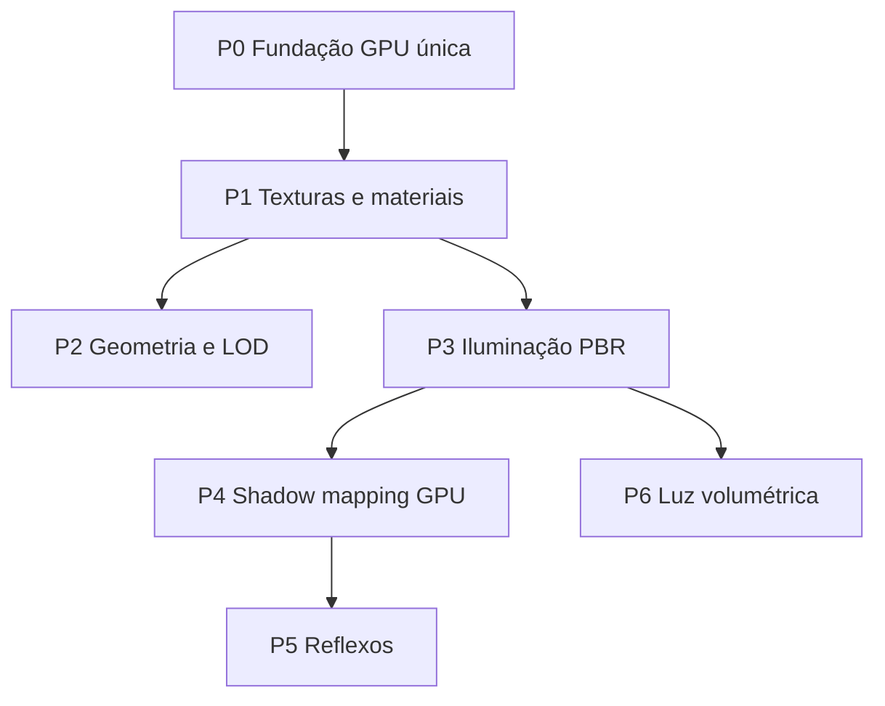

# 🎨 Rendering Roadmap — High Volume 3D

  Historical
  Last updated: <time datetime="2026-11-18">2026-11-18</time>

> * *Objective:** render 3D environments with high polygon volume and textures in an optimized, consistent and stable way** (without FPS spikes).
> **Criteria of “complete”: **Dense scene (earth + hundreds of textured meshes + dynamic lighting + shadows) at 60 FPS stable in the editor and runtime.
> **Current state (2026-10-02):**viewport GPU; cap editor 1280 px; mesh LOD; GGX + ACES; shadows in the editor only with the camera stopped and **1 cascade**. Installing and IBL are in the main pass. Coarse occlusion, reflexes (planar / screen-space / probe) and volumetrics are optional and are turned off — reflexes and probes only run with the camera still. Scene `assets/benchmarks/dense_outdoor.caf` . Gate p95 < 16.6 ms has not yet been measured in the editor.

---

## Diagnosis (probable cause of spikes)

| Sintoma | Causa raiz | Ficheiros |
|---------|-----------|-----------|
| Spike when moving camera | Shadow passes + resolution High HiDPI | `GpuSceneRenderer.cpp` , `SceneViewport.cpp` |
| Spike when moving camera (mixed) | Skip shadows in fast motion; cap resolution 1920px | `SceneViewport.cpp` |
| Terreno pesado | Rebuild mesh / upload GPU synchronous | `TerrainCache.cpp` , `GpuSceneRenderer.cpp` |
| Muitos draw calls | 1 `drawIndexed` por mesh, sem batching | `GpuSceneRenderer.cpp` |
| Sombras inconsistentes | ~~Runtime CPU shadows~~solved; tuning CSM/PCF | `GpuDirectionalShadowMap.*` , `scene_lit.frag` |
| Flat Materials | Phong ligado; PBR metallic/roughness pendente | `scene_lit.frag` , `terrain_lit.frag` |

---

## Phases and dependencies

Each phase has testable delivery. **Do not advance** to reflexes/volumetric before stable P4.

---

## P0 — Foundation: a single GPU path

**Meta:** eliminar dual-path (CPU raster + GPU) no viewport 3D.

| Tarefa | Description | Ficheiros |
|--------|-----------|-----------|
| P0.1 | GPU como default para **todos** os meshes texturizados | `SceneViewport.cpp` , `GpuSceneRenderer.cpp` |
| P0.2 | Remover fallback CPU exceto wireframe/debug | `SceneViewport.cpp` | ✅ (GPU texturizado + wireframe `FillMode::Line` ) |
| P0.3 | Upload of buffers** before** render pass (already partial) | `GpuSceneRenderer.cpp` |
| P0.4 | Runtime play mode usar `GpuSceneRenderer` (hoje CPU-only) | `RuntimeSceneRenderer.cpp` | ✅ |
| P0.5 | Profiler markers por pass (shadow, opaque, terrain, composite) | `Profiler.hpp` , viewport | ✅ |

**Métrica de sucesso:** viewport 3D sem `MeshCpuRasterizer` in shaded mode; FPS stable ±5% when orbiting camera.

**Doc detalhada:** [`rendering/rhi.md`](../rendering/rhi.md) (updating after P0)

---

## P1 — Textures and materials

**Meta:** cache GPU global, mips, sem reload por frame.

| Tarefa | Description | Ficheiros |
|--------|-----------|-----------|
| P1.1 | `GpuTextureCache` central (path → `GPUTexture` , refcount) | `src/caffeine/render/GpuTextureCache.hpp` | ✅ |
| P1.2 | Generation of mipmaps in upload | `GpuTextureCache.cpp` , `RenderDevice.cpp` | ✅ |
| P1.3 | Bind albedo + normal + ORM no `scene_lit` | `scene_lit.frag` , `MaterialFile` , Material Editor | ✅ albedo, normal, ORM, emissão; o `.mat` alimenta o passe |
| P1.4 | Async decode (job system) + upload no frame N+1 | `JobSystem` , `AssetManager` |
| P1.5 | Atlas opcional para props repetidos (instancing) | `TextureAtlas.hpp` (estender) |
| P1.6 | LOD of remote textures to viewers (cachetiers) | `TextureQuality.hpp` , `GpuTextureCache.*` | ✅ |

**Metric:** 0 `stbi_load` during render loop; stable GPU memory after warm-up.

**Doc:** [`assets/asset-manager.md`](../assets/asset-manager.md), [`rendering/texture-quality-lod.md`](../rendering/texture-quality-lod.md), [`rendering/materials-pbr.md`](../rendering/materials-pbr.md)

---

## P2 — Polygons, meshes and LOD

**Meta:** scenes with 500k–2M visible triangles with aggressive cooking.

| Tarefa | Description | Ficheiros |
|--------|-----------|-----------|
| P2.1 | Mesh LOD real (simplification or LOD chains no import) | `MeshLOD.cpp` , pipeline `.caf` | ✅ clustering; import chains ainda não |
| P2.2 | LOD selection by distance + hysteresis (as terrain) | `GpuSceneRenderer.cpp` | ✅ |
| P2.3 | Frustum + occlusion coarse (octree already exists) | `CoarseOcclusion.hpp` | ✅ off por defeito; modo Coarse |
| P2.4 | Installing for repeated meshes (trees, props) | `drawIndexedInstanced` | Up to 256 per batch |
| P2.5 | Land: separate collision mesh (made); GPU stable Chunks | `TerrainLodSystem.*` |

**Metric:** draw calls < 200 for reference scene; visible triangles scale with LOD.

**Doc:** [`rendering/mesh-lod.md`](../rendering/mesh-lod.md)

---

## P3 — Lighting

**Meta:**PBR forward+ (Cook-Torrance) with multiple lights.

| Tarefa | Description | Ficheiros |
|--------|-----------|-----------|
| P3.1 | unified LED/point/spot up to N lamps | `LightingSystem.*` , shaders |
| P3.2 | PBR: metallic/roughness, Fresnel, GGX | `scene_lit.frag` | ✅ specular GGX; diffuse Lambert |
| P3.4 | Tone mapping (ACES) + exposure | shader + `PostProcess` GPU futuro | ACES `scene_lit` |
| P3.3 | Basic IBL (irradiance + optional probe) | `scene_lit.frag` | ✅ cor de ambiente; probe se o modo estiver ativo |
| P3.5 | Spot lights on GPU (today only CPU) | `scene_lit.frag` | ✅ |

**Metric:** reference sphere + terrain with plausible physical response; without flagging on gradients.

**Doc:** atualizar [`rendering/camera-3d.md`](../rendering/camera-3d.md)

---

## P4 — Shadow mapping (GPU)

**Meta:**directive shadows + stable spot; optional point (cubemap).

| Tarefa | Description | Ficheiros |
|--------|-----------|-----------|
| P4.1 | Ligar `renderDirectionalShadows` em `renderWithCamera` | `GpuSceneRenderer.cpp` | ✅ |
| P4.2 | CSM 2–4 waterfalls for sun | `GpuDirectionalShadowMap.*` | ✅ |
| P4.3 | PCF / PCSS no `scene_lit.frag` | shaders | ✅ PCF 3×3 |
| P4.4 | Terreno `castShadows` no gather GPU | `GpuSceneRenderer.cpp` | ✅ |
| P4.5 | Spot shadow maps (1–2 lights) | `GpuSpotShadowMap.*` | ✅ |
| P4.6 | Desligar CPU shadow path no editor quando GPU OK | `SceneViewport.cpp` | ✅ editor: 1 cascata só com câmara parada |
| P4.7 | Point light cubemap shadows (up to 2) | `GpuPointShadowMap.*` | ✅ |

**Infra ligada:** `GpuDirectionalShadowMap` , `GpuPointShadowMap` , `shadow_depth.*` — ver [`rendering/shadow-mapping.md`](../rendering/shadow-mapping.md)

**Metric:** shadow without visible acne/ peter-panning; cost < 3 ms @ 1080p.

**Doc:** [`rendering/shadow-mapping.md`](../rendering/shadow-mapping.md), [`rendering/materials-phong.md`](../rendering/materials-phong.md)

---

## P5 — Real-time reflections

**Meta:** reflexos convincentes sem custo proibitivo.

| Abordagem | Quando | Custo |
|-----------|--------|-------|
| **Plan** (mirrors, flat water) | P5.1 | Baixo |
| **SSR** (screen-space) | P5.2 | Medium |
| **Reflection probes** (cubemap local) | P5.3 | Medium |
| **RT reflections** | futuro | Alto |

| Tarefa | Description |
|--------|-----------|
| P5.1 | Planar reflection pass + clip plan | ✅ meia resolução, só com câmara parada |
| P5.2 | SSR over planar target (configurable steps without G-buffer) | ✅ |
| P5.3 | Probe cubemap local, 16–128 px, recapture when the camera sits | ✅ |

* * Prerequisite:** P4 + depth prepass or G-buffer minimum.

**Doc:** nova `docs/rendering/reflections.md`

---

## P6 — Volumetric light

**Meta:**God ray, volumetric fog, directional light shafts.

| Tarefa | Description |
|--------|-----------|
| P6.1 | Ray march no shader forward (6 ou 12 passos) | ✅ não redesenha a cena |
| P6.2 | Nevoeiro por altura (sem textura 3D) | ✅ |
| P6.3 | Amostra opcional do shadow map no march | ✅ |

**Nota:** `PostProcessRenderer` current is overlay ImGui — does not count as volumetric GPU.

**Doc:** nova `docs/rendering/volumetric-lighting.md`

---

## Reference scene (internal benchmark)

`assets/benchmarks/dense_outdoor.caf` (constantes em `DenseOutdoorBenchmark.hpp` ):

- Terreno 129² (sobe para 512 em `kDenseOutdoorTerrainResolution` when the budget holds)
- 240 esferas + 40 cubos, o mesmo mesh para instancing
- 1 direcional + 2 point + 1 spot
- Water plan Y = 0 for planar mode
- Frame time no profiler do editor (p50 / p95 / p99 ainda manuais)

* * Quality Gate: ** p95 frame time < 16.6 ms @ 1080p before scoring phase as done.

---

## Recommended execution order

1. **P0** (this week) — greater impact on spikes
2. **P1** — textures are suspect #1 of current spikes
3. **P2** — LOD-free polygons kill GPU and CPU
4. **P4** — GPU shadows (infra already exists)
5. **P3** — PBR on stable base
6. **P5 / P6** — advanced visual polish

---

## Links

| Documento | Content |
|-----------|----------|
| [`rendering/rhi.md`](../rendering/rhi.md) | SDL GPU Abstract |
| [`rendering/batch-renderer.md`](../rendering/batch-renderer.md) | Sprites 2D (non 3D) |
| [`terrain/terrain-system.md`](../terrain/terrain-system.md) | Terreno LOD/chunks |
| [`plans/2026-05-23-3d-mesh-enhancements.md`](2026-05-23-3d-mesh-enhancements.md) | Plano anterior meshes |
| [`plans/2026-09-22-viewport-rendering-quality-session.md`](2026-09-22-viewport-rendering-quality-session.md) | Viewport session: HiDPI, GPU wireless, LOD textures |
| [`rendering/texture-quality-lod.md`](../rendering/texture-quality-lod.md) | LOD of textures by distance |
| [`editor/scene-viewport.md`](../editor/scene-viewport.md) | Pipeline do Scene Viewport 3D |
| [`rendering/mesh-lod.md`](../rendering/mesh-lod.md) | LOD de meshes por clustering |
| [`rendering/reflections.md`](../rendering/reflections.md) | Planar, screen-space e probe |
| [`rendering/volumetric-lighting.md`](../rendering/volumetric-lighting.md) | Analytical mist |
