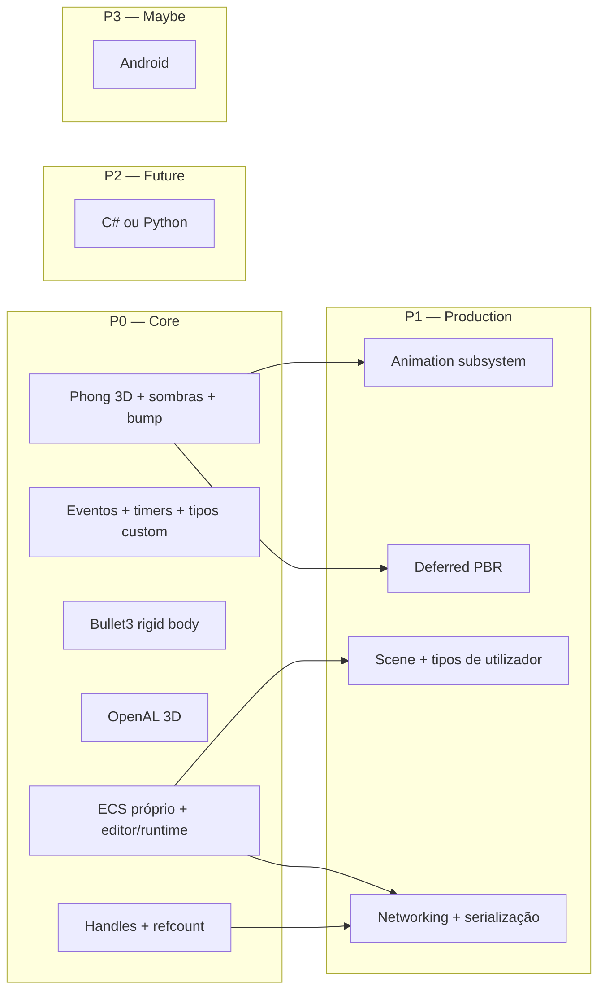
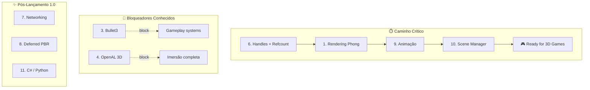

# 🏛️ Engine Pillars — Roadmap of Fundamental Systems

> **Objective:** define in a solid and verifiable way** the subsystems that Caffeine Engine should have as its production base — regardless of editor features or plugins.
> **Criteria of “complete”:** each pillar has documented requirements, acceptance criteria and current state.
> * *Last update:**2026-10-01

Este documento complementa:
- [`2026-09-21-rendering-roadmap.md`](2026-09-21-rendering-roadmap.md) — 3D rendering technical detail
- [`../HISTORY.md`](../ HISTORY.md) — historical stages of development
- [`../../planning/caffeine-studio-ide.md`](./../planning/caffeine-studio-ide.md) — Doppio milestones (IDE)

---

## Prioridades

| Tier | Significado |
|------|-------------|
| **P0 — Core** | Mandatory foundation for serious 3D games. Without this the engine is not “production-ready”. |
| **P1 — Production** | Required for full titles (multiplayer, rich animation, advanced serialization). |
| **P2 — Future** | Planned, but doesn't block the first 3D release. |
| **P3 — Maybe** | Desirable; depends on resources and market validation. |

---

## P0 — Core

### 1. Rendering 3D Phong

* * State:** Partial — Phong GPU + CSM + point/spot shadows in runtime; normal maps; `GpuTextureCache` . Editor (2026-09-23 / 10-01): **~10 → ~100 FPS**, shadow passes off in viewport (always connected samplers), GPU frame cache invalidated by camera ** and** scene content (transforms/land), skybox with raster adaptive to movement, hierarchical profiler ( `self` / `total` ). Cap offscreen do editor: 1280 px. Falta: mesh geometry LOD/batching, sombras GPU de volta no editor sem quebrar o budget de 16 ms, gate formal de 60 FPS.

* It must be solid:

| Requisito | Acceptance criteria |
|-----------|----------------------|
| Phong Lighting (ambient + diffuse + specular) | Materiais com `shininess` , directional/point lamps stable at 60 FPS |
| Dynamic shadows | Shadow mapping GPU direcional CSM (2) + point cubemap (2) + spot (2); sem fallback CPU no viewport GPU |
| Bump / normal mapping | Normal maps em meshes (TBN) e terreno (triplanar); tangentes no vertex buffer |
| 3D camera system | Componente `Camera3D` + follow/orbit/FPS; editor e runtime partilham a mesma API |
| Single Pipeline GPU | Sem dual-path CPU raster no viewport shaded (ver rendering roadmap P0) |

** Dependencies:** RHI, mesh loading, materials, `Camera3DComponent` .

**Relação com PBR:** Phong é o **degrau imediato** (P0 rendering). O deferred PBR (P1) evolui sobre a mesma infraestrutura de G-buffer, shadow maps e materiais — não substitui o trabalho de câmaras, sombras e normal mapping.

**Docs:** [`rendering/materials-phong.md`](../rendering/materials-phong.md), [`rendering/shadow-mapping.md`](../rendering/shadow-mapping.md), [`rendering/texture-quality-lod.md`](../rendering/texture-quality-lod.md), [`editor/scene-viewport.md`](../editor/scene-viewport.md), [`performance/editor-viewport-performance.md`](../performance/editor-viewport-performance.md), [`2026-09-21-rendering-roadmap.md`](2026-09-21-rendering-roadmap.md), [`2026-09-22-phong-gpu-handles-session.md`](2026-09-22-phong-gpu-handles-session.md), [`2026-09-22-viewport-rendering-quality-session.md`](2026-09-22-viewport-rendering-quality-session.md)

---

### 2. Sistema de eventos (timers + tipos customizados)

**Estado:** 🟡 Parcial — `EventBus` tipado + `TimerScheduler` ( `scheduleOnce` / `scheduleRepeating` no fixed timestep). Tipos custom runtime e thread-safety doc ainda limitados.

* It must be solid:

| Requisito | Acceptance criteria |
|-----------|----------------------|
| Pub/sub tipado | `subscribe<T>` / `publish<T>` with cancelable handsles |
| Eventos diferidos | Fila processada em `dispatch()` no game loop |
| **Timers** | `scheduleOnce` , `scheduleRepeating` , cancellation by handle; integration with fixed timestep |
| **Tipos custom** | API to register new event types (stable ID or controlled RTTI) without recompile core |
| Thread-safety documentada | Clear rules: what can be called jobs vs main thread |

** Dependencies:** Game loop, `EventBus` .

**Docs:** [`core/events.md`](../core/events.md), [`core/timer.md`](../core/timer.md)

---

### 3. Physics rigid body (Bullet3)

**Estado:** 🟡 Em curso (2026-10-01) — `btDiscreteDynamicsWorld` com box, sphere e capsule; `RigidBody3D` + `Collider3D` (POD, serializados); sync no play mode do Doppio; gravidade e fixed step 1/60. Falta: heightfield/mesh de terreno, convex mesh, debug draw, joints, teste cross-platform de determinismo.

* It must be solid:

| Requisito | Acceptance criteria |
|-----------|----------------------|
| Integration **Bullet3** | `btDiscreteDynamicsWorld` , shapes (box, sphere, capsule, mesh convex), rigid bodies |
| ECS bridge | `RigidBody3D` , `Collider3D` , sync transform ↔ physics (editor + play mode) |
| Terreno | Heightfield ou mesh collision para terreno sculptado |
| Debug draw | Wireframes de colliders no viewport (toggle) |
| Reasonable Determinism | Fixed step; document cross-platform limitations |

**Dependências:** ECS, math, terreno collision mesh ( `TerrainCollisionMeshBuilder` ).

**Docs:** [`physics/physics-3d.md`](../physics/physics-3d.md), [`physics/physics-2d.md`](../physics/physics-2d.md)

**Note:**Bullet3 explicitly chosen as backend; abstraction `IPhysicsWorld3D` to not attach ECS to Bullet across the code.

---

### 4. 3D Audio (OpenAL)

**Estado:** 🟡 Parcial — áudio 2D/spatial básico; OpenAL não integrado como backend principal.

* It must be solid:

| Requisito | Acceptance criteria |
|-----------|----------------------|
| Backend **OpenAL** | Contexto, buffers, sources, listener |
| Formatos comuns | WAV, OGG, FLAC (via decoder); MP3 opcional |
| 3D Audio | Listener position/orientation and sources; attenuation and cone |
| ECS | `AudioEmitter3D` , `AudioListener` ligados a `Transform` / `Position3D` |
| Streaming | Music/long-form without loading entire file into RAM |

** Dependencies:** Asset manager, ECS, game loop.

**Docs:** [`audio/audio-system.md`](../audio/audio-system.md)

---

### 5. ECS itself, integrated into runtime and editor

**Estado:** 🟢 Avançado — `World` archetype-based, editor Doppio, runtime `caffeine-runtime` , scene serialization.

* It must be solid:

| Requisito | Acceptance criteria |
|-----------|----------------------|
| ECS **escrito pela equipa** | No dependence on flecs/EnTT in production |
| Editor ↔ runtime | Same serializable components; play mode does not corrupt scene |
| Command buffer | Create/destroy safe during iteration |
| Minimum Reflection | Inspector e serializers gerados ou registados por tipo |
| Systems pipeline | deterministic order; documented priorities |

**Dependências:** Memory, scene serializer.

**Docs:** [`ecs/README.md`](../ecs/README.md), [`ecs/scene.md`](../ecs/scene.md)

---

### 6. Resource management with handsles and reference counting

**Estado:** 🟡 Parcial — generation counter, refcount RAII ( `AssetHandle` ), LRU, invalidation callbacks; `GpuTextureCache` GPU with mips. Missing: async decode→upload N+1, `.caf` checksum header.

* It must be solid:

| Requisito | Acceptance criteria |
|-----------|----------------------|
| **Handles opacos** | `TextureHandle` , `MeshHandle` , etc. — No pointers exposed to gameplay |
| **Reference counting** | Acquire/release; auto unload when recount = 0 |
| Resistente a erros | Load failed → invalid handle + log; no crash in use of dead handle |
| Hot-reload | Reload asset keeps handsles valid or explicit invalidation |
| Thread-safe load | Async load with callback or future; main thread only consumes ready handsles |

** Dependencies:** Job system, file I/O, formats `.caf` .

**Docs:** [`assets/asset-manager.md`](../assets/asset-manager.md)

---

## P1 — Production

### 7. Networking + custom serialization of objects

* *State:** 

* It must be solid:

| Requisito | Acceptance criteria |
|-----------|----------------------|
| Transporte | UDP com camada de confiabilidade (ou TCP opcional para lobby) |
| ** Custom Serialization** | Versioned binary format for components/entities; without JSON in hot path |
| ECS replication | Spawn/despawn/update de entidades autoritativas |
| Interpolation / prediction | Documented for transforms and physics |
| Editor opcional | Painel de debug de rede (latency, packet loss) |

** Dependencies:** ECS, hands, event bus, scene serialization.

---

### 8. Deferred rendering, physically-based (PBR)

* *State:** 

* It must be solid:

| Requisito | Acceptance criteria |
|-----------|----------------------|
| G-buffer | Albedo, normal, metallic-roughness, depth |
| Deferred lighting | Multiple lamps with no linear cost per object |
| PBR (GGX / Fresnel) | Materiais energy-conserving; IBL opcional |
| Coexistence with Phong | Gradual migration; convertible legacy materials |

** Dependencies:** P0 rendering (shadows, normal maps, single GPU pipeline).

**Docs:** [`2026-09-21-rendering-roadmap.md`](2026-09-21-rendering-roadmap.md) phases P3–P6.

---

### 9. Animation subsystem

* * State:** Partial — animation 2D, skeletal stubs, timeline in the editor.

* It must be solid:

| Requisito | Acceptance criteria |
|-----------|----------------------|
| Skeletal 3D | Bones, skinning GPU, import glTF |
| State machines | Transitions, blend trees |
| Animation 2D | Sprite clips (already partial) |
| Timeline editor | Keyframes sincronizados com play mode |
| Animation Events | Footsteps, hit frames via event bus |

** Dependencies:** ECS, mesh loading, rendering.

**Docs:** [`animation/skeletal-animation.md`](../animation/skeletal-animation.md)

---

### 10. Scene management + serialization of user types

**Estado:** 🟡 Parcial — `SceneSerializer` , blobs por componente; tipos user-defined limitados.

* It must be solid:

| Requisito | Acceptance criteria |
|-----------|----------------------|
| Hierarchical scenes | Load/save, streaming opcional |
| **Tipos de utilizador** | API para registar serializers de componentes custom (plugins, gameplay) |
| Versionamento | Format migration `.cscene` / `.caf` |
| Prefabs | Overriding bodies by entity |
| Async load | Progress callback; sem frame hitch |

** Dependencies:** ECS, assert handsles, editor.

**Docs:** [`ecs/scene.md`](../ecs/scene.md)

---

## P2 — Future

### 11. Scripting via C# ou Python

**Estado:** 🟡 Lua em produção; C#/Python não decidido.

**Direction:**

| Option | Pros | Contras |
|-------|------|---------|
| **C#** | Ecossistema Unity-like, tooling maduro | Runtime (Mono/CoreCLR), GC, build |
| **Python** | Fast Prototyping | Performance, embedding, GIL |

** Acceptance criteria (when starting):**VM/embed stable, hot-reload, ECS bindings generated or reflecton, documented sandbox.

**Note:** Moon remains supported; C#/Python would be ** Additional layer**, not immediate replacement.

**Docs:** [`scripting/scripting.md`](../scripting/scripting.md)

---

## P3 — Maybe

### 12. Suporte a dispositivos Android

* * State:** 

* * Prerequisites before compromising:

- Portable RHI (Vulkan/ GLES via SDL3)
- Input touch + safe areas
- Asset pipeline mobile (ASTC/ETC2 compression)
- Bullet + OpenAL em ARM
- CI com build NDK

* *Criteria to promote P1:** product or partner with confirmed Android requirement.

---

## Matriz resumo

| # | Pilar | Tier | Estado | Backend / notas |
|---|-------|------|--------|-----------------|
| 1 | Phong 3D + shadows + bum + cameras | P0 | Partial | ~100 FPS editor; GPU cache for content; shadows off in editor |
| 2 | Eventos + timers + tipos custom | P0 | Partial | `EventBus` + `TimerScheduler` |
| 3 | Rigid body 3D | P0 | Ongoing | **Bullet3** box/sphere/capsule + play mode |
| 4 | 3D Audio | P0 | Partial | **OpenAL** |
| 5 | ECS own + editor/runtime | P0 | Advanced | Core da engine |
| 6 | Handles + refcount | P0 | Partial | Generation + RAII + LRU + `GpuTextureCache` |
| 7 | Networking + serialization | P1 | Not started | Custom Binary |
| 8 | Deferred PBR | P1 | Partial | After solid Phong |
| 9 | Animation | P1 | Partial | 2D + skeletal |
| 10 | Scene + tipos user | P1 | Partial | `SceneSerializer` |
| 11 | C# / Python | P2 | 🔴 Futuro | Lua atual |
| 12 | Android | P3 | 🔴 Maybe | Depende de RHI mobile |

---

## Suggested implementation order

1. **Handles + refcount** (unlocks stable assets everywhere else)
2. **Phong + shadows + bum + cameras**(Rendering roadmap P0–P2)
3. **Eventos: timers + tipos custom** (desbloqueia gameplay e networking)
4. **Bullet3**( 3D Collision with land)
5. **OpenAL 3D** (paridade sensorial)
6. **Scene + serializers user** (plugins e jogos)
7. ** Full skeletal animation**
8. **Networking**
9. **Deferred PBR**
10. C# / Python / Android conforme prioridade de produto

---

## Como usar este documento

- **Before implementing** a subsystem: open the corresponding pillar and check acceptance criteria.
- ** By closing a feature: ** Update “State” column in this file and link technical doc in `docs/<módulo>/` .
- **Rendering:** phase-to-phase detail continues on [`2026-09-21-rendering-roadmap.md`](2026-09-21-rendering-roadmap.md); this doc defines *what*; that one defines *how*.

---

## Quantitative criteria for production-ready

| Metric | Alvo | Measurement |
|---------|------|---------|
| Frame time | ≤16 ms (60 FPS) in 95th percentilee | Target Minimum Hardware Profiling |
| Memory baseline | ≤ 512 MB idle | Process working set (Windows/Linux) |
| Load time | ≤3 s scene 50 MB | Cold boot, SSD |
| Crash rate | ≤0.1% sessions | Telemetria em beta fechado |
| Build reproducibility | 100% deterministic | CI hash comparison |

---

## Critical path of dependencies

---

## Technical analysis and improvements

### ECS — additional requirements

| Area | Recommendation |
|------|--------------|
| Reflection | Macro-based build time codegen (C++20 modules or generators) instead of manual RTTI |
| Serialization | Schema versioning with forward/backward compatibility from the beginning (field numbering protobuf style) |
| Cache locality | Document memory layout (SoA vs AoS) and allignment for SIMD |
| Multi-threading | Ownership model claro: quem owns ECS data? Job system acessa via snapshots? |

* *Add to acceptance criteria (pillar 5):**

- **Schema evolution:** compatibilidade entre versões `.cscene` (major.minor.patch)
- **Storage strategy:** Hybrid archetype + chunk-based (semelhante EnTT/SparseSet)
- **Query cache:** Compiled query plans reutilizados entre frames
- **Hot reload safety:** Versionamento de componentes durante play mode

---

### Rendering — Phong Transition → PBR

| Aspecto | Problema | Solution |
|---------|----------|---------|
| Shader reuse | Phong shaders not G-buffer compatible | Material abstraction layer translating Phong→PBR automatically |
| Shadow maps | CPU shadows in editor  | Unificar shadow pipeline desde P0 (GPU-only mesmo no editor) |
| Memory budget | Deferred requires ~2× Forward VRAM | Document VRAM budgets per platform (desktop minimum 4 GB) |
| TAA/PostFX | Not mentioned | PostFX pipeline (bloom, SSAO, TAA) como parte do P1 |

* *Additional acceptance criteria (pillar 8):**

> Automatic migration of materials Phong→PBR via convert tool that maps `shininess↔roughness` , `specular↔metallic` with visual validation ≤5% RMS difference.

---

### Physics — determinism and backend policy

| Decision | Option A | Option B | Recommendation |
|---------|---------|---------|--------------|
| Backend | Bullet3 | Jolt Physics | Jolt has better multithreading and C++20; **Bullet3 maintained by explicit decision** until reassessment |
| Sync transform | Pull (physics→render) | Push (render→physics) | Pull with interpolation to avoid stutter |
| Terrain collision | Heightfield | Mesh collision | Heightfield LOD for scalable performance |
| Determinismo | Documentado | Cross-platform verified | Test x86/arm/Windows/Linux with tolerance <0.001 |

**Determinism policy (pillar 3):**

- Fixed timestep: 1/60 s (configurable up to 1/240 s)
- Float precision: single ( `float` ) with optional quantisation** for replay
- Cross-platform tolerance: position <0.001 units, rotation <0.1 degrees
- Rollback network: support documented for rollback windows ≥16 frames

---

### Handles — Safety Protocol

| Mecanismo | Description |
|-----------|-----------|
| **Generation counter** | `TextureHandle = { id: u32, generation: u16 }` — prevents use after asset removed |
| **Invalidation callback** | System registers listeners when handle becomes invalid |
| **Async load states** | `{ Pending, Loading, Ready, Failed, Invalid }` |
| **Memory pressure** | LRU eviction with callbacks to release critical features |
| **Bundle format** | `.caf` com checksum SHA-256 + schema version header |

**Estado atual (2026-09-22):** `AssetHandle<T> = { id: u32, generation: u16 }` with validation in `get()` ; `LoadStatus` explicit ( `Pending | Loading | Ready | Failed | Invalid` ); generation incrementada em `collectGarbage` (evict); hot-reload keeps generation for active handsles.

---

### Networking — proposed architecture (P1)

| Componente | Protocolo | Notas |
|------------|-----------|-------|
| Transporte | ENet ou Nakama | Reliable UDP built-in |
| Serialization | FlatBuffers ou Cap'n Proto | Zero-copy parsing (alternative to custom binary) |
| Authority model | Server-authoritative | Client-prediction + server reconciliation |
| Tick rate | 30 Hz (minimum), 60 Hz (recommended) | Trade-off bandwidth × responsiveness |
| Reconciliation | Interpolation lag 100 ms + prediction | 2–3 s buffer for entities |

* *Additional acceptance criteria:**

> Stress test: 100 simulated entities, 32 simultaneous players, latency 150 ms, pack loss 5% → <10% unsynchronized entities after 5 minutes.

---

### Animation — 2D vs 3D separation

| Subsystem | P0 | P1 | P2 |
|-----------|----|----|-----|
| Sprite animation | ✅ | — | — |
| Skeletal import (glTF/FBX) | — | ✅ | — |
| GPU skinning | — | ✅ | — |
| Blend shapes / morph targets | — | Partial | ✅ Completo |
| IK solvers | — | — | ✅ |
| Retargeting between rigs | — | — | ✅ |

**Additional criteria (pillar 9):**

> Import pipeline glTF 2.0 with validation: Bones ≤255, weights ≤4 per vertex, animations ≥30 fps sample rate.

---

### Scripting — comparative

| Criteria | Lua (atual) | C# | Python |
|----------|-------------|----|--------|
| Performance | ✅ 2–5× C++ | ⚠️ 3–8× (GC stalls) | 10–50× |
| GC predictability | ✅ Manual/yield | ❌ Geracional | Reference counting |
| Tooling | ⚠️ VSCode + LSP | ♪ Rider/VS full ♪ | ⚠️ VSCode |
| Bindings ECS | Manual/cbindgen | Generated (source gen) | ctypes/CFFI |
| Hot reload | ✅ Native | ⚠️ Assembly load | ✅ |
| Sandboxing | ⚠️ `lua_open()` | ⚠️ AppDomain | ✅ `ast.parse` |
| Team skill | ⚠️ Curva de aprendizado | Common in game dev | Common outside games |

* *Recommendation:** keep **Lua as primary scripting layer** (gameplay, AI, UI). C# as secondary layer only if business partner requires, complexity gameplay >50k lines, or internal tooling in predominant C#.

---

## Technical documentation pending

| Documento | Prioridade | Content |
|-----------|------------|----------|
| `docs/architecture/threat-model.md` | P0 | Security (anti-tamper, cheat prevention) |
| `docs/performance/profiling-guidelines.md` | P0 | Como profilear CPU/GPU/memory |
| `docs/assets/pipeline-spec.md` | P0 | Import formats, compression, validation rules |
| `docs/builds/platform-support-matrix.md` | P1 | Compilers, SDKs, minimum versions |
| `docs/networking/protocol-spec.md` | P1 | Wire format, message IDs, versioning |

---

## Estado atual da branch `feature/editor-plugin-sdk`

Esta branch isola o **Plugin SDK** do core do Doppio:

- Terrain, procedural tools, post-process e git UI movidos para plugins `.so`
- `PluginServiceRegistry` generic — core not hardcoda feature services
- Ver [`docs/editor/plugin-sdk.md`](../editor/plugin-sdk.md)

* *Impact on the pillars:** Pillar 10 (Scene + user types) and Pillar 5 (ECS reflection) directly benefit from this architecture — plugins record drawers and serializers without recompiling the editor.

---

## Next cut (from 2026-10-01)

Order still valid. The active cut is **pillar 3**:

1. ~~World Bullet + box/sphere/capsule + sync play mode~~
2. Heightfield a partir de `TerrainComponent` / `TerrainCollisionMeshBuilder`
3. Debug draw de colliders no viewport (toggle already planned)
4. Convex mesh a partir de `MeshFilter`
5. Return GPU shadows to editor only when frame fits in 16 ms (pillar 1)

OpenAL (pilar 4) fica a seguir, depois de o terreno colidir.
