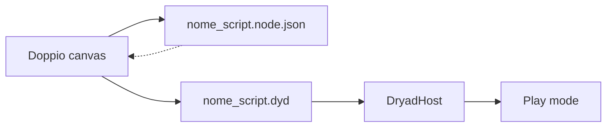

# Dryad and node scripts

**Date:** 2026-10-19  
**Namespace:** `Caffeine::Script`  
**Language:** Dryad, in the separate `source/` repository, file extension `.dyd`  
**Status:** host, emitter, Doppio canvas, and `.dyd` round-trip (when `// @node` markers are present)

The node graph is not a second runtime. The game runs Dryad. The canvas only records how that text was built.

## File contract

In the project scripts folder (the same one the Lua watcher already uses):

| File | Read by | Role |
|------|---------|------|
| `nome_script.dyd` | Dryad runtime | The real program. The only thing executed. |
| `nome_script.node.json` | Editor only | Canvas positions, node types, wires, and parameters. |



The runtime ignores the JSON. If the JSON is missing, the game still runs. If the `.dyd` is edited by hand, the game uses that text; the canvas may be stale until the graph is rebuilt.

The emitter must be deterministic: the same graph always produces the same `.dyd`.

## Language boundary

Dryad stays a general-purpose language. Caffeine, Doppio, ECS, nodes, and `.node.json` do not enter the language, the standard library, or the syscalls.

| Where | What |
|-------|------|
| Dryad repository (`source/`) | Interpreter, `run_source`, `call_global`, build fixes. Dryad's own rules: generic intrinsics, stdlib written in Dryad, tests first. |
| Caffeine engine | `DryadHost`, `onCreate` / `onUpdate` / `onFixedUpdate` hooks, `caffeine_set_position` / `caffeine_get_position_*`, `Caffeine::Script::Nodes::NodeEmitter`, extension dispatch, canvas, and JSON. |

Current Dryad limits, handled by the emitter rather than host shortcuts:

- `&&` does not short-circuit. The graph emits `if`.
- `Promise` is synchronous. The game tick does not depend on it.
- Each Dryad worker has its own `Interpreter`. Gameplay tick stays on one thread.

## What the engine already does

Lua stays. `ScriptComponent.scriptPath` picks the runtime by suffix:

- `.lua` → `ScriptEngine` (sol2)
- `.dyd` → `DryadHost`

Each `.dyd` gets its own `dryad::Interpreter`. The file is read once (`run_file` → `run_source`, which keeps the syntax tree). Each frame calls the global function when it exists:

```dryad
function onUpdate(entity, dt) {
  caffeine_set_position(entity, 3, 4, 5);
}
```

`onCreate` and `onFixedUpdate` use the same `(entity, dt)` shape. A missing function is a no-op, matching Lua.

`caffeine_set_position` is a host native registered with `define_native`. It is not part of Dryad. The interpreter's network access stays off (`set_network_allowed(false)`).

Dryad commit `1e0eef2`:

- `Interpreter::run_source` retains the `Program` so functions stay valid after load.
- `Interpreter::call_global` invokes a function in the global environment.
- A build without OpenSSL no longer fails on an unused TLS helper.

## Phases

### 1. Minimal host — done

`src/script/DryadHost.hpp` loads the `.dyd` and calls the hooks. `ScriptSystem` splits `.lua` from `.dyd`. Test: `onUpdate` writes the entity `Transform`.

Still open: input bindings, `.dyd` hot-reload.

### 2. Emitter, no UI — done

`src/script/nodes/NodeGraph.hpp` holds the in-memory graph (`nodes`, `edges`, canvas `x`/`y`). `NodeEmitter::emit` returns deterministic `.dyd` text and `.node.json`; `writeSiblingFiles` writes both next to the script path.

Catalog (pin names in edges use `nodeId.pin`):

| Type | Exec pins | Data pins |
|------|-----------|-----------|
| `OnUpdate` | `out` | — |
| `SetPosition` | `in`, `out` | `x`, `y`, `z` (default `0` if unwired) |
| `GetPosition` | — | `x`, `y`, `z` → `caffeine_get_position_*` |
| `Constant` | — | `value` (`valueKind` `number` or `bool` in JSON) |
| `Branch` | `in`, `then`, `else`, `out` | `condition` |

Generated `.dyd` is ordinary Dryad with `// @node <id>` markers; branches use `if` / `else`, never `&&`. Tests: `tests/test_node_emitter.cpp` (determinism + `DryadHost` execution).

### 3. Doppio canvas — done

`DryadNodeScriptPanel` (`Window → Dryad Node Script`, or open a `.dyd` from the Asset Browser) edits the sibling `.node.json` in memory and calls `NodeEmitter::writeSiblingFiles` when links change, nodes move, constants change, or you press **Save**. Play mode still runs only the `.dyd` via `DryadHost`.

JSON sketch:

```json
{
  "version": 1,
  "script": "nome_script.dyd",
  "nodes": [{ "id": "n1", "type": "OnUpdate", "x": 0, "y": 0 }],
  "edges": [{ "from": "n1.out", "to": "n2.in" }]
}
```

### 4. Round-trip — done

`NodeRoundTrip::importFromDyd` rebuilds graph topology from emitter-shaped `.dyd` (markers on `OnUpdate`, `Branch`, `SetPosition`; data nodes are inferred from expressions). Opening a script in `DryadNodeScriptPanel` prefers the `.dyd` when markers exist and keeps canvas `x`/`y` from `.node.json` for matching ids. **Sync from .dyd** forces a refresh.

| `.dyd` | Canvas behaviour |
|--------|------------------|
| Has `// @node` markers | Graph rebuilt from script; layout merged from JSON |
| No markers | Valid Dryad; canvas stays on JSON (or default); status bar explains mismatch |
| Markers but parse error | Falls back to JSON; error in status bar |

Tests: `tests/test_node_emitter.cpp` (round-trip reproduces emitted text).

## Out of scope

- Executing the JSON.
- Opaque Dryad, one unreadable line per node.
- Calling Lua from each node.
- Putting Caffeine concepts inside the Dryad repository.
- Using the bytecode VM (`VM::execute`) yet. The stable path is the `Interpreter`. The VM waits until the host is measured.
