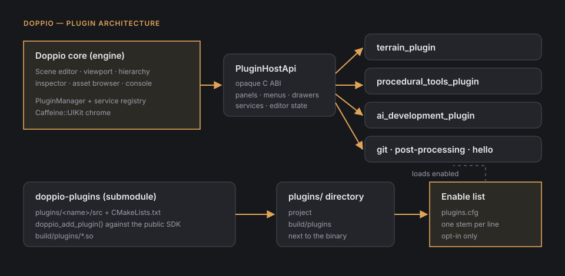

# Plugins

<div class="doc-meta">
  <span class="doc-badge doc-badge--reference">Reference</span>
  <span>Last updated: <time datetime="2026-11-18">2026-11-18</time></span>
</div>

<div class="doc-callout doc-callout--warning">
  <p><strong>Legacy host.</strong> The active Rust/Iced Doppio does not load C++ plugins.
  These pages document the C++/ImGui plugin SDK and its host in the archived C++ editor
  (<code>doppio-archived/</code>). The engine still builds every plugin from the submodule
  so the SDK stays compile-tested.</p>
</div>

<p class="doc-lede">The plugin catalog, the C++/ImGui SDK contract and the build and
install steps for the legacy editor host.</p>

Editor extensions are **shared libraries** built against the public
`caffeine/plugin/` SDK. They live in the separate
[doppio-plugins](https://github.com/devscafecommunity/doppio-plugins) repository,
which is pinned as an engine submodule.

The engine build compiles them into `build/plugins/`; the legacy host loads none of
them at startup. Install the libraries in a plugin directory and enable the ones you
need in that host's Plugin Manager. The current Rust Doppio neither scans nor loads
these libraries.

<figure class="doc-figure">
  
  <figcaption>Doppio plugin architecture</figcaption>
</figure>


## Catalog

| Plugin | Binary | What it adds |
|--------|--------|--------------|
| Hello | `hello_plugin` | Minimal SDK example: panel and menu action |
| Terrain Generator | `terrain_plugin` | Ultra-realistic terrain, heightmap import, terrain editor panel |
| Procedural Tools | `procedural_tools_plugin` | Streaming worlds, benchmarks, procedural director |
| Post Processing | `post_processing_plugin` | Post-process stack UI and camera helpers |
| Git | `git_plugin` | Project Git status, history and commit actions |
| AI Development | `ai_development_plugin` | Nav volumes, nav agents and behaviour templates |
| VC&M | `volumetric_clouds_plugin` | Procedural volumetric clouds and ground mist |
| Natural Fluids | `natural_fluids_plugin` | Flat, wind/physics and realistic water surfaces plus real 2D/3D water, fire, fog and smoke fluids |

## Pages

| Page | Contents |
|------|----------|
| [Getting started](getting-started.md) | Build the hello template and install it |
| [Installing plugins](installing-plugins.md) | Discovery paths, enable list, distribution |
| [Writing a plugin](writing-a-plugin.md) | C ABI, `IPlugin` lifecycle, host API |
| [Service registry](service-registry.md) | Cross-plugin services such as terrain and procedural |
| [Plugin Manager](../editor/plugin-manager.md) | Opt-in loading and troubleshooting |
| [Compatibility](compatibility.md) | ABI, build flags and platform matrix |
| [VC&M](volumetric-clouds.md) | Volumetric clouds and mist plugin |
| [Natural Fluids](natural-fluids.md) | Water surfaces and real Eulerian fluids |

## Quick build

```bash
git submodule update --init doppio-plugins

cmake -S doppio-plugins -B doppio-plugins/build \
  -DCAFFEINE_ROOT="$PWD" \
  -DIMGUI_DIR="$PWD/build/_deps/imgui-src"
cmake --build doppio-plugins/build -j

cp doppio-plugins/build/plugins/*.so build/plugins/
```

Then start the legacy C++ host and enable the plugin in its Plugin Manager. The
libraries still build against the current engine; only the host is legacy.
