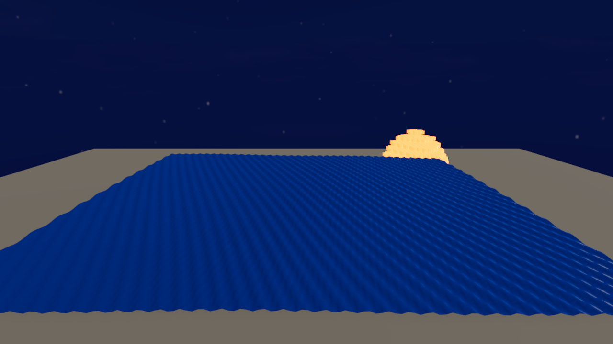

# Natural Fluids

Natural Fluids is a **Doppio plugin** for animated water and real fluids. It adds a
`NaturalFluidComponent` to entities and four authoring levels, from a flat water
plane to a 3D Eulerian fluid volume.



## Four levels

| Level | What it does |
|-------|--------------|
| **Flat water** | A flat animated water plane with a transparent, low-roughness material. |
| **Wind + physics** | Gerstner wind waves plus a conservative shallow-water solver: wind stress, drops, impulses, terrain bed and volume conservation. |
| **Realistic water** | A broad Gerstner spectrum with finite-depth dispersion, choppiness, whitecap foam and depth attenuation. |
| **Fluid volume** | A real 3D Stable-Fluids solver for water, fire, fog and smoke. |

## How it works

The engine keeps the simulation, not the plugin:

- `WaveField` samples a deterministic Gerstner spectrum from wind, direction,
  choppiness, wavelength and depth.
- `ShallowWater` is a face-staggered shallow-water solver. It conserves volume in a
  closed basin and reacts to wind, drops and impulses.
- `EulerFluid2D` and `FluidVolume` use semi-Lagrangian advection, Jacobi pressure
  projection, buoyancy and vorticity confinement. Density and temperature are
  transported by the incompressible velocity field, so fire rises and smoke/fog
  drift with the real flow.
- `Scene::tickNaturalFluids` rebuilds a smooth water mesh or a density-voxel mesh
  every frame and feeds the existing scene renderer.

`NaturalFluidComponent` is a POD and is saved with the scene. Generated meshes are
not saved; they are rebuilt on load.

## Panel

Open **View → Panels → Natural Fluids** (or enable the plugin and use its docked
panel). Select an entity with the component, or create one from the panel.

The panel exposes size, water level, wind, amplitude, choppiness, foam threshold,
mesh/physics resolution, time scale and material. The fluid volume section adds
the material preset (water, fire, fog, smoke), source rate/radius/heat, fluid wind
and emission. Buttons inject drops, impulses and puffs and reset the simulation.
A live preview draws the water height/foam map, a 2D density slice or two 3D
slices.

## Rendering

Water uses the scene PBR shader with a transparent water material. A dedicated
water shader with planar refraction/reflection and foam texture is the next step.
Fluid volumes are currently visualized as density voxels; a raymarch pass can
replace them without changing the solver.

## Install

```bash
cmake -S doppio-plugins -B doppio-plugins/build \
  -DCAFFEINE_ROOT="$PWD" \
  -DIMGUI_DIR="$PWD/build/_deps/imgui-src"
cmake --build doppio-plugins/build --target natural_fluids_plugin
cp doppio-plugins/build/plugins/natural_fluids_plugin.so build/plugins/
```

Enable **Natural Fluids** in **Plugins → Plugin Manager**.
