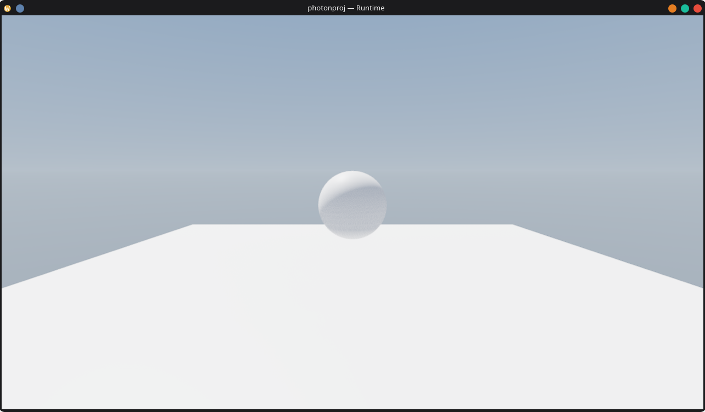

# Photon — hybrid radiance-cascade GI

Photon is Doppio's **global illumination** plugin: a real-time GI system for scenes
with no hardware ray tracing. It is an alternative to Lumen-style GI for GPUs that
only expose ordinary graphics pipelines.

## v0.1 scope

| Photon spec | v0.1 status |
|-------------|-------------|
| Screen-anchored near field | **Implemented**: K exponentially growing intervals traced against the depth buffer |
| Interval merge | **Implemented**: front-to-back radiance accumulation |
| Far field | **Approximated**: sky + ambient fallback when a ray leaves the screen |
| World-anchored probe field | Not yet |
| Multi-bounce feedback | Not yet |
| Glossy reflection pass | Not yet |
| Temporal denoiser | Provided by the engine's TAA: Photon runs before it |

The full specification is the design target. This plugin is the first functional
near-field slice and is intentionally labelled v0.1 wherever it differs from the
reference design.

## Presets

| Preset | Quality | Cascades | Radius |
|--------|---------|----------|--------|
| **Performance** | Low | 3 | 10 m |
| **Balanced** | Medium | 4 | 14 m |
| **High** | High | 5 | 22 m |
| **Cinematic** | High | 6 | 32 m |

## Parameters

| Parameter | Meaning |
|-----------|---------|
| **Intensity** | Indirect-light multiplier |
| **Cascades** | Number of distance intervals |
| **Radius** | Near-field reach in world units |
| **Thickness** | Depth tolerance for accepting a screen hit |
| **Sky intensity** | Far-field fallback when a ray leaves the screen |
| **Ambient** | Constant bounce term |
| **Tint RGB** | Albedo approximation applied to gathered radiance |
| **Debug** | Lit scene, GI only, or fallback only |

## Use it

1. Open a scene with a Camera 3D and geometry.
2. Enable **Photon** in **Plugins → Plugin Manager**.
3. Use **Plugins → Create Photon GI** or **View → Photon Global Illumination**.
4. Pick a preset, then tune radius/thickness for the scene scale.
5. Switch **Debug → GI only** to inspect the cascade result.

The component is `ECS::PhotonGIComponent`; the Inspector has a full drawer even
without the plugin.

## Performance

The pass reuses the engine's post-process stack:

- Low: 4 rays × 2 steps per interval
- Medium: 8 rays × 2 steps
- High: 12 rays × 3 steps

Photon runs **before TAA**, so the temporal resolve cleans the stochastic ray
pattern. Start at Balanced for editing and High/Cinematic for captures.

## Limitations

- No world-anchored radiance probe field: off-screen light falls back to a constant
  sky + ambient term.
- Single bounce: the previous frame's indirect irradiance is not fed back yet.
- Screen-space occlusion can leak on thin geometry; raise **Thickness** or use a
  smaller **Radius**.
- Glossy reflections are not part of v0.1.

## Related

- [Plugin catalog](README.md)
- [Plugin Manager](../editor/plugin-manager.md)
- [Scene viewport](../editor/scene-viewport.md)
