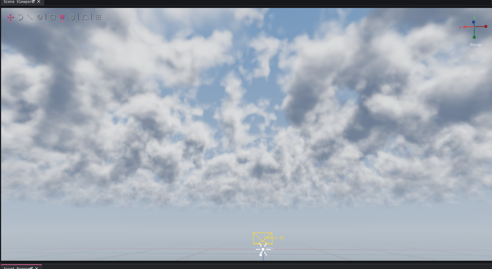

# VC&M — Volumetric Clouds & Mist

VC&M is a **Doppio plugin** that procedurally authors volumetric clouds and ground
mist. The plugin owns the weather model and the authoring UI; the engine ray-marches
the cloud layer in the sky pass.



## What it does

- Generates a weather profile from **humidity**, **instability**, **wind** and a
  **seed**.
- Ray-marches a 3D value-noise FBM cloud layer between two altitudes.
- Marches toward the sun for self-shadowing and scattering.
- Adds ground mist that also feeds the engine's scene volumetric fog, so geometry
  is wrapped in the same haze.
- Provides an **Inspector drawer** for the `VolumetricCloudsComponent`.

## Presets

| Preset | Look |
|--------|------|
| **Fair weather** | Sparse, high, soft clouds |
| **Cumulus** | Puffy mid-level clouds with strong detail |
| **Overcast** | Dense, low, flat layer |
| **Storm** | Thick dark cells, high wind and detail |
| **Misty morning** | Low coverage with strong valley mist |
| **Alpine** | High base, crisp detail, light mist |
| **Clear sky** | Disables the layer |

## How the algorithm maps weather

| Input | Effect |
|-------|--------|
| **Humidity** | Coverage, density, lower base, thicker layer, more mist |
| **Instability** | Detail octaves and vertical development |
| **Wind speed / direction** | Drift of the procedural field |
| **Seed** | Shifts the 3D noise field |
| **Quality** | Ray-march steps: Low 8, Medium 16, High 24 |

The plugin writes a `VolumetricCloudsComponent` on the selected entity (or a
dedicated `Volumetric Clouds` entity). The engine resolves the component once per
frame and uploads it to the sky shader.

## Installing

```bash
./scripts/submodules.sh

cmake -S doppio-plugins -B doppio-plugins/build \
  -DCAFFEINE_ROOT="$PWD" \
  -DIMGUI_DIR="$PWD/build/_deps/imgui-src"
cmake --build doppio-plugins/build --target volumetric_clouds_plugin
cp doppio-plugins/build/plugins/volumetric_clouds_plugin.so build/plugins/
```

Enable **VC&M** in **Plugins → Plugin Manager**, then use
**Plugins → Create Volumetric Clouds & Mist** (creates the component, enables it and
opens the panel) or **View → Volumetric Clouds & Mist**.

## Quick Search

Press **Ctrl+P**, type `clouds`, and run **Add Volumetric Clouds**. If nothing is
selected, VC&M creates and selects an entity, adds the component with a usable
Cumulus profile and enables the layer. Run **Plugins → Create Volumetric Clouds &
Mist** to do the same and open the panel.

## Usage

1. Select an entity, or let VC&M create a dedicated atmosphere entity.
2. Pick a preset and tune humidity/instability.
3. Press **Generate**.
4. Switch the viewport to **3D** and look toward the sky.
5. Tune the cloud layer and mist values directly; the viewport updates live.

## Performance

High quality uses 24 ray-march steps plus 4 sun-march steps. Use **Medium** while
editing and **High** for captures. The cloud pass only shades sky pixels; it is
skipped for rays below the horizon.

## Related

- [Plugin catalog](README.md)
- [Plugin Manager](../editor/plugin-manager.md)
- [Scene viewport](../editor/scene-viewport.md)
