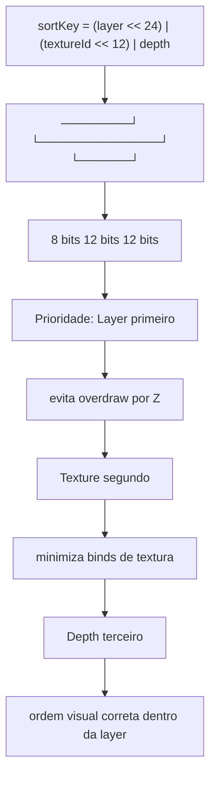

# 📦 Batch Renderer

> **Phase:**3 — The Eye of Engine
> **Namespace:** `Caffeine::Render` 
> **Files:** `src/render/BatchRenderer.hpp` , `src/render/TextureAtlas.hpp` 
> **Status: ** Implemented
> **RFs:** RF3.3, RF3.4, RF3.5, RF3.6

---

## Overview

The Batch Renderer groups thousands of sprites into a single draw call**. Instead of 50,000 individual calls to the GPU, we send 1. That's the key to 60fps with lots of sprites.

**Técnicas utilizadas:**
- **Instanced Rendering** — GPU draws N copies with different transforms
- **Persistant Mapped Buffers** — shared buffer CPU↔GPU without memcpy
- **Radix Sort** — orders sprites by layer → texture → depth before batch

---

## API

```cpp
namespace Caffeine::Render {

// ============================================================================
// @brief  Formato de vértice de sprite (24 bytes — alinhado para GPU).
//
//  offset  0: Vec3  position  (12 bytes)  — x, y, depth(z)
//  offset 12: Vec2  texcoord  ( 8 bytes)  — UV coordinates
//  offset 20: u32   tint      ( 4 bytes)  — RGBA8 packed
//                                TOTAL: 24 bytes (align 4)
// ============================================================================
struct SpriteVertex {
    Vec3 position;   // x, y, z (z = depth/layer)
    Vec2 texcoord;   // UV from TextureAtlas
    u32  tint;       // RGBA8 packed: (r<<24)|(g<<16)|(b<<8)|a
};

// ============================================================================
// @brief  Sistema de Batch Rendering para sprites 2D.
//
//  Limite:
//  - 32K sprites por batch (max por draw call)
//  - Batches ilimitados por frame (novo batch quando textura/pipeline muda)
//
//  Fluxo:
//  1. beginFrame()         — reseta buffers
//  2. submitSprite(...)    — acumula sprites (ECS SpriteSystem chama aqui)
//  3. endFrame(cmd)        — sort → upload → drawInstanced()
// ============================================================================
class BatchRenderer {
public:
    explicit BatchRenderer(RHI::RenderDevice* device);
    ~BatchRenderer();

    // ── Frame lifecycle ────────────────────────────────────────
    void beginFrame();
    void endFrame(RHI::CommandBuffer* cmd);

    // ── Submit sprites (chamado pelo ECS SpriteSystem) ─────────
    void submitSprite(const Mat4& worldTransform, const Sprite& sprite);

    // ── Camera (view-projection matrix) ────────────────────────
    void setCamera(const Camera2D& camera);

    // ── Estatísticas do último frame ───────────────────────────
    struct FrameStats {
        u32 totalSprites;
        u32 totalBatches;
        u32 drawCalls;
        u32 verticesUploaded;
    };
    FrameStats lastFrameStats() const { return m_stats; }

private:
    // ── Batch interno ──────────────────────────────────────────
    struct Batch {
        RHI::Pipeline*  pipeline   = nullptr;
        RHI::Texture*   texture    = nullptr;
        i32             layer      = 0;
        std::vector<SpriteVertex> vertices;
        std::vector<u32>          indices;
    };

    void flushBatch(RHI::CommandBuffer* cmd, Batch& batch);
    void sortBatches();   // Radix Sort por layer → textureId → depth

    RHI::RenderDevice*     m_device;
    Camera2D               m_camera;
    HashMap<u64, Batch>    m_batches;    // key = hash(pipelineId + textureId + layer)
    RHI::Buffer*            m_vertexBuf = nullptr;  // Persistent Mapped Buffer
    RHI::Buffer*            m_indexBuf  = nullptr;  // Persistent Mapped Buffer
    FrameStats              m_stats;
};

// ============================================================================
// @brief  Texture Atlas — agrupa múltiplas texturas em uma só imagem.
//
//  Benefício: apenas 1 texture bind por batch, mesmo com 100+ sprites diferentes.
//
//  Fluxo:
//  1. add(name, region) — registra sprite sheet region
//  2. pack()             — organiza regiões com bin-packing
//  3. getUV(name)        — retorna Vec4(u0, v0, u1, v1) para o shader
// ============================================================================
class TextureAtlas {
public:
    TextureAtlas(u32 width, u32 height);
    ~TextureAtlas();

    // Registra uma região (recorte de sprite sheet)
    bool add(const char* name, Rect2D region);

    // Executa bin-packing (deve ser chamado antes de getUV)
    void pack();

    // Exporta como imagem para upload à GPU
    Buffer exportImage() const;

    // Retorna UV normalizado: Vec4(u0, v0, u1, v1)
    Vec4 getUV(const char* name) const;

    u32 usedArea() const;
    u32 totalArea() const { return m_width * m_height; }
    f32 utilization() const { return (f32)usedArea() / (f32)totalArea(); }

private:
    struct Region {
        FixedString<64> name;
        Rect2D          rect;        // em pixels
        Vec4            uv;          // normalizado [0,1]
    };

    std::vector<Region> m_regions;
    u32 m_width, m_height;
};

}  // namespace Caffeine::Render
```

---

## Persistent Mapped Buffers (RF3.4)

- `CPU GPU`
    - `Persistent Mapped Buffer │`
    - `◄──────────────────────────►│`
    - `(mesma memória física) │`
    - `CPU escreve vértices │ GPU lê vértices`
    - `sem memcpy │ sem esperar CPU`


* *Implementation:**
```cpp
// Criado uma vez no init:
m_vertexBuf = m_device->createBuffer(
    { .size = MAX_SPRITES * 4 * sizeof(SpriteVertex) },
    BufferUsage::Vertex | BufferUsage::PersistentMapped
);

// Por frame — sem memcpy, escrita direta:
SpriteVertex* mapped = (SpriteVertex*)m_vertexBuf->mappedData();
for (auto& sprite : m_pendingSprites) {
    buildQuad(sprite, mapped + writeOffset);
    writeOffset += 4;
}
// GPU já tem acesso — sem upload explícito
```

---

## Radix Sort Layer Sorting (RF3.5)




---

## Exemplo de Uso

```cpp
// ── Setup ──────────────────────────────────────────────────────
Caffeine::Render::BatchRenderer renderer(&device);
Caffeine::Render::TextureAtlas atlas(2048, 2048);

atlas.add("hero_idle",   { {0,   0},   {64, 64} });
atlas.add("hero_walk_0", { {64,  0},   {64, 64} });
atlas.add("tile_grass",  { {128, 0},   {16, 16} });
atlas.pack();

// ── Por frame (via ECS SpriteSystem) ──────────────────────────
renderer.beginFrame();
renderer.setCamera(camera2D);

world.query(spriteQuery, [&](Position2D& pos, Sprite& sprite) {
    Mat4 transform = Mat4::translate(pos.x, pos.y);
    renderer.submitSprite(transform, sprite);
});

auto* cmd = device.beginFrame();
renderer.endFrame(cmd);   // sort → upload → 1 drawInstanced call
device.present(cmd);

// ── Stats ─────────────────────────────────────────────────────
auto stats = renderer.lastFrameStats();
// stats.drawCalls == 1 para 50K sprites da mesma textura/layer
```

---

## Design Decisions

| Decision | Justificativa |
|---------|-------------|
| Instanced rendering | 1 draw call vs N chamadas individuais |
| Persistent mapped buffers | Zero memcpy elimina o maior bottleneck |
| Radix Sort | O(n) vs O(n log n) — essential for 50K sprites |
| Batching por (pipeline + texture + layer) | Minimum state changes in GPU |
| `SpriteVertex` 24 bytes | Aligned to 4 bytes — no wasted padding |

---

## Acceptance Criteria

- [x] 50K sprites em 1 draw call (verificado com GPU profiler)
- [x] 60fps stable mid-range hardware
- [x] GPU time < 2ms para 50K sprites
- [x] Zero `memcpy` por frame (Persistent Mapped Buffers)
- [x] Radix sort correto: layer menor renderiza antes

---

## Dependencies

- **Upstream:** [RHI](rhi.md), [Camera](camera.md), [Asset Manager](asset-manager.md)
- **Downstream:** [Phase 4 — ECS SpriteSystem](../ecs/core.md), [Phase 5 — 3D Rendering](../assets/mesh-loading.md)

---

## 🔗 Related Topics

| Topic | Description |
|--------|-----------|
| [Rendering & Pipeline]() | Batch Renderer no centro da pipeline 2D |

## References

- [`docs/architecture_specs.md`](../architecture specs.md) — §9 Batch Renderer
- [`docs/fase3/rhi.md`](rhi.md) — CommandBuffer used in endFrame()
- [`docs/rendering/camera-2d.md`](camera-2d.md) — viewProjectionMatrix for shader
- [Transversal Topic Index]()
