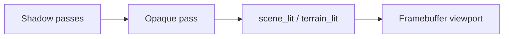

# Materiais Phong (3D)

> **Namespace:** `Caffeine::Render` , `Caffeine::ECS` 
> **Shaders:** `src/render/shaders/scene_lit.{vert,frag}` , `terrain_lit.frag` 
> **Renderer:** `GpuSceneRenderer` 
> ** Status:** 

---

## Overview

Meshes com um `.mat` They use metallic, roughness, ORM and emission. See [`materials-pbr.md`](materials-pbr.md). O passe GPU avalia:

```
final = ambient + Σ (diffuse Lambert + specular GGX) × shadow
```

- **Diffuse:** `max(dot(N, L), 0) × albedo × lightColor × (1 - metallic)`
- **Specular:** GGX com roughness e metallic
- **Normal mapping:** `N` via TBN e textura normal (meshes) ou triplanar (terreno)

---

## Componentes ECS

### MeshFilterComponent

```cpp
struct MeshFilterComponent {
    MeshPrimitive primitive = MeshPrimitive::Cube;
    std::string   customMeshPath;
    std::string   customTexturePath;
    std::string   customNormalPath;   // caminho relativo ao projeto
    std::string   customMaterialPath;
    f32           shininess = 32.0f;  // expoente especular
};
```

**Inspector (Doppio):**Albedo Texture, Normal Map, Shininess (slider 1–128).

### TerrainComponent

```cpp
char normalMapPath[256] = {};
f32  shininess = 16.0f;
bool castShadows = true;
bool receiveShadows = true;
```

**Inspector:** Normal Map, Shininess, Albedo Texture (splat layers).

---

## Pipeline GPU



1. `renderDirectionalShadows()` — up to 2 directional lamps with `castShadows` .
2. `renderPointShadows()` — up to 2 point lamps (cubéap Depth).
3. Pass principal com UBO de luzes + UBO de sombras + materiais.

### Samplers (meshes — `scene_lit.frag` )

| Slot | Textura |
|------|---------|
| 0 | Albedo |
| 1 | Normal map |
| 2–3 | Shadow maps direcionais |
| 4–5 | Cubemaps sombra pontual |

### Samplers (land — `terrain_lit.frag` )

| Slot | Textura |
|------|---------|
| 0–4 | Splat + camadas |
| 5 | Normal map triplanar |
| 6–7 | Shadow maps direcionais |
| 8–9 | Cubemaps sombra pontual |

---

## Tangentes

`MeshLoader::computeMeshTangents()` calculates tangents by vertex (MikkTSpace simplified) after import OBJ/glTF. Vertex shader builds the TBN matrix:

```
TBN = mat3(normalize(T), normalize(B), normalize(N))
N'  = normalize(TBN * (sample(normalMap) * 2 - 1)))
```

---

## Caminho CPU (legado)

In the editor, when viewport 3D does not** use textured GPU ( `gpuTextured3D == false` ), the CPU raster can still evaluate diffuse lighting with shadow maps CPU. The default shadow path with active GPU ** does not** build shadows CPU.

Ver [`shadow-mapping.md`](shadow-mapping.md) e [`plans/2026-09-21-rendering-roadmap.md`](../plans/2026-09-21-rendering-roadmap.md) P0.

---

## References

- [`assets/mesh-loading.md`](../assets/mesh-loading.md) — tangents and import
- [`terrain/terrain-system.md`](../terrain/terrain-system.md) — normal map on the ground
- [`shadow-mapping.md`](shadow-mapping.md) — GPU shadow passes
