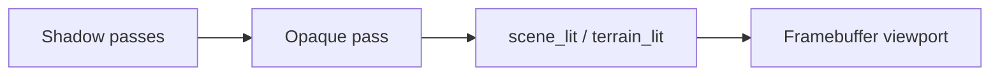

# Materials in the 3D forward pass

<div class="doc-meta">
  <span class="doc-badge doc-badge--reference">Reference</span>
  <span><strong>Namespace:</strong> `Caffeine::Render`, `Caffeine::ECS`</span>
  <span>Last verified: <time datetime="2026-11-18">2026-11-18</time></span>
  <span>Source: <a href="https://github.com/devscafecommunity/caffeine/blob/main/src/caffeine/render/shaders/scene_lit.frag"><code>render/shaders/scene_lit.frag</code></a></span>
</div>

<p class="doc-lede">What the forward shader actually evaluates for meshes and terrain, the
sampler slots behind it, and why the old “Phong” fields are now legacy data.</p>

> **Shaders:** `src/caffeine/render/shaders/scene_lit.vert` / `.frag`, `terrain_lit.frag`
> **Renderer:** `GpuSceneRenderer`

---

## Overview

Meshes with a `.mat` use metallic, roughness, ORM and emission. See
[`materials-pbr.md`](materials-pbr.md). The GPU pass evaluates a GGX specular lobe:

```text
final = ambient/IBL + Σ (diffuse Lambert + specular GGX) × shadow
```

- **Diffuse:** `max(dot(N, L), 0) × albedo × lightColor × (1 - metallic)`
- **Specular:** GGX with roughness and metallic
- **Normal mapping:** `N` via TBN and normal texture (meshes) or triplanar (terrain)

Terrain (`terrain_lit.frag`) is a rough dielectric: Lambert diffuse plus sky IBL, with a
triplanar normal map. It has no specular lobe.

---

## ECS components

### MeshFilterComponent

```cpp
struct MeshFilterComponent {
    MeshPrimitive primitive = MeshPrimitive::Cube;
    std::string   customMeshPath;
    std::string   customTexturePath;
    std::string   customNormalPath;   // project-relative
    std::string   customMaterialPath;
    f32           shininess = 32.0f;  // legacy; kept for serialization
};
```

**Inspector (Doppio):** Albedo Texture, Normal Map, Shininess.

`shininess` is no longer read by the shader: the forward pass takes roughness and metallic
from the `.mat` or the embedded glTF material.

### TerrainComponent

```cpp
char normalMapPath[256] = {};
f32  shininess = 16.0f;   // legacy; terrain lighting has no specular term
bool castShadows = true;
bool receiveShadows = true;
```

**Inspector:** Normal Map, Shininess, Albedo Texture (splat layers).

---

## GPU pipeline



1. `renderDirectionalShadows()` — up to 2 directional lamps with `castShadows`.
2. `renderPointShadows()` / `renderSpotShadows()` — up to 2 point and 2 spot lamps.
3. Main pass with the lighting UBO, shadow UBO and material uniforms.

### Samplers (meshes — `scene_lit.frag`)

| Slot | Texture |
|------|---------|
| 0 | Albedo |
| 1 | Normal map |
| 2–3 | Directional shadow maps |
| 4–5 | Point shadow cubemaps |
| 6–7 | Spot shadow maps |
| 8 | Planar reflection |
| 9 | Reflection probe cubemap |
| 10 | ORM map |
| 11 | Environment (sky) |
| 12–13 | Previous colour / depth (SSR, TAA) |
| 14 | Emission map |
| 15 | Opaque scene copy (blend) |

### Samplers (terrain — `terrain_lit.frag`)

| Slot | Texture |
|------|---------|
| 0 | Splat map |
| 1–4 | Splat layers |
| 5 | Triplanar normal map |
| 6–7 | Directional shadow maps |
| 8–9 | Point shadow cubemaps |
| 10–11 | Spot shadow maps |

---

## Tangents

`MeshLoader::computeMeshTangents()` calculates per-vertex tangents (simplified MikkTSpace)
after an OBJ/glTF import. The vertex shader builds the TBN matrix:

```text
TBN = mat3(normalize(T), normalize(B), normalize(N))
N'  = normalize(TBN * (sample(normalMap) * 2 - 1))
```

---

## See also

- [`materials-pbr.md`](materials-pbr.md) — the `.mat` parameters and the material editor
- [`shadow-mapping.md`](shadow-mapping.md) — GPU shadow passes and the sampler rule
- [`../assets/mesh-loading.md`](../assets/mesh-loading.md) — tangents and import
- [`../terrain/terrain-system.md`](../terrain/terrain-system.md) — terrain shading
