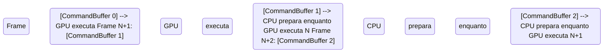

# ⚡ RHI — Rendering Hardware Interface

> **Phase:**3 — The Eye of Engine
> **Namespace:** `Caffeine::RHI` 
> **Files:** `src/rhi/RenderDevice.hpp` , `src/rhi/CommandBuffer.hpp` 
> ** Status:** 
> **RFs:** RF3.1, RF3.2

---

## Overview

RHI is the layer of abstraction on `SDL_GPU` . The engine **never calls SDL GPU functions directly — all calls pass through the RHI, which manages command buffers, swapchains and render targets.

**Por que RHI?** 
Separates the rendering logic from the underlying graphical API. Today SDL GPU; tomorrow Vulkan directly or WebGPU — without changing the [Batch Renderer](batch-renderer.md) nor the game shakers.

---

## API Planejada

```cpp
namespace Caffeine::RHI {

// ============================================================================
// @brief  Configuração do render device.
// ============================================================================
struct RenderConfig {
    u32  width          = 1280;
    u32  height         = 720;
    bool vsync          = true;
    bool tripleBuffering = true;
    const char* windowTitle = "Caffeine Engine";
};

// ============================================================================
// @brief  Descritor de textura para criação.
// ============================================================================
struct TextureDesc {
    u32            width, height;
    SDL_GPUTextureFormat format = SDL_GPU_TEXTUREFORMAT_R8G8B8A8_UNORM;
    SDL_GPUTextureUsageFlags usage = SDL_GPU_TEXTUREUSAGE_SAMPLER;
    u32            mipLevels = 1;
};

// ============================================================================
// @brief  Descritor de buffer para criação.
// ============================================================================
struct BufferDesc {
    u64 size;
    const char* name = nullptr;  // para debug
};

enum class BufferUsage : u8 {
    Vertex,
    Index,
    Uniform,
    Storage,
    TransferSrc,
    TransferDst
};

// ============================================================================
// @brief  Descritor de shader para criação.
// ============================================================================
struct ShaderDesc {
    const u8* code;
    usize     codeSize;
    const char* entryPoint = "main";
    SDL_GPUShaderStage stage;
};

// ============================================================================
// @brief  Dispositivo de renderização principal.
//
//  Gerencia:
//  - SDL_GPUDevice (handle para a GPU)
//  - Swapchain (buffers de apresentação)
//  - Triple buffering de command buffers
//  - Resource pools (textures, buffers, shaders)
// ============================================================================
class RenderDevice {
public:
    RenderDevice() = default;
    ~RenderDevice();

    bool init(SDL_Window* window, const RenderConfig& config = {});
    void shutdown();

    // ── Frame lifecycle ────────────────────────────────────────
    CommandBuffer* beginFrame();
    void           endFrame(CommandBuffer* cmd);
    void           present(CommandBuffer* cmd);

    // ── Resource creation ──────────────────────────────────────
    Texture* createTexture(const TextureDesc& desc);
    Texture* createTextureFromData(const void* pixels, u32 width, u32 height);
    Shader*  createShader(const ShaderDesc& desc);
    Buffer*  createBuffer(const BufferDesc& desc, BufferUsage usage);

    // ── Resource destruction ───────────────────────────────────
    void destroyTexture(Texture* tex);
    void destroyShader(Shader* shader);
    void destroyBuffer(Buffer* buf);

    // ── Queries ────────────────────────────────────────────────
    u32  backbufferWidth()  const { return m_config.width; }
    u32  backbufferHeight() const { return m_config.height; }
    bool isVSync()          const { return m_config.vsync; }

    SDL_GPUDevice* nativeDevice() const { return m_device; }

private:
    SDL_GPUDevice*    m_device    = nullptr;
    SDL_Window*        m_window    = nullptr;
    SDL_GPUSwapchain* m_swapchain = nullptr;
    CommandBuffer*     m_cmdBuffers[3];  // triple buffering
    u32                m_frameIndex = 0;
    RenderConfig       m_config;
};

// ============================================================================
// @brief  DrawCommand — comando de desenho enfileirado.
//
//  Enfileirado pelo BatchRenderer, executado em flush pelo CommandBuffer.
// ============================================================================
struct DrawCommand {
    Pipeline* pipeline  = nullptr;
    Buffer*   vertices  = nullptr;
    Buffer*   indices   = nullptr;
    Texture*  texture   = nullptr;
    u32       indexCount  = 0;
    u32       firstIndex  = 0;
    u32       instanceCount = 1;
    Mat4      transform  = Mat4::identity();
    Vec4      tint       = {1, 1, 1, 1};
    i32       sortKey    = 0;
};

// ============================================================================
// @brief  Command buffer — encapsula comandos GPU de um frame.
//
//  Ciclo:
//  1. beginRenderPass() — abre passo de renderização
//  2. Emite comandos (bind, draw)
//  3. endRenderPass()   — fecha passo
//  4. RenderDevice::present() — submete para GPU
// ============================================================================
class CommandBuffer {
public:
    void beginRenderPass(const RenderPassDesc& desc);
    void endRenderPass();

    // Binding de recursos
    void bindPipeline(Pipeline* pipeline);
    void bindVertexBuffer(Buffer* buf, u32 slot = 0);
    void bindIndexBuffer(Buffer* buf);
    void bindTexture(Texture* tex, u32 slot = 0);
    void setViewport(f32 x, f32 y, f32 w, f32 h);
    void setScissor(u32 x, u32 y, u32 w, u32 h);

    // Draw calls
    void draw(u32 vertexCount, u32 firstVertex = 0);
    void drawIndexed(u32 indexCount, u32 firstIndex = 0, i32 vertexOffset = 0);
    void drawInstanced(u32 vertexCount, u32 instanceCount,
                       u32 firstVertex = 0, u32 firstInstance = 0);

    // Pipeline barriers (sincronização CPU↔GPU)
    void barrier(const BarrierDesc& desc);

    // GPU timestamps para profiling
    void writeTimestamp(GPUTimestamps* pool, u32 index);
};

}  // namespace Caffeine::RHI
```

---

## Ciclo de Render por Frame

- `beginFrame()`
  - `acquires swapchain texture, allocates CommandBuffer`
- `CommandBuffer::beginRenderPass(clearColor)`
  - `BatchRenderer → bindPipeline + bindVertexBuffer + drawInstanced`
  - `DebugDraw → additional draw calls (debug builds only)`
  - `UI System → UI draw calls (Fase 4)`
- `CommandBuffer::endRenderPass()`
- `present(cmd)`
  - `submits cmd to GPU, presents swapchain`


---

## Triple Buffering




* *Benefit:** CPU does not wait GPU — can prepare the next frame in parallel.

---

## Exemplos de Uso

```cpp
// ── Inicialização ─────────────────────────────────────────────
Caffeine::RHI::RenderDevice device;
device.init(window, { .vsync = true, .tripleBuffering = true });

// ── Criar recursos ────────────────────────────────────────────
Caffeine::RHI::TextureDesc texDesc { .width = 512, .height = 512 };
Texture* heroTex = device.createTexture(texDesc);

// ── Frame loop ────────────────────────────────────────────────
auto* cmd = device.beginFrame();

cmd->beginRenderPass({ .clearColor = {0.1f, 0.1f, 0.1f, 1.0f} });

// BatchRenderer envia seus comandos aqui (internamente):
batchRenderer.endFrame(cmd);

cmd->endRenderPass();
device.present(cmd);
device.endFrame(cmd);
```

---

## Design Decisions

| Decision | Justificativa |
|---------|-------------|
| Abstraction on SDL GPU | Portabilidade futura (Vulkan direto, WebGPU) |
| Triple buffering | Elimination of GPU stalls |
| `CommandBuffer` tipado | Encapsula estado corrente da pipeline |
| Recursos opacos (Texture*, Buffer*) | Internal implementation can change |

---

## Acceptance Criteria

- [ ] No game code calls SDL GPU directly
- [ ] Triple buffering functional (CPU not waiting for GPU)
- [ ] `createTexture` / `destroyTexture` sem memory leaks
- [ ] GPU Profiler mostra < 2ms por frame com 50K sprites

---

## Dependencies

- **Upstream:** `SDL3::SDL_GPU` , [Phase 1 — Math](../math/vectors.md)
- **Downstream:** [Batch Renderer] (batch-renderer.md), [Debug Tools](../debug/debug-tools.md) (DebugDraw), [Phase 4 — UI](../ui/game-ui.md)

---

## 🔗 Related Topics

| Topic | Description |
|--------|-----------|
| [Rendering & Pipeline]() | RHI as GPU abstraction |

## References

- [`docs/architecture_specs.md`](../architecture specs.md) — §8 RHI
- [`docs/fase3/batch-renderer.md`](batch-renderer.md) — uses RHI internally
- [SDL_GPU API Reference](https://wiki.libsdl.org/SDL3/CategoryGPU)
- [Transversal Topic Index]()
