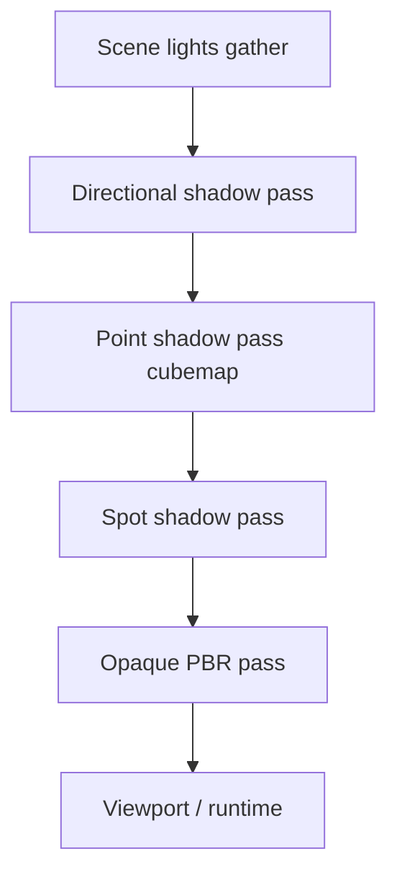

# Shadow Mapping (GPU)

<div class="doc-meta">
  <span class="doc-badge doc-badge--reference">Reference</span>
  <span><strong>Namespace:</strong> `Caffeine::Render`</span>
  <span>Last verified: <time datetime="2026-11-18">2026-11-18</time></span>
  <span>Source: <a href="https://github.com/devscafecommunity/caffeine/blob/main/src/caffeine/render/GpuSceneRenderer.cpp"><code>render/GpuSceneRenderer.cpp</code></a></span>
</div>

<p class="doc-lede">The three GPU shadow passes — directional cascades, point cubemaps and
spot maps — how the shaders sample them, and the editor rule that keeps the samplers bound.</p>

> **Files:** `GpuDirectionalShadowMap.*`, `GpuPointShadowMap.*`, `GpuSpotShadowMap.*`,
> `GpuSceneRenderer.cpp`
> **Shaders:** `shadow_depth.vert` / `shadow_depth.frag`, `scene_lit.frag`, `terrain_lit.frag`

---

## Overview

Dynamic shadows render into separate passes before the main opaque pass. The fragment shader
applies a rotated Poisson PCF (12 taps) to the depth maps; TAA averages the rotation.



---

## Supported lights

| Type | Pass | Limit | Shader sample |
|------|------|-------|---------------|
| Directional | 4096² atlas (4× 2048² cascades in light 0) | 2 | `sampleDirShadow()` — rotated Poisson PCF |
| Point | Depth cubemap, 512² per face | 2 | `samplePointShadow()` |
| Spot | Perspective depth 2D, 1024² | 2 | `sampleSpotShadow()` |

Only lights with `castShadows == true` enter the GPU passes.

---

## SceneShadowUBO

Mirrored in C++ (`GpuSceneRenderer.cpp`) and GLSL (`scene_lit.frag`, `terrain_lit.frag`):

```glsl
// Directional: mat4 light VP × 8 (4 cascades × 2 lights) + cascade splits + flags
// Point: vec4 position × 2, vec4 radius, vec4 valid
// Spot: mat4 light VP × 2, vec4 position × 2, vec4 params × 2, vec4 valid
layout(set = 3, binding = 1) uniform ShadowUBO { ... } shadows;
```

`uDirShadowValid` / `uPointShadowValid` / `uSpotShadowValid` let the shader ignore
unassigned slots.

---

## GpuPointShadowMap

- `setSlot(index, position, radius, isValid)` after rendering the cubemap.
- `clearSlot(index)` when the light stops casting shadows.
- Bound on samplers 4–5 for meshes and 8–9 for terrain.

---

## Editor vs runtime

| Context | Shadow **passes** | Shadow **samplers** bound |
|---------|-------------------|---------------------------|
| Editor scene viewport (`caffeine_session_*`) | ❌ `enableShadows=false` | ✅ always (`bindShadowTextures`) |
| Editor previews | ❌ | ✅ |
| Runtime / play mode | ✅ when `enableShadows=true` | ✅ |

### ⚠️ Safety rule (NVIDIA SIGSEGV)

`enableShadows=false` **skips** `renderDirectionalShadows` / point / spot — do not skip
`bindShadowTextures()`.

The fragment shaders declare shadow samplers even when `uDirShadowValid=0`. Unconnected
slots can cause a **segmentation fault** on the NVIDIA driver.

```cpp
// GpuSceneRenderer::renderMeshes — correct pattern
if (options.enableShadows) {
    renderDirectionalShadows(...);
}
bindShadowTextures(2, 4, 6);  // meshes: dir 2–3, point 4–5, spot 6–7
// terrain pass: bindShadowTextures(6, 8, 10)
```

With the GPU owning the scene, `gatherSceneLighting` with CPU shadow maps does not run for
meshes (`gpuOwnsSceneMeshes`).

---

## CSM (cascaded shadow maps)

- **Directional light slot 0:** up to 4 cascades in a 4096² atlas (2048² each).
- Practical splits (λ=0.5) between `nearClip` and `shadowDistance`.
- `SceneShadowUBO`: `uDirShadowVP[8]`, `uDirCascadeSplits[2]`, `uCameraView`.
- **Light slot 1:** single map (no cascades).

## Spot shadows GPU

- `GpuSpotShadowMap` — up to 2 lamps, 1024², `lightVP` + `cosHalfAngle` (same math as the
  CPU fallback).
- Spot lighting in `scene_lit.frag` / `terrain_lit.frag` with cone + shadow map.

## Next steps (roadmap)

1. **PCSS** — soft shadows in cascades.
2. **CSM in the secondary light** — slot 1 with cascades.
3. **Inter-cascade blending** — reduce seams between cascades.

---

## References

- [`materials-phong.md`](materials-phong.md) — forward pass and sampler tables
- [`../plans/2026-09-21-rendering-roadmap.md`](../plans/2026-09-21-rendering-roadmap.md) — phase P4
- [`../plans/2026-09-22-phong-gpu-handles-session.md`](../plans/2026-09-22-phong-gpu-handles-session.md)
