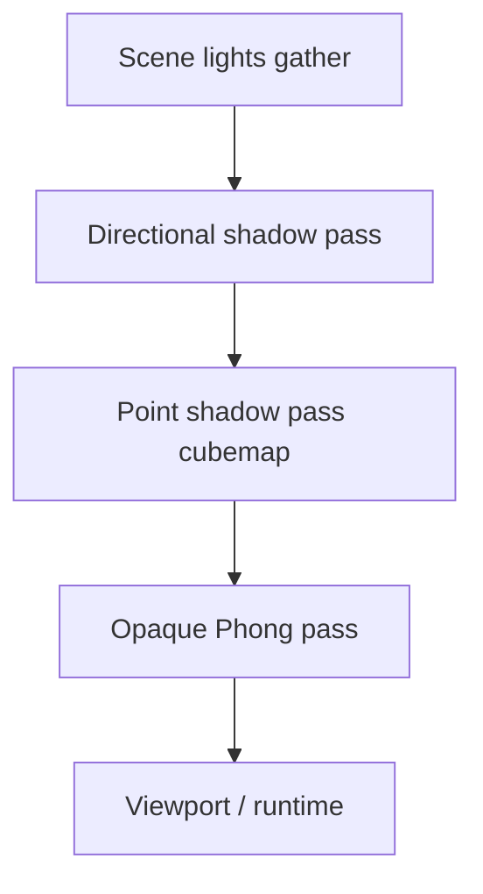

# Shadow Mapping (GPU)

> **Namespace:** `Caffeine::Render` 
> **Ficheiros:** `GpuDirectionalShadowMap.*` , `GpuPointShadowMap.*` , `GpuSceneRenderer.cpp` 
> **Shaders:** `shadow_depth.*` , `scene_lit.frag` , `terrain_lit.frag` 
> ** Status:** 

---

## Overview

Dynamic shadows are rendered into separate passes before the main opaque pass. The fragment shader makes PCF 3×3 on depth maps.



---

## Luzes suportadas

| Tipo | Pass | Limite | Shader sample |
|------|------|--------|---------------|
| Direcional | Atlas 10242 (4×512 cascades in light 0) | 2 | `sampleDirShadowCSM()` PCF 3×3 |
| Pontual | Cubemap depth | 2 | `samplePointShadow()` |
| Spot | Perspective depth 2D | 2 | `sampleSpotShadow()` |

Only lights with `castShadows == true` entram nos passes GPU.

---

## SceneShadowUBO (std140)

Espelhado em C++ ( `GpuSceneRenderer.cpp` ) e GLSL:

```glsl
// Direcional: mat4 view-projection × 2 + flags
// Point: vec3 position × 2, float radius × 2, float valid × 2
```

`uDirShadowValid` / `uPointShadowValid` allow the shader to ignore unassigned slots.

---

## GpuPointShadowMap

- `setSlot(index, position, radius)` after yielding the cubemap.
- `clearSlot(index)` quando a luz deixa de projectar sombra.
- Cubemap on 4–5 (meshes) or 8–9 (land) slots.

---

## Editor vs runtime

| Contexto | Shadow **passes** | Shadow **samplers** ligados |
|----------|-------------------|----------------------------|
| Editor Scene Viewport | ❌ `enableShadows=false` | Always ( `bindShadowTextures` ) |
| Editor previews | ❌ | ✅ |
| Runtime ( `RuntimeSceneRenderer` ) | ✅ quando `enableShadows=true` | ✅ |

### ⚠️ Safety rule (SIGSEGV NVIDIA)

`enableShadows=false` **omite** `renderDirectionalShadows` / point/ spot — do not omit `bindShadowTextures()` .

Os fragment shaders declaram samplers de sombra mesmo quando `uDirShadowValid=0` . Unconnected slots can cause ** segmentation fault** on the NVIDIA driver.

```cpp
// GpuSceneRenderer::renderMeshes — padrão correcto
if (options.enableShadows) {
    renderDirectionalShadows(...);
}
bindShadowTextures(2, 4, 6);  // obrigatório no início do pass opaco
```

Com GPU activo no editor, `gatherSceneLighting` with CPU shadow maps **not**runs to meshes ( `gpuOwnsSceneMeshes` ).

---

## CSM (cascaded shadow maps)

- **Luz direcional slot 0:** 4 cascatas em atlas 1024² (quadrantes 512²).
- Practical splits (λ=0.5) between `nearClip` e `shadowDistance` .
- `SceneShadowUBO` : `uDirShadowVP[8]` , `uDirCascadeSplits[2]` , `uCameraView` .
- * *Light slot 1:**single map (without cascades).

## Spot shadows GPU

- `GpuSpotShadowMap` — up to 2 lamps, 5122, `buildSpotLightVP()` (same math as CPU).
- Spot lighting in `scene_lit.frag` / `terrain_lit.frag` com cone + shadow map.

## Next steps (roadmap P4)

1. **PCSS** — soft shadows in cascades.
2. **CSM in secondary light** — slot 1 with cascades.
3. **Inter-cascade blending** — reduce seams between waterfalls.

---

## References

- [`materials-phong.md`](materials-phong.md)
- [`plans/2026-09-21-rendering-roadmap.md`](../plans/2026-09-21-rendering-roadmap.md) — phase P4
- [`plans/2026-09-22-phong-gpu-handles-session.md`](../plans/2026-09-22-phong-gpu-handles-session.md)
