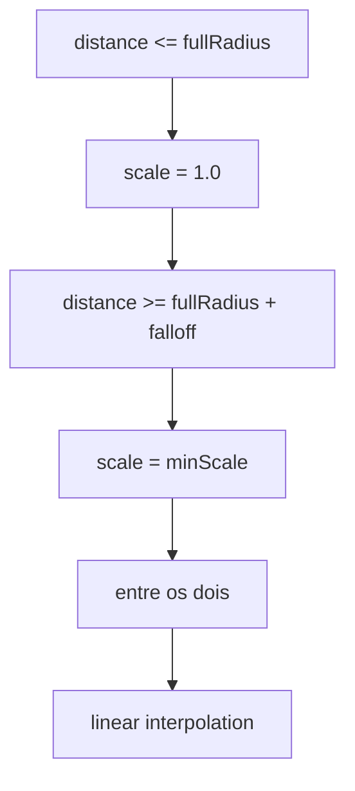
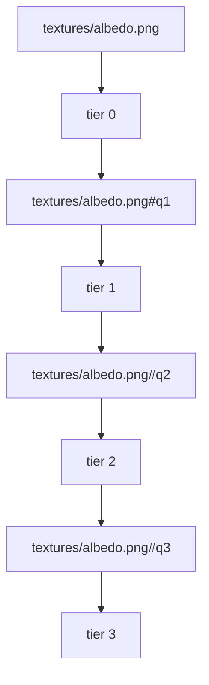

# Texture Quality LOD — Distance to Viewers

<div class="doc-meta">
  <span class="doc-badge doc-badge--reference">Reference</span>
  <span><strong>Namespace:</strong> `Caffeine::Render`</span>
  <span>Last verified: <time datetime="2026-11-18">2026-11-18</time></span>
  <span>Source: <a href="https://github.com/devscafecommunity/caffeine/blob/main/src/caffeine/render/TextureQuality.hpp"><code>render/TextureQuality.hpp</code></a></span>
</div>

<p class="doc-lede">How the renderer picks a smaller GPU texture tier for objects far from
the active camera, and which settings are wired today.</p>

> **Files:** `src/caffeine/render/TextureQuality.hpp`, `GpuTextureCache.hpp` / `.cpp`
> **Status:** implemented (GPU scene renderer, editor and runtime)

---

## Overview

The **texture quality LOD system** lowers the resolution of GPU textures according to the
distance between the object and the active viewers. Textures are not removed — a cache entry
with smaller dimensions is used instead.

Goals:

- Less GPU memory in large scenes
- Less texture bandwidth on distant objects
- Full quality near the camera (editor camera, `Camera3D`, camera preview)

---

## Viewers

The distance used for each draw is the **minimum** between the object position and each
active viewer; with no explicit list, the render camera position is used:

| Context | Viewers |
|---------|---------|
| Scene viewport | Render camera supplied by the caller (`GpuSceneRenderOptions::textureQualityViewers` when set) |
| Camera preview | The preview camera |
| Runtime | The active camera |

```cpp
const f32 dist = distanceToNearestViewer(worldPos, options.textureQualityViewers);
const u32 tier = textureQualityTier(dist, options.textureQuality);
```

---

## Quality curve

Settings live in `TextureQualitySettings`:

| Field | Default | Description |
|-------|---------|-------------|
| `enabled` | `true` | Enables the LOD |
| `fullRadius` | `35.0` m | Within this radius → tier 0 (100%) |
| `falloffDistance` | `100.0` m | Linear decay beyond the radius |
| `minScale` | `0.25` | Minimum scale at the falloff limit (1/4 res) |

### Continuous scale




### Discrete tiers (GPU cache)

| Tier | Approx. scale | Example (1024² source) |
|------|---------------|------------------------|
| 0 | 100% | 1024 × 1024 |
| 1 | 50% | 512 × 512 |
| 2 | 25% | 256 × 256 |
| 3 | 12.5% | 128 × 128 (min. 16 px) |

Thresholds in `textureQualityTier()`: `>= 0.75` → tier 0, `>= 0.375` → tier 1,
`>= 0.1875` → tier 2, otherwise tier 3.

---

## GpuTextureCache

Each tier is a separate cache entry:




### API

```cpp
RHI::Texture* acquire(RHI::RenderDevice* device, const std::string& path,
                      const std::string& projectRoot, u32 qualityTier = 0,
                      bool srgb = false);
RHI::Texture* acquireFromPixels(RHI::RenderDevice* device, const std::string& cacheKey,
                                const u8* pixels, u32 width, u32 height, int channels,
                                u32 qualityTier = 0, bool srgb = false);
```

On upload (`loadTexture`):

1. Decode the original image (tier 0)
2. `downscaleRgba()` halves the buffer once per tier
3. Upload the reduced dimensions and generate mipmaps

`release()` and `invalidate()` walk **every** tier of the path (and both sRGB states);
`releaseAll()` clears the cache on device shutdown.

---

## Integration in render

### GpuSceneRenderOptions

```cpp
struct GpuSceneRenderOptions {
    bool wireframeMeshes = false;
    bool enableShadows   = true;
    TextureQualitySettings textureQuality{};
    std::vector<Vec3>      textureQualityViewers;
};
```

### GpuSceneRenderer

In `gatherMeshDraws()`, each `MeshDraw` receives `viewerDistance` (AABB centre or terrain
chunk centre).

In `resolveMeshAlbedo()` and the terrain splat binding:

```cpp
const u32 tier = textureQualityTier(draw.viewerDistance, options.textureQuality);
auto* tex = GpuTextureCache::instance().acquire(m_device, path, projectRoot, tier, srgb);
```

---

## Settings and limits

`EditorContext` still declares `textureQualityEnabled`, `textureQualityRadius`,
`textureQualityFalloff` and `textureQualityMinScale`, but no settings panel, preferences file
or C ABI call reads them. The renderer therefore runs with the `TextureQualitySettings`
defaults above; a frontend that wants different values has to fill
`GpuSceneRenderOptions::textureQuality` itself.

---

## Flow diagram

```mermaid
flowchart TD
  Viewer_positions["Viewer positions"] --> m[""]
  n[""] --> _["▼"]
  distanceToNearestViewer_meshCenter_["distanceToNearestViewer(meshCenter)"] --> m[""]
  textureQualityTier_distance__settings_["textureQualityTier(distance, settings)"] --> m[""]
  GpuTextureCache__acquire_path__tier_["GpuTextureCache::acquire(path, tier)"] --> m[""]
  n[""] --> __cache_hit["─ cache hit"]
  __cache_hit["─ cache hit"] --> bind_texture_existente["bind existing texture"]
  bind_texture_existente["bind texture existente"] --> __cache_miss["─ cache miss"]
  __cache_miss["─ cache miss"] --> load___downscale___upload_GPU["load + downscale + upload GPU"]
```


---

## Limitations

| Item | Notes |
|------|-------|
| No smooth transition | Tier changes are discrete; there is no blend between resolutions |
| Downscale at load | No separate GPU filter; CPU box filter (`downscaleRgba`) |
| Terrain | Splat layers use the same tier per chunk |
| Normal maps | Follow the same tier as albedo |

---

## See also

- [Scene viewport](../editor/scene-viewport.md) — viewers and `GpuSceneRenderOptions`
- [Session 2026-09-22](../plans/2026-09-22-viewport-rendering-quality-session.md) — complete changelog
- [Asset Manager](../assets/asset-manager.md) — image loading
- [Mesh LOD](mesh-lod.md) — geometry LOD, a separate path
