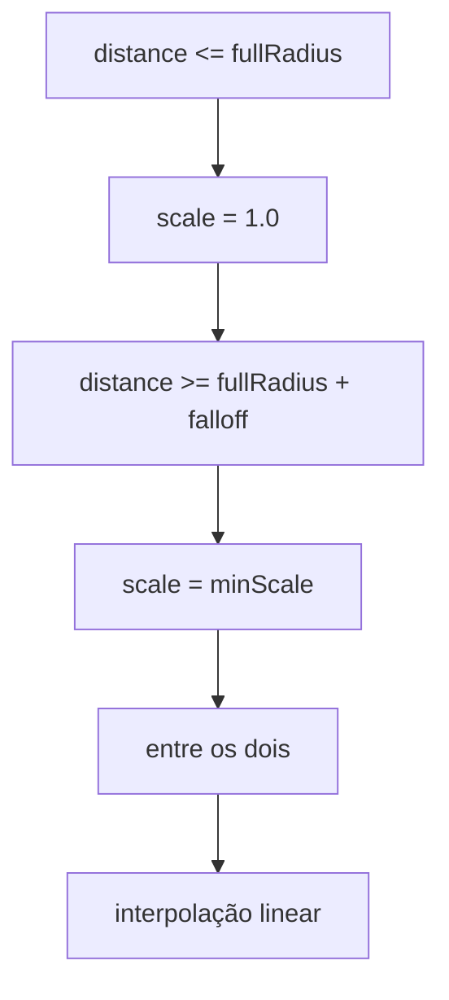
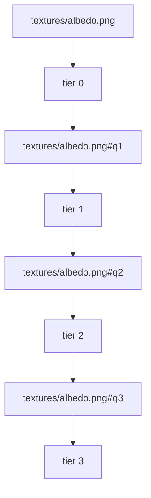

# Texture Quality LOD — Distance to Viewers

> **Namespace:** `Caffeine::Render` 
> **Ficheiros:** `src/render/TextureQuality.hpp` , `src/render/GpuTextureCache.{hpp,cpp}` 
> ** Status:** Implemented (editor + runtime GPU)

---

## Overview

The **texture quality LOD system** reduces the resolution of GPU textures according to the distance between the object and the **viewers**(chambers). The textures ** are not removed** — only cache with smaller dimensions.

Objetivos:

- Less use of GPU memory in big scenes
- Menos banda de textura em objetos distantes
- Total quality near the cameras (editor, `Camera3D` , Camera Preview)

---

## Visualizadores

The distance used for each draw is the **minimum** between the position of the object and each active viewer:

| Contexto | Visualizadores |
|----------|----------------|
| Scene Viewport | Editor camera (orbit) + all entities with `Camera3DComponent` |
| Camera Preview | Only the position of the panel camera |
| Runtime | Camera position active (when `textureQualityViewers` is completed) |

```cpp
f32 dist = distanceToNearestViewer(worldPos, options.textureQualityViewers);
u32 tier = textureQualityTier(dist, options.textureQuality);
```

---

## Curva de qualidade

Settings in `TextureQualitySettings` :

| Campo | Default | Description |
|-------|---------|-----------|
| `enabled` | `true` | Liga/desliga o LOD |
| `fullRadius` | `35.0` m | Within this radius → tier 0 (100%) |
| `falloffDistance` | `100.0` m | Linear decay beyond the radius |
| `minScale` | `0.25` | Minimum scale at falloff limit (1/4 res) |

### Continuous scale




### Tiers discretos (cache GPU)

| Tier | Escala aprox. | Exemplo (1024² base) |
|------|---------------|----------------------|
| 0 | 100% | 1024 × 1024 |
| 1 | 50% | 512 × 512 |
| 2 | 25% | 256 × 256 |
| 3 | 12.5% | 128 × 128 (min. 16 px) |

Limites em `textureQualityTier()` : `>= 0.75` → Tier 0, `>= 0.375` → Tier 1, `>= 0.1875` → Tier 2, otherwise Tier 3.

---

## GpuTextureCache

Each tier is a separate cache entry:




### API

```cpp
GpuTexture* acquire(const std::string& path, u32 qualityTier = 0);
GpuTexture* acquireFromPixels(const std::string& key, const u8* pixels,
                              u32 w, u32 h, u32 qualityTier = 0);
```

No upload ( `loadTexture` ):

1. `stbi_load` original image (tier 0) or memory reuse
2. `downscaleRgba()` com `halveRgbaImage()` for each tier level
3. Upload GPU with reduced dimensions + mipmap generation

`release()` e `invalidate()` limpam **todos** os tiers ( `0 .. kTextureQualityMaxTier` ).

---

## Integration in render

### GpuSceneRenderOptions

```cpp
struct GpuSceneRenderOptions {
    bool wireframeMeshes = false;
    bool enableShadows   = true;
    TextureQualitySettings textureQuality{};
    std::vector<Vec3>      textureQualityViewers;
};
```

### GpuSceneRenderer

Em `gatherMeshDraws()` , cada `MeshDraw` recebe `viewerDistance` (centro do AABB ou chunk de terreno).

Em `resolveMeshAlbedo()` e binding de splat do terreno:

```cpp
const u32 tier = textureQualityTier(draw.viewerDistance, options.textureQuality);
auto* tex = m_textureCache.acquire(path, tier);
```

---

## Editor Settings

**Settings → Viewport → Texture quality**

| JSON Preferences | Campo `EditorContext` |
|------------------|----------------------|
| `texture_quality_enabled` | `textureQualityEnabled` |
| `texture_quality_radius` | `textureQualityRadius` |
| `texture_quality_falloff` | `textureQualityFalloff` |
| `texture_quality_min_scale` | `textureQualityMinScale` |

Persistido em `~/.config/caffeine/editor_preferences.json` .

Ficheiros: `EditorPreferences.{hpp,cpp}` , `SettingsPanel.cpp` , `EditorContext.hpp` .

---

## Diagrama de fluxo

```mermaid
flowchart TD
  Viewer_positions["Viewer positions"] --> m[""]
  n[""] --> _["▼"]
  distanceToNearestViewer_meshCenter_["distanceToNearestViewer(meshCenter)"] --> m[""]
  textureQualityTier_distance__settings_["textureQualityTier(distance, settings)"] --> m[""]
  GpuTextureCache__acquire_path__tier_["GpuTextureCache::acquire(path, tier)"] --> m[""]
  n[""] --> __cache_hit["─ cache hit"]
  __cache_hit["─ cache hit"] --> bind_texture_existente["bind texture existente"]
  bind_texture_existente["bind texture existente"] --> __cache_miss["─ cache miss"]
  __cache_miss["─ cache miss"] --> load___downscale___upload_GPU["load + downscale + upload GPU"]
```


---

## Limitations

| Item | Notas |
|------|-------|
| No smooth transition | Tier exchange is discreet; no blend between resolutions |
| Downscale no load | Do not use separate GPU filters; CPU box filter ( `halveRgbaImage` ) |
| Terreno | Splat layers usam o mesmo tier por chunk |
| Normal maps | Seguem o mesmo tier que o albedo |

---

## See also

- [Scene Viewport](../editor/scene-viewport.md) — viewers and `GpuSceneRenderOptions`
- [Session 2026-09-22](../plans/2026-09-22-viewport-rendering-quality-session.md) — complete changelog
- [Asset Manager](../assets/asset-manager.md) — loading of images
- [Rendering Roadmap] — P1/P2 LOD
