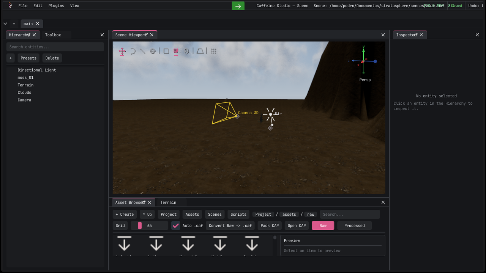

# Terrain System

<div class="doc-meta">
  <span class="doc-badge doc-badge--stable">Stable</span>
  <span><strong>Namespace:</strong> `Caffeine::Terrain`, `Caffeine::ECS::TerrainComponent`</span>
  <span><strong>Files:</strong> `src/caffeine/terrain/`, `src/caffeine/ecs/TerrainComponents.hpp`</span>
  <span>Last verified: <time datetime="2026-11-18">2026-11-18</time></span>
  <span>Source: <a href="https://github.com/devscafecommunity/caffeine/blob/main/src/caffeine/ecs/TerrainComponents.hpp"><code>ecs/TerrainComponents.hpp</code></a></span>
</div>

<p class="doc-lede">The editable heightfield: chunked mesh and LOD, splat painting, coarse
collision, the native Terrain Editor and the <code>.cterrain</code> format.</p>

> **Procedural generation:** the Doppio Terrain Generator (C ABI v8); the legacy
> `terrain_plugin` is documented in [`terrain-plugin.md`](terrain-plugin.md)

---

## Overview

Terrain in Caffeine is an editable **heightfield**: data in `TerrainHeightmap`, rendering via
`TerrainMeshBuilder` + per-chunk LOD, splat painting in `TerrainSplatmap`. The engine **does
not** ship procedural generation in the core. Doppio's **Terrain** tab builds heightfields
with a node graph and places them through the C ABI v8; the legacy `terrain_plugin` remains
for the C++ host.

**Separation of responsibilities:** the Terrain Editor, sculpt/paint tools and `.cterrain` I/O
are native engine features. Procedural generation lives in Doppio's Terrain tab; the
legacy `terrain_plugin` keeps the C++ host version.

| Layer | Responsibility |
|-------|----------------|
| **Core** | Heightmap, mesh, LOD, coarse collision, sculpt/paint, `.cterrain` |
| **Terrain Editor (native)** | Sculpt, splat paint, undo and `.cterrain` import/export |
| **Terrain Generator (Doppio tab)** | Presets, node graph, splat layers, Place in scene |
| **terrain_plugin (legacy)** | Node.js algorithm and heightmap import for the C++ host |

---

## TerrainComponent

```cpp
struct TerrainComponent {
    u32 resolutionX = 257;
    u32 resolutionZ = 257;
    u32 splatResolutionScale = 2;          // splatmap is coarser than the heightmap
    f32 worldSizeX = WorldUnits::kDefaultTerrainSizeM; // metres (1 u = 1 m)
    f32 worldSizeZ = WorldUnits::kDefaultTerrainSizeM;
    f32 maxHeight = WorldUnits::kDefaultTerrainHeightM;

    u32 dataRevision = 1;                  // bumped when heights/splat change
    u32 meshRevision = 0;
    u32 splatRevision = 1;
    bool castShadows = true;
    bool receiveShadows = true;

    char texturePath[256];                 // default ground albedo
    char normalMapPath[256];               // triplanar normal map (GPU)
    f32  textureTileSize = 8.0f;
    f32  shininess = 16.0f;                // legacy; terrain shading has no specular
    Vec3 tint{1.0f, 1.0f, 1.0f};           // multiplies the sampled albedo

    bool useSplatmap = true;
    char splatLayerPaths[4][256];          // Grass, Rock, Sand, Dirt defaults
    f32  splatTileSize = 8.0f;

    bool useChunks = true;
    u32 chunkVertexCount = 33;
    u32 maxLodLevels = 2;
    bool frustumCull = true;
    f32 lodDistanceScale = 520.0f;
    f32 lodHysteresis = 0.25f;

    u32 collisionSampleStep = 4;           // 4 = ~16x fewer triangles
    bool buildCollisionMesh = true;

    char terrainDataPath[256];             // .cterrain path in the project
};
```

The internal heightmap stores **normalised** values `[0, 1]`. In the mesh, `y = sample *
maxHeight`.

---

## Data pipeline

- `TerrainComponent (ECS)`
- `▼`
- `TerrainCache::initializeEntity / syncEntity`
  - `TerrainHeightmap (CPU, editable)`
  - `TerrainSplatmap (4 layers)`
  - `Mesh3D render (TerrainMeshBuilder + tangents)`
  - `Mesh3D collision (TerrainCollisionMeshBuilder, decimated)`
  - `TerrainChunk[] (LOD + frustum cull)`


### TerrainMeshBuilder

- Generates vertices with the heightmap normal (`sampleNormalBilinear`).
- UVs tiled according to `textureTileSize` / `splatTileSize`.
- **Tangents** calculated per triangle (base for normal mapping).

### Collision

`TerrainCollisionMeshBuilder` reuses `buildRegion` with `collisionSampleStep` (for example 4 →
~16× fewer triangles). Access it through `TerrainCache::collisionMeshFor(entity)`.

---

## Editor

| Panel | Function |
|-------|----------|
| **Inspector → Terrain** | Resolution, size, LOD, splat, collision, Normal Map, Shininess |
| **Terrain Editor (native)** | Sculpt (raise/lower/smooth/flatten/noise), splat paint, import/export `.cterrain` |

### Native Terrain Editor

<figure class="doc-figure">
  
  <figcaption>Terrain with natural ground textures</figcaption>
</figure>


Open it from **View → Terrain Editor**, the command palette (**Terrain Editor**),
or the **Open Terrain Editor** button in the Toolbox while a Terrain entity is
selected.

| Tool | Behaviour |
|------|-----------|
| **Raise / Lower** | Adds or removes height with a smooth falloff |
| **Smooth** | Averages the local neighbourhood |
| **Flatten** | Flattens to the height under the first click of the stroke |
| **Noise** | Adds deterministic detail |
| **Splat paint** | Paints Grass, Rock, Sand or Dirt weights |
| **Reset default textures** | Restores the default paths and the Grass layer |
| **Data tab** | Edits the `.cterrain` path and imports/exports the file |

Fast strokes are interpolated between frames instead of stamping only once per
frame. Undo/redo snapshots include the heightmap and splatmap, so **Ctrl+Z**
restores terrain edits instead of resetting the terrain to flat.

New terrains start with the **Grass** layer and natural 1k ground textures
from `assets/hdr-assets-texture` (dirt/rock/moss, rocks, dirt and mud). The
Inspector **Tint** colour multiplies the sampled albedo.

Scenes authored before this default stored an unpainted terrain as the old
**Light** layer. Loading such a `.cterrain` migrates the uniform Light splatmap
to Grass and upgrades the untouched Kenney prototype paths to the natural ground
set automatically.

Procedural generation: panel **Terrain Generator** (plugin). The plugin does not
own sculpting or painting.

---

## GPU rendering

With `CF_HAS_SDL3`, terrain uses `terrain_lit.frag`:

- Lambert diffuse plus sky IBL; the surface is a rough dielectric, with no specular lobe.
- Normal map **triplanar** via the terrain GPU texture cache (sampler slot 5).
- Directional shadows (slots 6–7), point cubemaps (slots 8–9) and spot maps (slots 10–11).
- Splat map on slot 0, the four layers on slots 1–4.
- `castShadows` / `receiveShadows` are read in `GpuSceneRenderer::gatherMeshDraws`.

See [`rendering/materials-phong.md`](../rendering/materials-phong.md) and
[`rendering/shadow-mapping.md`](../rendering/shadow-mapping.md).

---

## Serialization

`SceneSerializer` writes `TerrainComponent` into the scene blob (terrain blob version **11**).
Version 9 added `collisionSampleStep` and `buildCollisionMesh`; version 10 added
`normalMapPath` and `shininess`; version 11 added `tint`. Legacy generation fields (v2–v8) are
read and discarded for compatibility. Heavy height/splat data live in the `.cterrain`
referenced by `terrainDataPath`.

---

## Useful API

```cpp
TerrainCache& cache = TerrainCache::instance();
cache.initializeEntity(world, entity);
cache.heightmapFor(entity)->setNormalized(x, z, h);
cache.syncEntity(world, entity);

Terrain::importHeightmapFile(world, entity, path, worldSizeX, worldSizeZ);
```
