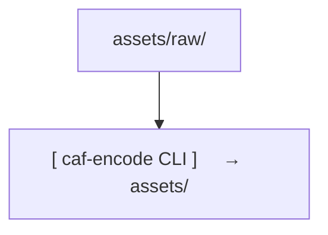

# Asset Pipeline

<div class="doc-meta">
  <span class="doc-badge doc-badge--stable">Stable</span>
  <span><strong>Namespace:</strong> `Caffeine::Tools`</span>
  <span>Last verified: <time datetime="2026-11-18">2026-11-18</time></span>
  <span>Source: <a href="https://github.com/devscafecommunity/caffeine/blob/main/src/caffeine/tools/AssetPipeline.hpp"><code>tools/AssetPipeline.hpp</code></a></span>
</div>

<p class="doc-lede">A ferramenta de linha de comandos <code>caf-encode</code> e os encoders que
transformam PNG, WAV, OBJ e glTF em ficheiros <code>.caf</code>, incluindo o manifesto de
batch.</p>

---

## Visão Geral

A **Asset Pipeline** é a ferramenta de linha de comandos (CLI) que converte assets de origem
(PNG, WAV, OBJ, glTF) para o formato binário `.caf` do engine.

A pipeline corre **fora do runtime** — antes do jogo, durante o build. Pode ser invocada a
partir do CMake como passo de build.



<div class="doc-callout doc-callout--note">
  <p><strong>Estado.</strong> O CMake marca o <code>caf-encode</code> como legado e aponta as
  pipelines novas para a CLI <code>caf-pack</code> (packs <code>.caf</code> /
  <code>.cap</code>). Os encoders abaixo continuam a ser a referência para o formato interno do
  engine e continuam a ser construídos.</p>
</div>

---

## API

Os headers da ferramenta vivem em `src/caffeine/tools/` (`TextureEncoder.hpp`,
`AudioEncoder.hpp`, `MeshEncoder.hpp`, `AssetPipeline.hpp`, `AssetManifest.hpp`).

```cpp
namespace Caffeine::Tools {

struct ConversionResult {
    bool        success = false;
    std::string errorMessage;
    u64         inputBytes  = 0;
    u64         outputBytes = 0;
    f32         compressionRatio = 0.0f;  // outputBytes / inputBytes
};

struct TextureEncodeOptions {
    enum class Format { RGBA8, RGB8, BC1, BC3, BC7 } format = Format::RGBA8;
    bool generateMipmaps = true;
    u32  maxMipLevels    = 0;    // 0 = automático (log2 da maior dimensão)
    bool premultiplyAlpha = false;
    bool flipVertically   = false;
};

struct AudioEncodeOptions {
    enum class Format { PCM16, OGG_VORBIS } format = Format::PCM16;
    u32  targetSampleRate = 44100;
    bool mono             = false;
    f32  normalizeGain    = 0.0f;
};

struct MeshEncodeOptions {
    bool optimizeVertexCache = true;
    bool generateTangents    = true;
    bool compressVertices    = false;
    f32  lodReductionRatio   = 0.0f;
};

class TextureEncoder {
public:
    ConversionResult encode(std::string_view inputPath, std::string_view outputPath,
                            const TextureEncodeOptions& opts = {});
    static ConversionResult encodeRaw(std::string_view outputPath, const u8* pixels,
                                      u32 width, u32 height, u32 channels,
                                      const TextureEncodeOptions& opts = {});
};

class AudioEncoder {
public:
    ConversionResult encode(std::string_view inputPath, std::string_view outputPath,
                            const AudioEncodeOptions& opts = {});
    ConversionResult encodeWav(std::string_view inputPath, std::string_view outputPath,
                               const AudioEncodeOptions& opts = {});
    static ConversionResult encodeRaw(std::string_view outputPath, const i16* samples,
                                      u32 sampleCount, u32 sampleRate, u16 channels,
                                      const AudioEncodeOptions& opts = {});
};

class MeshEncoder {
public:
    ConversionResult encode(std::string_view inputPath, std::string_view outputPath,
                            const MeshEncodeOptions& opts = {});
    ConversionResult encodeObj(std::string_view inputPath, std::string_view outputPath,
                               const MeshEncodeOptions& opts = {});
    ConversionResult encodeGltf(std::string_view inputPath, std::string_view outputPath,
                                const MeshEncodeOptions& opts = {});
};

struct AssetManifestEntry {
    std::string         id;       // nome lógico (sem extensão)
    std::string         path;     // relativo à pasta de saída
    Assets::AssetType   type;
    u64                 sizeBytes = 0;
    u32                 crc32     = 0;
};

class AssetManifest {
public:
    bool load(std::string_view manifestPath);
    bool save(std::string_view manifestPath) const;

    void addEntry(AssetManifestEntry entry);
    void removeEntry(std::string_view id);

    const AssetManifestEntry* find(std::string_view id) const;
    const std::vector<AssetManifestEntry>& entries() const;
    usize entryCount() const;
};

class AssetPipeline {
public:
    struct BatchOptions {
        std::string inputDir;
        std::string outputDir;
        std::string manifestPath;   // vazio = sem manifesto
        bool        forceRebuild    = false;
        bool        verbose         = false;
        u32         threadCount     = 4;
    };

    struct BatchReport {
        u32 converted = 0;
        u32 skipped   = 0;   // sem alterações (mesmo CRC/timestamp)
        u32 errors    = 0;
        std::vector<std::string> errorMessages;
        f64 totalTimeSeconds = 0.0;
        u64 totalInputBytes  = 0;
        u64 totalOutputBytes = 0;
    };

    BatchReport run(const BatchOptions& opts);
};

}  // namespace Caffeine::Tools
```

`threadCount` é aceite mas o ciclo de batch converte actualmente em série.

---

## CLI: caf-encode

```bash
# Uma textura (precisa de pixels: ver encodeRaw abaixo):
caf-encode texture hero.png assets/sprites/hero.caf --mipmaps

# Áudio:
caf-encode audio bgm.wav assets/audio/bgm.caf

# Mesh (OBJ / glTF / GLB):
caf-encode mesh level01.gltf assets/meshes/level01.caf

# Pasta inteira (incremental):
caf-encode batch ./raw/ ./assets/ --manifest assets/manifest.json --jobs 8

# Reconstruir tudo:
caf-encode batch ./raw/ ./assets/ --force-rebuild

# Log detalhado:
caf-encode batch ./raw/ ./assets/ --verbose
```

`caf-encode --help` imprime as opções aceites no build que tens. A conversão de texturas aceita
`--mipmaps` / `--no-mipmaps`; a conversão em batch aceita `--manifest`, `--force-rebuild`,
`--jobs` e `--verbose`.

<div class="doc-callout doc-callout--warning">
  <p><strong>A codificação de texturas está em stub.</strong>
  <code>TextureEncoder::encode(inputPath, …)</code> devolve “stb_image not linked - file-based
  encoding unavailable”; só <code>TextureEncoder::encodeRaw(...)</code>, que recebe pixels já
  descodificados, escreve uma textura. A codificação de áudio (WAV) e de mesh (OBJ/glTF) a
  partir de ficheiro funciona.</p>
</div>

---

## Estrutura de pastas

- `project/`
  - `raw/ ← assets originais (não vão no build)`
    - `sprites/`
      - `hero.png`
      - `enemy.png`
    - `audio/`
      - `bgm.wav`
      - `jump.wav`
    - `meshes/`
      - `level01.gltf`
      - `level01_textures/diffuse.png`
  - `assets/ ← assets convertidos (incluídos no build)`
    - `sprites/hero.caf ← RGBA8 + mipmaps`
    - `audio/bgm.caf ← PCM16`
    - `meshes/level01.caf ← Mesh3D + materiais + texturas embutidas`
    - `manifest.json ← índice de assets`
  - `build.sh / CMakeLists ← invoca caf-encode batch antes do link`


---

## Formato .caf — cabeçalho

```cpp
// Cabeçalho de 32 bytes (especificação completa em assets/caf-format.md):
struct CafHeader {
    u32       magic;         // 0xCAFECAFE
    u16       versionMajor;  // 1
    u16       versionMinor;  // 0
    AssetType type;          // Texture=0, Audio=1, Mesh=2, ...
    u16       flags;         // COMPRESSED=0x01, MIPCHAIN=0x08, ...
    u32       crc32;         // CRC32 do payload
    u64       metadataSize;  // bytes de metadata
    u64       dataSize;      // bytes de payload
};
```

Para a especificação completa, ver [`assets/caf-format.md`](caf-format.md).

---

## Integração com o build (CMake)

```cmake
# CMakeLists.txt — correr a pipeline antes de compilar o jogo:
add_custom_command(
    OUTPUT  ${CMAKE_BINARY_DIR}/assets/manifest.json
    COMMAND caf-encode batch
            ${CMAKE_SOURCE_DIR}/raw/
            ${CMAKE_BINARY_DIR}/assets/
            --manifest ${CMAKE_BINARY_DIR}/assets/manifest.json
            --jobs 4
    DEPENDS ${RAW_ASSET_FILES}
    COMMENT "Converting raw assets to .caf format..."
    VERBATIM
)

add_custom_target(assets DEPENDS ${CMAKE_BINARY_DIR}/assets/manifest.json)
add_dependencies(${GAME_TARGET} assets)
```

---

## Build incremental

```mermaid
flowchart TD
  raw_hero_png["raw/hero.png"] --> CRC__0xABCD1234_____assets_hero_caf_exis["CRC: 0xABCD1234  →  assets/hero.caf existe?"]
  CRC__0xABCD1234_____assets_hero_caf_exis["CRC: 0xABCD1234  →  assets/hero.caf existe?"] --> m[""]
  n[""] --> ___________["┌────┴────┐"]
  ___________["┌────┴────┐"] --> Existe___["Existe  │"]
  Existe___["Existe  │"] --> __________["───┬─────┘"]
  __________["───┬─────┘"] --> m[""]
  n[""] --> CRC_stored____CRC_actual_["CRC stored == CRC actual?"]
  CRC_stored____CRC_actual_["CRC stored == CRC actual?"] --> _["│"]
  _["│"] --> SIM_________NÃO["SIM         NÃO"]
  SIM_________NÃO["SIM         NÃO"] --> _["│"]
  _["│"] --> SKIP_______CONVERTER["SKIP       CONVERTER"]
  SKIP_______CONVERTER["SKIP       CONVERTER"] --> _0__CPU_____TextureEncoder_["(0% CPU)   (TextureEncoder)"]
```


---

## Geração de mipmaps

- `Textura original: 512×512 (RGBA8, 1MB)`
  - `Mip 0: 512×512 (1MB)`
  - `Mip 1: 256×256 (256KB)`
  - `Mip 2: 128×128 (64KB)`
  - `Mip 3: 64×64 (16KB)`
  - `Mip 4: 32×32 (4KB)`
  - `Mip 5: 16×16 (1KB)`
  - `Mip 6: 8×8 (256B)`
  - `Mip 7: 4×4 (64B)`
  - `Mip 8: 2×2 (16B)`
  - `Mip 9: 1×1 (4B)`
- `Total: ~1.33MB (33% de overhead)`
- `Filtragem: downscale box do nível anterior`


---

## Limites actuais

- [ ] O caminho de ficheiro do `caf-encode texture` está em stub (`encodeRaw` funciona com pixels descodificados)
- [x] `caf-encode audio` converte WAV → .caf PCM16
- [x] `caf-encode mesh` converte OBJ e glTF → .caf Mesh3D
- [x] `caf-encode batch` converte uma pasta e escreve um manifesto JSON
- [x] Build incremental: só converte assets alterados
- [ ] O `AssetManager` ainda não lê o manifesto
- [ ] Hot-reload de fontes em bruto (RF6.6) não está ligado à pipeline
- [ ] A saída OGG Vorbis (`AudioEncodeOptions::Format`) está declarada mas não é codificada

---

## Dependências

- **Upstream:**
  - [Asset Manager](asset-manager.md) — formato `CafHeader`, `AssetType`
  - [CAF Format](caf-format.md) — especificação binária do `.caf`
  - [Mesh Loading](mesh-loading.md) — `Vertex3D`, `Mesh3D`, `SubMesh`
  - [Audio System](../audio/audio-system.md) — `AudioClip`, formatos de áudio
- **Downstream:** nenhum — a ferramenta corre antes do runtime

---

## Referências

- [`caf-format.md`](caf-format.md) — formato binário `.caf`
- [`asset-manager.md`](asset-manager.md) — `AssetManager` + `AssetHandle`
- [`mesh-loading.md`](mesh-loading.md) — `Mesh3D` + `Vertex3D`
- [stb image](https://github.com/nothings/stb) — descodificação PNG/JPG/BMP
- [dr_wav](https://github.com/mackron/dr_libs) — descodificação WAV
- [cgltf](https://github.com/jkuhlmann/cgltf) — parser de glTF
- [meshoptimizer](https://github.com/zeux/meshoptimizer) — optimização de vertex cache
- [bc7enc](https://github.com/richgel999/bc7enc) — compressão de textura BC1/BC3/BC7
