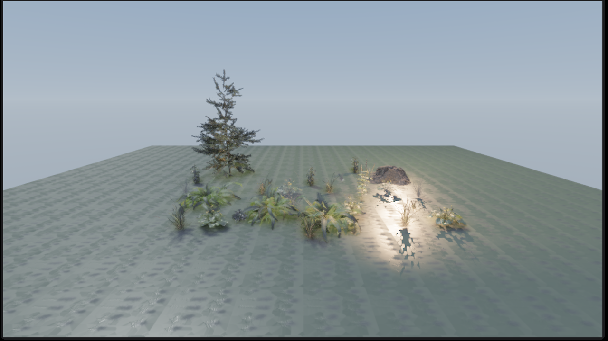
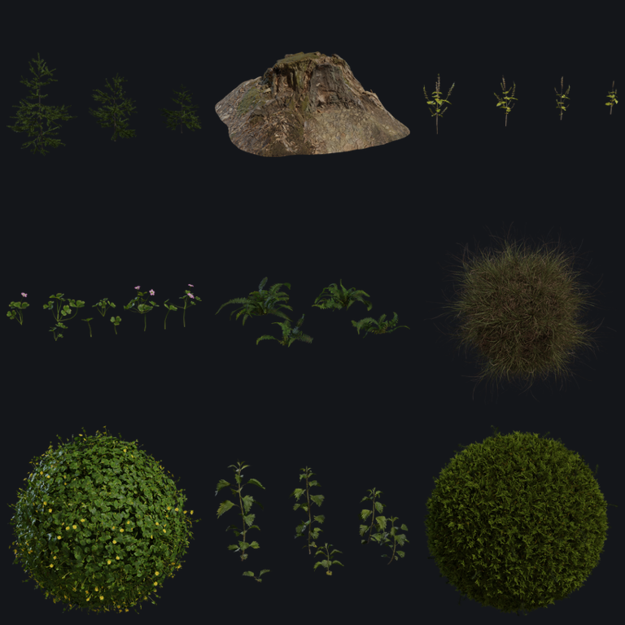

# Kit de Vegetação

<div class="doc-meta">
  <span class="doc-badge doc-badge--reference">Reference</span>
  <span>Last verified: <time datetime="2026-11-18">2026-11-18</time></span>
  <span>Source: <a href="https://github.com/devscafecommunity/caffeine/blob/main/assets/vegetation-kit/manifest.json"><code>assets/vegetation-kit/manifest.json</code></a></span>
</div>

<p class="doc-lede">Um conjunto CC0 de nove assets para testar PBR, folhagem com alpha cutout
e blend, sombras, GI e LOD, mais a cena de demonstração que os liga.</p>

O **Kit de Vegetação** é um conjunto autónomo de nove assets CC0 para testar o
renderer: materiais PBR, folhagem com alpha cutout e alpha blend, sombras, GI do
Photon, AO pré-processada, instancing e LOD automático.

<figure class="doc-figure">
  
  <figcaption>Cena demo do kit de vegetação</figcaption>
</figure>


O kit vive em `assets/vegetation-kit/` no repositório da engine. Todos os modelos
são PBR a 1k e cada material inclui albedo, normal e ARM (AO / roughness /
metallic) usados pela engine.

## Conteúdo

| Asset | Papel | Triângulos | Alpha | Material Caffeine |
|-------|-------|------------|-------|-------------------|
| `fir_sapling` | Árvore | 433 021 | Opaque | `fir_sapling_branches.mat`, `fir_sapling_twigs.mat` |
| `tree_stump_01` | Toco / casca | 41 046 | Opaque | `tree_stump_01.mat` |
| `shrub_03` | Arbusto | 8 287 | Cutout | `shrub_03.mat` |
| `shrub_sorrel_01` | Arbusto rasteiro | 3 319 | Cutout | `shrub_sorrel_01.mat` |
| `fern_02` | Feto | 6 232 | Cutout | `fern_02.mat` |
| `grass_medium_02` | Relva | 7 842 | Blend | `grass_medium_02.mat`, `_cutout.mat` |
| `celandine_01` | Flores | 8 966 | Blend | `celandine_01.mat`, `_cutout.mat` |
| `nettle_plant` | Planta alta | 31 304 | Cutout | `nettle_plant.mat` |
| `moss_01` | Cobertura do solo | 204 | Cutout | `moss_01.mat`, `_blend.mat` |

Um total de **540 221 triângulos** em nove assets, **41,8 MB** com texturas.
Todos os assets são **CC0 1.0** da [Poly Haven](https://polyhaven.com). Os URLs
de origem e autores estão em `manifest.json`; uma lista legível está em
`ATTRIBUTION.txt`.

<figure class="doc-figure">
  
  <figcaption>Miniaturas do kit de vegetação</figcaption>
</figure>


`previews/` contém as miniaturas da Poly Haven usadas nesta página e em asset
browsers.

## Início rápido

Copie o kit para a pasta de assets do projeto:

```bash
cp -r assets/vegetation-kit <projeto>/assets/
```

Os caminhos nos ficheiros `.gltf` e `.mat` são relativos ao projeto
(`assets/vegetation-kit/...`), por isso o kit tem de manter esta estrutura.

### Cena demo

`scenes/vegetation-kit.caf` contém um plano de chão, câmara, sol direcional, uma
point light quente, um componente Photon GI e 29 meshes de vegetação. A point
light existe para testar sombras pontuais e GI local, e a câmara usa o
enquadramento 16:9 da imagem acima.

- **Doppio:** copie o kit para o projeto e abra
  `assets/vegetation-kit/scenes/vegetation-kit.caf`.
- **Runtime:** defina a cena inicial do projeto:

```json
{
  "last_scene": "assets/vegetation-kit/scenes/vegetation-kit.caf"
}
```

e execute `caffeine-runtime --project <projeto>`.

A cena usa uma exposição mais baixa (`PostProcessComponent` exposure 0.9) do que
um projeto por omissão. Se reutilizar os assets numa cena mais clara, ajuste a
exposição em vez das cores dos materiais.

### Usar um asset

1. Arraste um modelo para o viewport, por exemplo
   `assets/vegetation-kit/models/fern_02/fern_02.gltf`.
2. Selecione a entidade e abra **Inspector → Mesh Filter**.
3. Defina **Custom Material** para o `.mat` correspondente, por exemplo
   `assets/vegetation-kit/materials/fern_02.mat`.
4. Ative **Cast Shadows** e **Receive Shadows** conforme necessário.

O caminho PBR completo é o ficheiro `.mat`. O glTF também contém um material de
cor base utilizável, por isso renderiza sem `.mat`; atribuir o `.mat` adiciona o
normal map, o ARM map, o modo alpha e o alpha cutoff.

## O que cada asset testa

| Funcionalidade | Assets | O que observar |
|----------------|--------|----------------|
| PBR opaco | `tree_stump_01`, `fir_sapling` | Grão da casca, detalhe do normal e AO do ARM map |
| Alpha cutout | `fern_02`, `shrub_03`, `shrub_sorrel_01`, `nettle_plant` | Bordas duras, sombras estáveis, sem sorting |
| Alpha blend | `grass_medium_02`, `celandine_01`, variantes blend de `moss_01` | Bordas suaves e superfícies transparentes ordenadas |
| Sombras | Todos + cena demo | Árvore e toco projetam sombra no chão; a point light quente cria sombras locais |
| Photon GI | Environment da cena demo | **View → Photon Global Illumination**; experimente **Debug → GI only** |
| AO pré-processada | `tree_stump_01`, `fern_02`, `shrub_03` | Faça bake no painel Photon e inspecione o novo ORM map |
| Instancing | `grass_medium_02`, `fern_02`, `celandine_01` | Duplique entidades e compare o custo de desenho |
| LOD automático | `fir_sapling` | Fonte com 433k triângulos; o renderer cria LODs clustered médio/longe |
| Multi-material | `fir_sapling` | Dividido em branches + twigs para cada parte usar um material PBR completo |

`fir_sapling` é o asset mais pesado do kit e o melhor teste de stress para o
caminho de LOD. Para uma árvore mais leve, reduza a escala das partes ou use o
toco como controlo PBR opaco.

## Modos alpha

O importador glTF passou a ler `alphaMode` (`OPAQUE`, `MASK`, `BLEND`) e
`alphaCutoff` para `MeshSurfaceMaterial`, e o renderer aplica o modo por
submesh. Assim, uma árvore pode ter tronco opaco e folhas cutout na mesma mesh.

Para este kit:

- **Cutout** é o modo por omissão de fetos, arbustos e das variantes cutout de
  relva/musgo. Escreve profundidade e é o caminho mais barato para folhagem com
  sombras.
- **Blend** é o modo por omissão de relva e celandine, e está disponível como
  `moss_01_blend.mat`. Dá bordas mais suaves, mas exige sorting e não escreve
  profundidade.
- Os PNGs de albedo contêm alpha. A Poly Haven publica diffuse e alpha em
  separado; o kit compõe ambos num albedo RGBA para a mesma textura funcionar na
  engine e em viewers glTF externos.

Se as bordas das folhas cintilarem, aumente ligeiramente `alpha_cutoff` (por
exemplo 0.45 → 0.55) ou use a variante blend. Geometria muito fina pode precisar
de `doubleSided`; os materiais glTF do kit são double-sided e a engine
atualmente desativa back-face culling globalmente.

## Partes da árvore

`fir_sapling` usa dois materiais (branches e twigs), e os materiais custom da
Caffeine aplicam-se à mesh inteira. Por isso o kit inclui dois glTFs
single-material:

- `models/fir_sapling/fir_sapling_branches.gltf` → `fir_sapling_branches.mat`
- `models/fir_sapling/fir_sapling_twigs.gltf` → `fir_sapling_twigs.mat`

Adicione as duas entidades na mesma posição e escala. A cena demo já o faz. O
`fir_sapling.gltf` completo também está presente para viewers ou pipelines que
suportem multi-material diretamente.

## AO pré-processada e GI

A cena demo tem um `PhotonGIComponent` na entidade **Environment**. Use o painel
nativo **Photon** para trocar presets ou inspecionar a vista GI-only.

Para fazer bake de AO estática:

1. Selecione uma mesh custom como **Tree Stump** ou **Fern**.
2. Abra **View → Photon Global Illumination**.
3. Em **Baked ambient occlusion**, escolha resolução/raios e prima
   **Bake selected mesh**.

O baker escreve um PNG ORM nos assets processados do projeto e atualiza o `.mat`
atribuído. Faça bake numa cópia do kit se quiser manter os materiais originais.
Meshes primitivas (o chão da demo) não são bons alvos de bake; use o toco ou uma
planta do kit.

## Checklist

- [x] Mapas PBR albedo, normal e ARM
- [x] Variantes alpha cutout e alpha blend
- [x] Projeção e receção de sombras
- [x] Componente Photon GI na cena demo
- [x] Alvos de AO com UVs únicas
- [x] Meshes repetidas para instancing
- [x] Fonte high-poly para LOD automático
- [x] Árvore multi-material dividida em partes single-material

## Licenciamento

Todos os assets são **CC0 1.0 Universal** (domínio público). A atribuição não é
obrigatória, mas os autores originais estão listados em `ATTRIBUTION.txt` e no
manifesto para proveniência:

- Poly Haven: <https://polyhaven.com>
- CC0 1.0: <https://creativecommons.org/publicdomain/zero/1.0/>

O texto da licença está em `LICENSES/CC0-1.0.txt`.

## Resolução de problemas

| Sintoma | Correção |
|---------|----------|
| Modelo branco ou sem textura | Atribua o `.mat` correspondente; o glTF sozinho só leva cor base |
| Texturas em falta | Mantenha a árvore `assets/vegetation-kit/` completa; `.gltf` e `.mat` usam caminhos relativos |
| Cena lavada / clara demais | Baixe `PostProcessComponent.colorGrading.exposure` ou a intensidade das luzes; a demo usa 0.9 |
| Árvore aparece em duas peças | Adicione `fir_sapling_branches.gltf` e `fir_sapling_twigs.gltf` com o mesmo transform |
| Bordas das folhas duras | Aumente `alpha_cutoff` ou use a variante `_blend` |
| Tiling do chão demasiado visível | Edite `uv_tiling` em `materials/ground.mat` (a demo usa 20×20) |
| Planta mostra um esqueleto amarelo | O componente Skeleton está presente. Remova-o, ou mantenha-o apenas se usou **Fit humanoid rig** de propósito. Novos imports já não recebem um rig automaticamente. |
| LOD faz popping | Esperado; ajuste a escala de distância de LOD ou use as plantas de menor poligonagem |

## Relacionado

- [Mesh loading](mesh-loading.md)
- [Asset pipeline](asset-pipeline.md)
- [Photon GI](../editor/photon.md)
