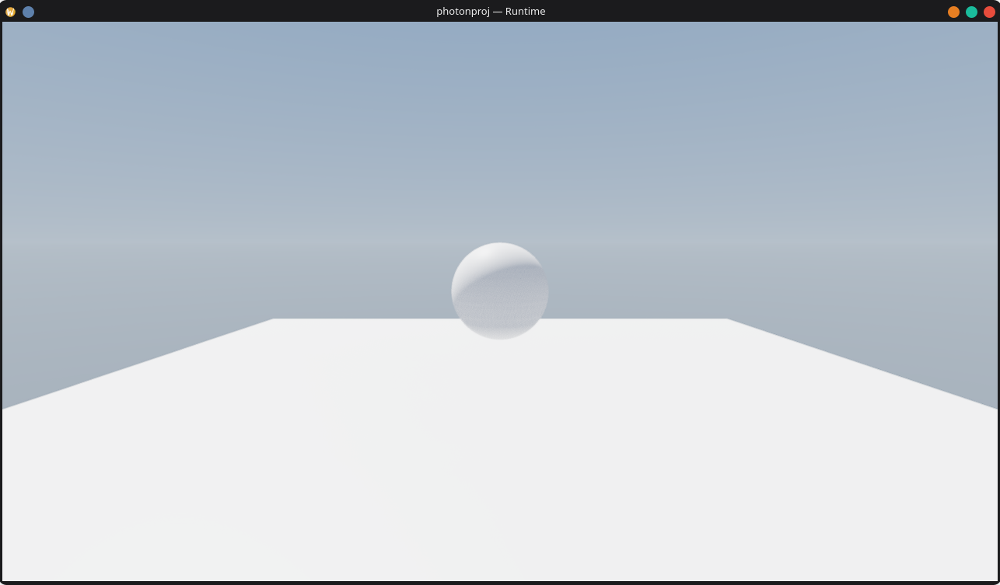

# Photon — GI híbrido nativo por radiance cascades

O Photon é um **sistema nativo do Doppio e do runtime**: é compilado nos binários do
editor e do runtime, não é carregado como plugin. Fornece iluminação global em tempo
real sem hardware de ray tracing.

## Âmbito v0.1

| Spec Photon | Estado v0.1 |
|-------------|-------------|
| Near field ancorado ao ecrã | **Implementado**: K intervalos exponenciais traçados contra o depth buffer |
| Merge de intervalos | **Implementado**: acumulação de radiance front-to-back |
| Far field | **Aproximado**: fallback de céu + ambiente quando o raio sai do ecrã |
| Campo de probes world-anchored | Ainda não |
| Feedback multi-bounce | Ainda não |
| Passe de reflexos glossy | Ainda não |
| Denoiser temporal | Fornecido pelo TAA da engine: o Photon corre antes dele |

A especificação completa é o alvo. Esta fatia nativa está marcada como v0.1 onde
difere do design de referência.

## Presets

| Preset | Qualidade | Cascatas | Raio |
|--------|-----------|----------|------|
| **Performance** | Low | 3 | 10 m |
| **Balanced** | Medium | 4 | 14 m |
| **High** | High | 5 | 22 m |
| **Cinematic** | High | 6 | 32 m |

## Parâmetros

| Parâmetro | Significado |
|-----------|-------------|
| **Intensity** | Multiplicador de luz indireta |
| **Cascades** | Número de intervalos de distância |
| **Radius** | Alcance do near field em unidades de mundo |
| **Thickness** | Tolerância de profundidade para aceitar um hit |
| **Sky intensity** | Fallback quando um raio sai do ecrã |
| **Ambient** | Termo de bounce constante |
| **Tint RGB** | Aproximação de albedo aplicada à radiance recolhida |
| **Debug** | Cena iluminada, só GI, ou só fallback |

## Utilização

1. Abra uma cena com Camera 3D e geometria.
2. Abra **View → Photon Global Illumination**, ou execute **Photon GI** na command
   palette.
3. Prima **Create Photon GI** se a cena ainda não tiver o componente.
4. Escolha um preset e ajuste radius/thickness à escala da cena.
5. Use **Debug → GI only** para inspecionar o resultado das cascatas.

O componente é `ECS::PhotonGIComponent`; o Inspector também tem um drawer completo.

## Oclusão de ambiente pré-processada (sem RTX)

A secção nativa **Baked ambient occlusion** pré-calcula AO estática para o material
do mesh selecionado:

1. Selecione uma entidade com mesh estática (ou use **Bake scene**).
2. Escolha resolução (256/512/1024), raios, distância máxima e bias.
3. Prima **Bake selected mesh**.

O baker usa **compute na GPU** quando o render device expõe compute e recorre ao BVH
CPU caso contrário. A CPU só rasteriza UVs e constrói a lista de triângulos; os testes
de raio pesados correm na GPU. Cenas com mais de 8192 triângulos usam o caminho CPU.

O baker:

- recolhe todos os triângulos estáticos da cena como oclusores,
- rasteriza o mesh alvo em espaço UV,
- lança raios com peso cosseno,
- escreve um **PNG ORM** com AO no R (roughness/metallic preservados em G/B),
- atualiza `orm_map` e `ao_strength` do material.

O shader da engine já usa ORM.R como oclusão de ambiente, por isso o resultado é
aplicado **sem hardware de ray tracing** e sem ruído de screen-space. Refaça o bake
depois de alterar geometria estática.

> O AO pré-processado é para meshes estáticas. Objetos em movimento devem continuar
> a usar o passe screen-space do Photon. Meshes com UVs sobrepostas fazem média das
> faces; use UVs únicas para AO por face.

## Resolução de problemas do bake

| Mensagem | Causa / correção |
|----------|------------------|
| **Select a mesh entity in the Hierarchy** | O bake usa uma mesh (`MeshFilterComponent`). Selecione uma entidade com mesh, não o environment ou uma luz. |
| **Selected entity has no mesh** | A entidade não tem `MeshFilterComponent` ou o caminho da mesh custom é inválido. |
| **Mesh has no usable UV coverage** | A mesh não tem UVs ou todas são degeneradas. Faça unwrap antes do bake. |
| **Could not read material** | `customMaterialPath` aponta para um `.mat` inexistente ou inválido. Corrija o caminho ou limpe-o para o baker criar um novo material. |
| **Bake scene: N failed** | Veja o estado/log; a primeira entidade falhada e o motivo são mostrados. As restantes são assadas normalmente. |
| **GPU compute unavailable** | O device não expõe compute; o baker usa automaticamente o BVH CPU. |
| **ORM gerado mas o viewport não muda** | O material tem de estar atribuído à mesh e o caminho ORM tem de resolver dentro do projeto. Volte a selecionar a entidade ou recarregue o material. |

O bake é enfileirado pelo painel e executado **entre frames** (depois de o frame do
editor ser submetido). Assim o command buffer da GPU fica independente do frame em
curso.

## Performance

- Low: 4 raios × 2 passos por intervalo
- Medium: 8 raios × 2 passos
- High: 12 raios × 3 passos

O Photon corre **antes do TAA**, por isso o resolve temporal limpa o padrão
estocástico. Comece em Balanced para edição e use High/Cinematic para capturas.

## Limitações

- Sem campo de probes world-anchored: a luz fora do ecrã usa um fallback constante
  de céu + ambiente.
- Bounce único: a irradiância indireta do frame anterior ainda não é realimentada.
- Oclusão em screen-space pode vazar em geometria fina; aumente **Thickness** ou
  reduza **Radius**.
- Reflexos glossy não fazem parte da v0.1.

## Relacionado

- [Scene viewport](scene-viewport.md)
- [Workspace e tema](workspace-and-theme.md)
- [Catálogo de plugins](../plugins/README.md)
