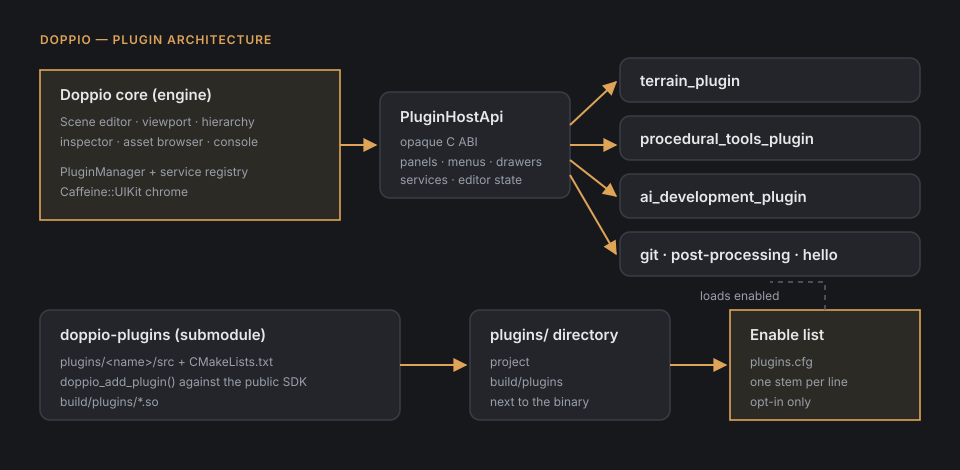
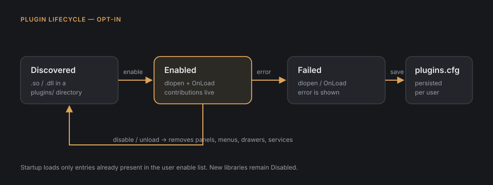

# Plugin Manager e carregamento opt-in

O Doppio é distribuído **sem** plugins de funcionalidades embutidos. O core do
editor não compila, copia nem pré-carrega plugins de terreno, procedural, Git,
pós-processamento ou IA. Expõe apenas o host de plugins (`PluginManager` +
`PluginServiceRegistry`).





## Onde vivem os plugins

O código-fonte dos plugins é mantido no repositório separado
[doppio-plugins](https://github.com/devscafecommunity/doppio-plugins), adicionado à
engine como submódulo:

```bash
./scripts/submodules.sh
```

Compile-os contra o SDK da engine:

```bash
cmake -S doppio-plugins -B doppio-plugins/build \
  -DCAFFEINE_ROOT=/caminho/para/caffeine \
  -DIMGUI_DIR=/caminho/para/caffeine/build/_deps/imgui-src
cmake --build doppio-plugins/build
```

Os artefactos ficam em `doppio-plugins/build/plugins/*.so`.

## Instalação

Copie as bibliotecas para qualquer diretório de plugins descoberto:

| Âmbito | Diretório |
|--------|-----------|
| Projeto | `<projeto>/plugins/` |
| Build do Doppio | `<caffeine>/build/plugins/` |
| Junto ao binário | `<dir-do-doppio>/plugins/` |

## Ativar apenas o necessário

Abra **Plugins → Plugin Manager**. As bibliotecas descobertas começam **desativadas**:

- Ativar **Enabled** carrega a biblioteca imediatamente e chama `OnLoad()`.
- Descarregar remove painéis, ações de menu, drawers de componentes e serviços.
- A escolha é persistida em `~/.config/caffeine/plugins.cfg` (ou
  `$XDG_CONFIG_HOME/caffeine/plugins.cfg`).

Nada é carregado no arranque a não ser que conste nessa lista. Uma biblioteca
copiada mais tarde para a pasta fica desativada até ser ativada.

## Porque isto importa

| Antes | Agora |
|-------|-------|
| Plugins compilados dentro do CMake da engine | Compilados a partir de `doppio-plugins` contra o SDK público |
| Todos os `.so` carregados no arranque | Só carregam plugins ativados pelo utilizador |
| Core referenciava identificadores de plugins | Core expõe apenas serviços genéricos |
| UI dos plugins acoplada ao Doppio | UI usa `Caffeine::UIKit` e callbacks opacos do host |

## Resolução de problemas

- **Plugin aparece mas não carrega:** verifique a coluna de estado para o erro de
  `dlopen`. No Linux o plugin tem de ser compilado com a mesma ABI do Doppio.
- **O painel desapareceu ao desativar:** o unload remove intencionalmente todas as
  contribuições. Reative para voltar a registá-las.
- **Quer um plugin ativo por omissão numa equipa:** distribua um `plugins.cfg` e
  copie-o para a config do utilizador; o formato é um stem de biblioteca por linha.
