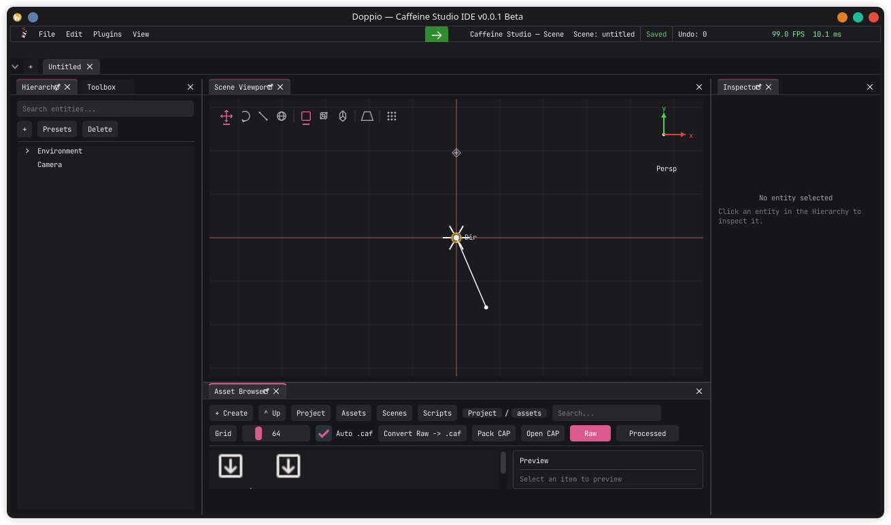
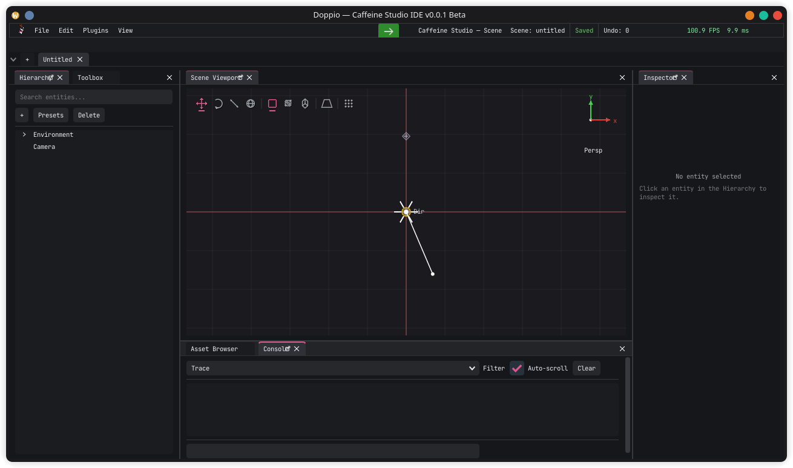

# Galeria da interface do editor

O Doppio usa a biblioteca partilhada **Caffeine::UIKit** para todo o chrome do
editor. Painéis, docking, toolbars e temas ficam consistentes entre o editor e as
janelas dos plugins.


O diálogo de arranque cria ou reabre um projeto. Os templates pré-configuram
projetos 2D ou 3D; **Empty** começa com uma cena vazia.

## Layout do editor



O workspace por omissão está dividido em quatro regiões:

| Região | Painéis por omissão |
|--------|---------------------|
| Esquerda | Hierarchy, Toolbox |
| Centro | Scene Viewport |
| Direita | Inspector |
| Baixo | Asset Browser, Console |

Cada painel é registado por um id estável no `UIKit::PanelRegistry`. A árvore de
docking vive em `assets/ui/workspace.json`, a paleta em `assets/ui/theme.json`, e
ambos podem ser recarregados em runtime sem reiniciar o Doppio.

## Viewport da cena



A toolbar do viewport é deliberadamente **só com ícones e sem fundo**, para flutuar
sobre a imagem renderizada. As ferramentas estão agrupadas em:

1. Seleção e transformação (select, mover, rodar, escalar).
2. Modos de vista (2D, 3D, isométrico) e projeção (perspetiva / ortográfica).
3. Toggles de visualização (grelha, gizmos, iluminação).

O navigation gizmo no canto superior direito também alterna entre projeção
perspetiva e ortográfica. **Isométrico** é uma vista 3D de primeira classe: fixa os
ângulos de câmara em 45° / 35.264° e ativa projeção ortográfica. A mesma matriz
view-projection é usada pelo renderer GPU, picking CPU, overlays e grelha.

## Tema e densidade

- Paleta grafite neutra com um único acento quente.
- Overline de acento nas tabs ativas, separadores subtis, sem bordas pesadas.
- Controlos compactos e property grids deixam o viewport dominante.
- Paleta clara e overrides do utilizador são suportados por `theme.json`.

## Capturar screenshots

As imagens acima são geradas a partir do próprio repositório:

```bash
python3 scripts/capture_doppio_ui.py
```

A lista de shots está em [`caffeine-website/captures/shots.json`](https://github.com/devscafecommunity/caffeine-website/blob/main/captures/shots.json)
e as imagens ficam em `caffeine-website/content/pt/docs/images/captures/`.
