# Referência da UI do Doppio

Gerado por `cargo test -p doppio-ui capture_ui_gallery -- --ignored`. As descrições vivem em `doppio/docs/ui-captions.json`.

## `editor.toolbar.undo`

Desfaz o último passo do editor.

## `editor.toolbar.redo`

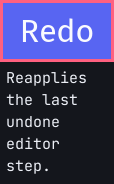

Refaz o último passo desfeito.

## `editor.toolbar.add_entity`

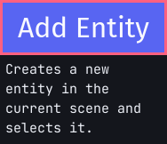

Cria uma entidade nova na cena atual e seleciona-a.

## `editor.toolbar.toggle_play`

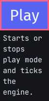

Inicia ou para o modo de jogo e avança o motor.

## `editor.toolbar.save`

Guarda a cena .caf atual e limpa o marcador de alterações.

## `editor.toolbar.render`

Pede um render offscreen do viewport.

## `editor.toolbar.log`

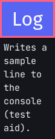

Escreve uma linha de exemplo no console (auxiliar de testes).

## `editor.pane.hierarchy`

Hierarquia da cena: lista as entidades e permite selecionar.

## `editor.pane.assets`

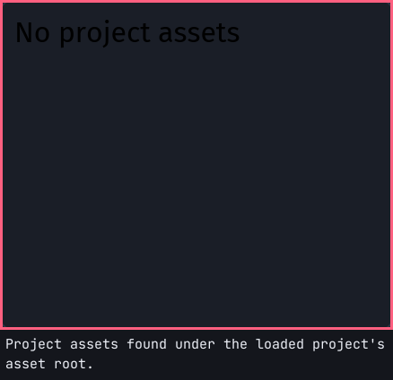

Assets do projeto encontrados na raiz de assets carregada.

## `editor.pane.viewport`

Render do motor para a cena atual, com controlos de câmara.

## `editor.pane.inspector`

Transformação e ações da entidade selecionada.

## `editor.pane.console`

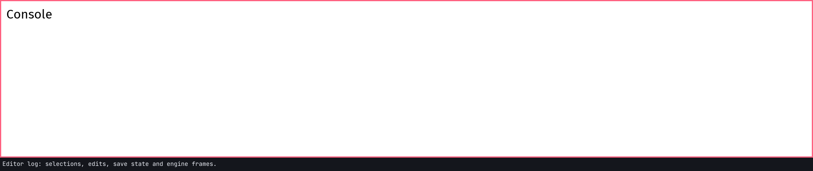

Registo do editor: seleções, edições, gravação e frames.

## `viewport.canvas.surface`

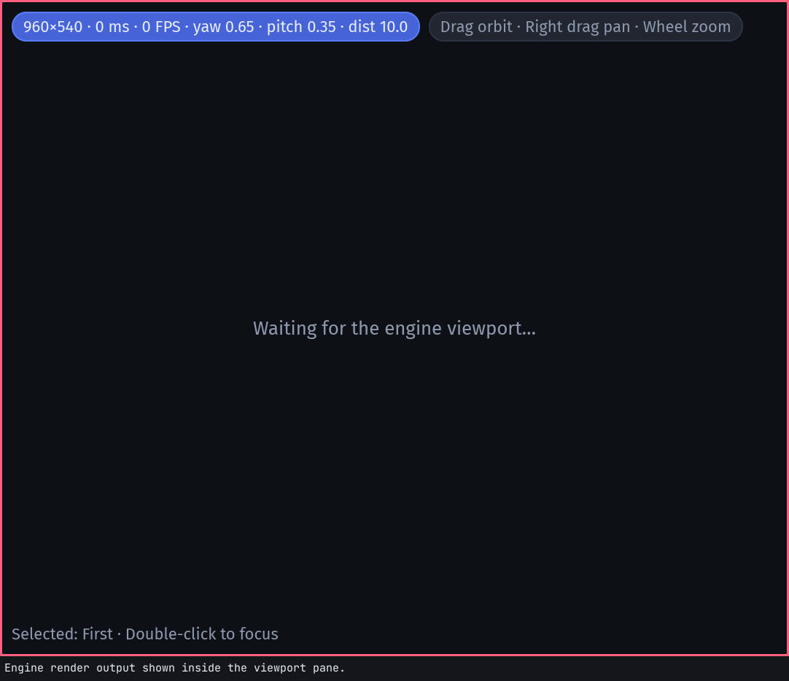

Imagem do motor apresentada dentro do painel de viewport.

## `viewport.camera.orbit_left`

Roda a câmara do viewport para a esquerda.

## `viewport.camera.orbit_right`

Roda a câmara do viewport para a direita.

## `viewport.camera.zoom_in`

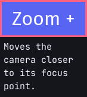

Aproxima a câmara do ponto de foco.

## `viewport.camera.zoom_out`

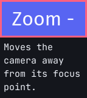

Afasta a câmara do ponto de foco.

## `viewport.camera.reset`

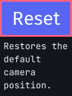

Repõe a posição de câmara predefinida.

## `inspector.entity.name`

Nome editável da entidade selecionada; chega ao motor.

## `inspector.entity.delete`

Destrói a entidade selecionada no mundo do motor.

## `inspector.add_component`

Adiciona um componente à entidade selecionada.

## `hierarchy.list.entity_row.0`

A row in the hierarchy list; rows use the .N suffix.

## `hierarchy.list.entity_row.1`

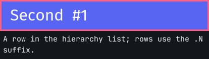

A row in the hierarchy list; rows use the .N suffix.

## `annotated.inspector`

Controlos do inspector, numerados para documentação.

