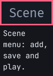
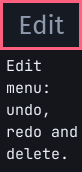
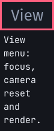
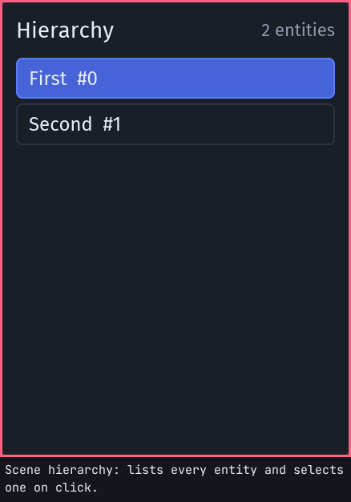
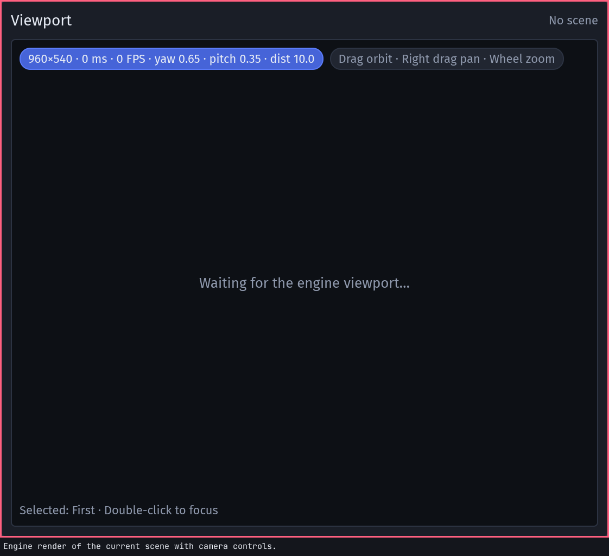
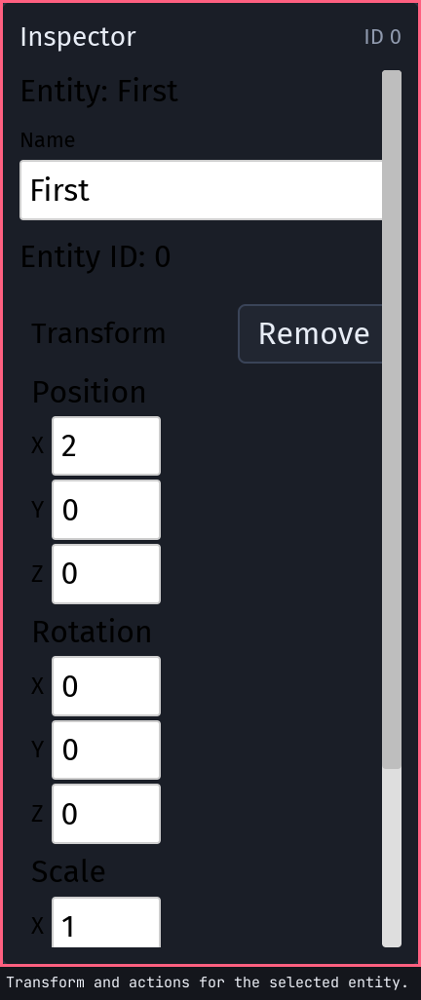
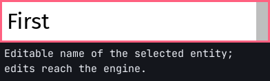
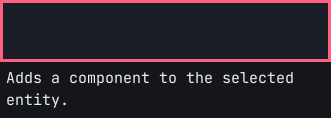
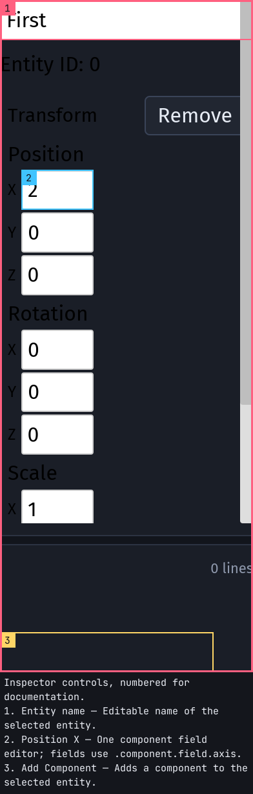

# Referência da UI do Doppio

Gerado por `cargo test -p doppio-ui capture_ui_gallery -- --ignored`. As descrições vivem em `doppio/docs/ui-captions.json`.

## `editor.menu.scene`

Menu Cena: adicionar, guardar e jogar.

## `editor.menu.edit`

Menu Editar: desfazer, refazer e apagar.

## `editor.menu.view`

Menu Ver: focar, repor câmara e renderizar.

## `editor.pane.hierarchy`

Hierarquia da cena: lista as entidades e permite selecionar.

## `editor.pane.assets`

Assets do projeto encontrados na raiz de assets carregada.

## `editor.pane.viewport`

Render do motor para a cena atual, com controlos de câmara.

## `editor.pane.inspector`

Transformação e ações da entidade selecionada.

## `editor.pane.console`

Registo do editor: seleções, edições, gravação e frames.

## `viewport.canvas.surface`

Imagem do motor apresentada dentro do painel de viewport.

## `inspector.entity.name`

Nome editável da entidade selecionada; chega ao motor.

## `inspector.add_component`

Adiciona um componente à entidade selecionada.

## `hierarchy.list.entity_row.0`

A row in the hierarchy list; rows use the .N suffix.

## `hierarchy.list.entity_row.1`

A row in the hierarchy list; rows use the .N suffix.

## `annotated.inspector`

Controlos do inspector, numerados para documentação.

