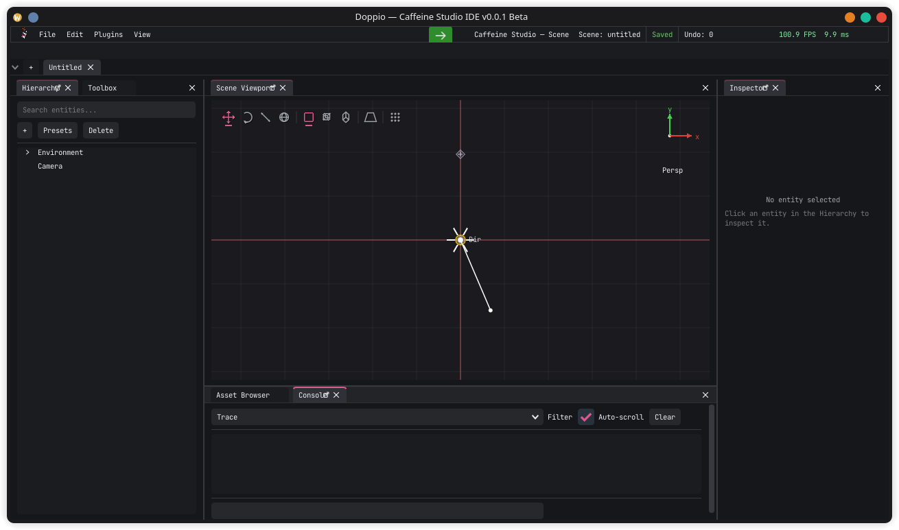

# Toolbar do viewport, projeção e vista isométrica

O viewport da cena tem uma toolbar compacta que flutua sobre a imagem renderizada.
É **só de ícones e sem fundo**, para nunca tapar a cena com uma barra de chrome.



## Grupos de ferramentas

| Grupo | Ferramentas |
|-------|-------------|
| **Seleção / transformação** | Select, mover, rodar, escalar |
| **Modo de vista** | 2D, 3D, Isométrico |
| **Projeção** | Perspetiva, Ortográfica |
| **Visualização** | Grelha, gizmos, overlays de iluminação |

Cada ícone tem tooltip. A ferramenta ativa usa a cor de acento e um sublinhado curto;
não há fundo preenchido.

## Projeção

A projeção é estado real do editor, não uma label:

```cpp
enum class ViewProjection { Perspective, Orthographic };
ViewProjection projection = ViewProjection::Perspective;
```

Vive em `EditorContext::projection`. A **mesma matriz view-projection** é usada por:

- o renderer GPU da cena,
- picking CPU (seleção e raycasts de gizmos),
- overlays, gizmos e helpers de luz,
- a grelha do editor.

Mudar de projeção muda o que vê e o que consegue clicar, sem desvio entre os dois.

A meia-altura ortográfica é derivada da distância da câmara e do FOV da perspetiva,
para o zoom manter aproximadamente o mesmo enquadramento ao alternar.

## Isométrico

**Isométrico** é um modo de vista 3D de primeira classe, não um truque de projeção 2D:

- yaw da câmara = `45°` (`0.7853982 rad`),
- pitch da câmara = `35.264°` (`0.6154797 rad`),
- projeção = **Ortográfica**,
- grelha e overlays usam a mesma matriz 3D.

Isto dá a vista clássica de jogo estilo 2:1 mantendo edição 3D completa, picking e
gizmos.

## Navegação

| Input | Ação |
|-------|------|
| Arrastar botão direito | Orbitar (3D / isométrico) |
| Arrastar botão do meio | Pan |
| Roda | Zoom |
| Arrastar direito na horizontal | Yaw em isométrico |
| F | Enquadrar seleção |
| Duplo clique numa entidade | Focar câmara |

## Labels de estado

O navigation gizmo no canto superior direito mostra a projeção atual (**Persp** /
**Ortho**) e permite alterná-la diretamente. O viewport mantém o modo de vista
selecionado visível na toolbar.

## Notas de implementação

- `SceneViewport::computeVP3D` constrói a matriz partilhada.
- `GpuSceneRenderer` aceita `GpuSceneRenderOptions::orthographic`.
- As funções de picking usam a mesma `Mat4` do renderer.
- `is3DViewMode()` trata `Mode3D` e `Isometric` de forma idêntica nos caminhos de
  runtime.

## Relacionado

- [Scene viewport](scene-viewport.md) para o pipeline de render.
- [Workspace e tema](workspace-and-theme.md) para a UI em volta.
