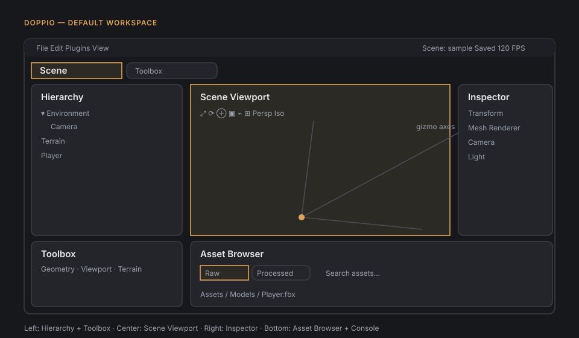

# Workspace, tema e UI kit

O chrome do editor Doppio é construído com **Caffeine::UIKit**, uma pequena
biblioteca de UI immediate-mode nos headers públicos (`include/caffeine/ui/`). O mesmo
vocabulário é usado pelos painéis nativos e pelos painéis de plugins, mantendo o
editor visualmente consistente mesmo quando funcionalidades saem do core.



## Camadas

| Camada | Header | Responsabilidade |
|--------|--------|------------------|
| **Theme** | `caffeine/ui/Theme.hpp` | Paleta, métricas, espaçamento, tipografia |
| **Widgets** | `caffeine/ui/Widgets.hpp` | Botões, property grids, section headers, empty states |
| **Icons** | `caffeine/ui/Icons.hpp` | Glifos vetoriais de toolbars e títulos |
| **PanelRegistry** | `caffeine/ui/PanelRegistry.hpp` | Ids estáveis, categorias, visibilidade |
| **Workspace** | `caffeine/ui/Workspace.hpp` | Layout JSON de docking, persistência, hot reload |

A biblioteca não depende de internals do Doppio. Os plugins incluem
`caffeine/plugin/PluginUI.hpp` e desenham os painéis com os mesmos widgets.

## Tema

`assets/ui/theme.json` guarda a paleta e métricas:

```json
{
  "name": "Graphite",
  "accent": "#e0a458",
  "background": "#17181c",
  "panel": "#23252b",
  "text": "#e8e8ea",
  "textMuted": "#9aa0aa",
  "rounding": 6,
  "spacing": 8
}
```

- Paleta grafite escura com um único acento quente.
- Tabs ativas recebem uma overline de acento em vez de fill pesado.
- Separadores de docking subtis; bordas só quando têm significado.
- Paleta clara incluída; overrides do utilizador são merged no load.

O ficheiro é observado em runtime: guarde-o e o editor reaplica a paleta sem
reiniciar.

## Layout do workspace

`assets/ui/workspace.json` descreve a árvore de docks:

```json
{
  "version": 1,
  "docks": {
    "left":   { "size": 0.20, "panels": ["editor.hierarchy", "editor.toolbox"] },
    "center": { "panels": ["editor.viewport"] },
    "right":  { "size": 0.22, "panels": ["editor.inspector"] },
    "bottom": { "size": 0.26, "panels": ["editor.assets", "editor.console"] }
  }
}
```

Regras:

1. O **layout do utilizador** ganha se existir (`~/.config/caffeine/ui/workspace.json`).
2. Caso contrário, carrega o **layout do projeto** (`<projeto>/ui/workspace.json`).
3. Caso contrário, usa o **default embutido** (`assets/ui/workspace.json`).

Edições do utilizador são escritas apenas na config por utilizador; a árvore de
assets nunca é modificada. Use **View → Save UI layout** e **View → Reset UI layout**.

## Painéis

Cada painel regista um id estável, categoria e dock por omissão:

```cpp
UIKit::PanelDesc desc;
desc.id = "editor.inspector";
desc.title = "Inspector";
desc.icon = "inspect";
desc.category = "Scene";
desc.dock = UIKit::DockArea::Right;
desc.size = 0.22f;
desc.defaultOpen = true;
UIKit::PanelRegistry::instance().add(std::move(desc));
```

O registo é idempotente: um plugin pode voltar a registar após hot reload sem
duplicar tabs nem repor o dock do utilizador.

## UI de plugins

Os painéis de plugins não recebem `EditorContext*`. O host expõe callbacks opacos via
`PluginHostApi`, e os helpers públicos de `PluginUI.hpp` embrulham-nos:

```cpp
#include "caffeine/plugin/PluginUI.hpp"

void renderPanel(void* userData) {
    using namespace Caffeine::UIKit;
    PanelHeader("My Tool", "Short description", "settings");
    if (Section("Options")) {
        // property grid, buttons, fields…
    }
    if (PrimaryButton("Apply")) { /* host callback */ }
}
```

Isto mantém a ABI dos plugins estável sem retirar o vocabulário de widgets do editor.

## Validação

- `CaffeineTest "[ui]"` cobre tokens de tema, widgets, panel registry e persistência
  do workspace.
- `audit-plugin-coupling` verifica que os plugins não incluem internals do editor.

## Relacionado

- [Galeria da UI](ui-gallery.md) para screenshots.
- [Scene viewport](scene-viewport.md) e [toolbar do viewport](viewport-toolbar.md).
- [Plugin SDK](plugin-sdk.md) e [Plugin Manager](plugin-manager.md).
