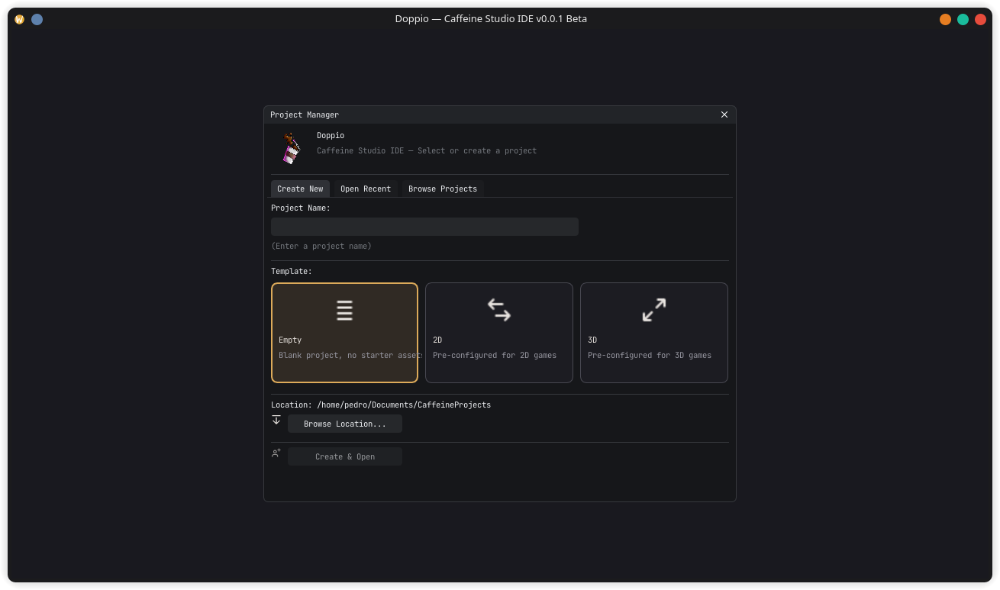

# Começar

Esta secção cobre o caminho mais curto desde um clone novo até uma sessão do
Doppio a correr, mais a automação de build por plataforma.



## Caminho recomendado

1. **Clonar com submódulos**

   ```bash
   git clone --recurse-submodules git@github.com:devscafecommunity/caffeine.git
   cd caffeine
   ```

2. **Configurar e compilar**

   ```bash
   cmake -S . -B build -DCMAKE_BUILD_TYPE=Release
   cmake --build build -j
   ```

3. **Executar o Doppio**

   ```bash
   ./build/doppio
   ```

4. **Opcional: compilar os plugins do editor**

   ```bash
   cmake -S doppio-plugins -B doppio-plugins/build -DCAFFEINE_ROOT="$PWD"
   cmake --build doppio-plugins/build -j
   ```

   Copie as bibliotecas para um diretório `plugins/` e ative-as em
   **Plugins → Plugin Manager**.

## Páginas

| Página | Conteúdo |
|--------|----------|
| [Build guide](build-guide.md) | Wrapper `caffeine-build`: configure, build, rebuild, test, run |
| [Quick start](quick-start.md) | Primeiro projeto e cena |
| [Building](building.md) | Opções manuais de CMake e requisitos por plataforma |
| [Contributing](contributing.md) | Regras de código e checklist de revisão |

## Requisitos

| Dependência | Versão |
|-------------|--------|
| CMake | 3.20+ |
| C++ | C++20 |
| SDL | SDL3 |
| Compilador | GCC 12+, Clang 15+, MSVC 19.3+ |

A engine descarrega o ImGui e outras dependências fixadas durante o configure. Não
é necessário instalar ImGui no sistema.
