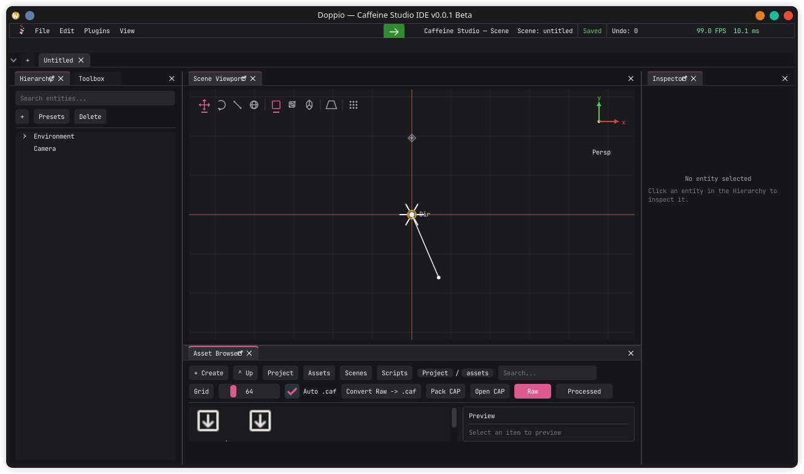

# Quick start

Esta página leva-o de um build novo a uma cena guardada em poucos minutos.


## 1. Criar um projeto

Execute o Doppio sem argumentos:

```bash
./build/doppio
```

No **Project Manager** escolha **Create New**, escreva um nome, escolha um template
(**Empty**, **2D** ou **3D**) e prima **Create & Open**. O Doppio cria as pastas do
projeto (`assets/`, `scenes/`, `scripts/`, `plugins/`) e guarda o ficheiro
`project.caffeine`.

## 2. Conhecer o workspace



| Painel | Função |
|--------|--------|
| **Hierarchy** | Lista as entidades da cena ativa |
| **Toolbox** | Adiciona geometria e alterna ferramentas do viewport |
| **Scene Viewport** | Renderiza e edita a cena |
| **Inspector** | Edita componentes da entidade selecionada |
| **Asset Browser** | Assets raw e processados do projeto |
| **Console** | Logs, erros e output dos plugins |

Arraste tabs de painéis para redockar. Use **View → Save UI layout** para guardar o
workspace; **View → Reset UI layout** restaura o padrão.

## 3. Adicionar uma entidade

1. Selecione uma cena na **Hierarchy**.
2. Use **Toolbox → Geometry** para adicionar um cubo ou plano.
3. Selecione a entidade; o **Inspector** mostra o transform e componentes.
4. Arraste o gizmo de mover/rodar/escalar no viewport.

## 4. Alternar vistas

A toolbar do viewport é só de ícones:

- **2D / 3D / Iso** mudam o espaço de edição.
- **Persp / Ortho** alterna a projeção.
- **Isométrico** fixa a câmara em 45° / 35.264° com projeção ortográfica.

Arrastar com o botão direito orbita em 3D, o botão do meio faz pan e a roda faz zoom.

## 5. Guardar

Prima **Ctrl+S** ou use **File → Save**. As cenas são guardadas como `.caf` na pasta
`scenes/` do projeto. A barra de título mostra o nome da cena e o badge **Saved**.

## Próximos passos

- [Galeria da UI](../editor/ui-gallery.md) para um tour visual.
- [Plugin Manager](../editor/plugin-manager.md) para adicionar terreno, Git ou IA.
- [Scene viewport](../editor/scene-viewport.md) para detalhes de rendering.
