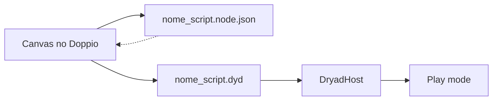

# Dryad e scripts por nodes

**Data:** 2026-10-19  
**Namespace:** `Caffeine::Script`  
**Linguagem:** [Dryad](https://github.com/devscafecommunity) em `source/` (repositório próprio, extensão `.dyd`)  
**Estado:** host, entidades 3D, hot reload, emissor, canvas no Doppio com attach/run e round-trip a partir de `// @node` no `.dyd`

O grafo de nodes **não é** um segundo runtime. O jogo executa Dryad. O canvas só descreve como esse texto foi montado.

## Contrato dos ficheiros

Na pasta de scripts do projeto (a mesma que o watcher de Lua já usa):

| Ficheiro | Quem lê | Papel |
|----------|---------|--------|
| `nome_script.dyd` | Runtime Dryad | Programa real. Única coisa executada. |
| `nome_script.node.json` | Só o editor | Posições, tipos de node, ligações e parâmetros do canvas. |



O runtime ignora o JSON. Se o JSON desaparecer, o jogo continua. Se o `.dyd` for editado à mão, o jogo usa o texto; o canvas pode ficar desatualizado até o grafo ser regenerado.

O emissor tem de ser determinista: o mesmo grafo produz sempre o mesmo `.dyd`.

## Fronteira com a linguagem

A Dryad mantém-se uma linguagem geral. Nada de Caffeine, Doppio, ECS, nodes ou `.node.json` entra na linguagem, na stdlib ou nos syscalls.

| Onde | O quê |
|------|--------|
| Repositório Dryad (`source/`) | Interpretador, `run_source`, `call_global`, correções de build. Padrões da própria linguagem: intrinsics genéricos, stdlib em Dryad, testes primeiro. |
| Engine Caffeine | `DryadHost`, hooks `onCreate` / `onUpdate` / `onFixedUpdate`, `caffeine_set_position` / `caffeine_translate` / `caffeine_get_position_*` / `caffeine_log`, `Caffeine::Script::Nodes::NodeEmitter`, despacho por extensão, canvas e JSON. |

Limitações atuais da Dryad, tratadas no emissor e não com atalhos no host:

- `&&` não faz short-circuit. O grafo emite `if`.
- `Promise` é síncrona. O tick do jogo não depende dela.
- Cada worker Dryad tem o seu `Interpreter`. O tick de gameplay fica numa thread só.

## O que a engine já faz

O Lua continua. O `ScriptComponent.scriptPath` escolhe o runtime pelo sufixo:

- `.lua` → `ScriptEngine` (sol2)
- `.dyd` → `DryadHost`

Cada `.dyd` tem um `dryad::Interpreter`. O ficheiro é lido uma vez (`run_file` → `run_source`, que retém a árvore sintática). Cada frame chama a função global, se existir:

```dryad
function onUpdate(entity, dt) {
  caffeine_set_position(entity, 3, 4, 5);
}
```

`onCreate` e `onFixedUpdate` seguem a mesma forma `(entity, dt)`. Função em falta é no-op, como no Lua.

`caffeine_set_position` e `caffeine_translate` são funções nativas registadas pelo host com `define_native`. Não fazem parte da Dryad. A rede do interpretador fica desligada (`set_network_allowed(false)`).

Entidades 3D guardam a transformação em `ECS::Position3D`, não em `ECS::Transform`. As funções de posição leem e escrevem `Position3D` quando existe (com fallback para `Transform` em entidades 2D), por isso o grafo move o mesmo componente que o renderer 3D desenha.

`DryadHost::setSearchRoot` resolve caminhos relativos ao projeto, como `scripts/player.dyd`. O `ScriptSystem` recebe a raiz do projeto quando o play começa. `reloadIfChanged` recompila o script quando a data de modificação muda e volta a correr `onCreate`, por isso gravar o canvas durante o play tem efeito imediato.

Na Dryad, commit `1e0eef2`:

- `Interpreter::run_source` guarda o `Program` para as funções continuarem válidas depois do load.
- `Interpreter::call_global` invoca uma função do ambiente global.
- O build sem OpenSSL deixa de falhar por uma função TLS não usada.

## Fases

### 1. Host mínimo — feito

`src/script/DryadHost.hpp` carrega o `.dyd` e chama os hooks. O `ScriptSystem` separa `.lua` de `.dyd`. Testes: `onUpdate` escreve `Transform` em entidades 2D e `Position3D` em entidades 3D.

Resolução de caminhos e hot reload estão feitos. Ainda falta: bindings de input.

### 2. Emissor, sem UI — feito

`src/script/nodes/NodeGraph.hpp` guarda o grafo em memória (`nodes`, `edges`, `x`/`y` no canvas). `NodeEmitter::emit` devolve `.dyd` e `.node.json` deterministas; `writeSiblingFiles` grava os dois ficheiros junto ao script.

Catálogo (as ligações usam `nodeId.pin`):

| Tipo | Pins de exec | Pins de dados |
|------|--------------|----------------|
| `OnUpdate` | `out` | — |
| `SetPosition` | `in`, `out` | `x`, `y`, `z` (editável inline, default `0`) |
| `Translate` | `in`, `out` | `x`, `y`, `z` → `caffeine_translate` (editável inline) |
| `GetPosition` | — | `x`, `y`, `z` → `caffeine_get_position_*` |
| `DeltaTime` | — | `value` → `dt` |
| `Constant` | — | `value` (`valueKind` `number` ou `bool` no JSON) |
| `Branch` | `in`, `then`, `else`, `out` | `condition` |

O `.dyd` gerado é Dryad legível com marcadores `// @node <id>`; ramos usam `if` / `else`, nunca `&&`. Testes: `tests/test_node_emitter.cpp` (determinismo + execução no `DryadHost`).

### 3. Canvas no Doppio — feito

O `DryadNodeScriptPanel` (menu **Dryad Node Script**, ou abrir um `.dyd` no Asset Browser) edita o `.node.json` lado a lado e chama `NodeEmitter::writeSiblingFiles` quando ligações mudam, nodes se movem, constantes mudam, ou ao carregar em **Save**. O play mode continua a executar só o `.dyd` via `DryadHost`.

### Controlos do canvas

- **+ Add node** ou **clique direito** abre o catálogo de nodes.
- **Delete** (ou a tecla `Del`) remove os nodes e ligações selecionados.
- **Home** centra o grafo; **Arrange** dispõe-no pela ordem de execução.
- **Arrastar com o botão do meio** faz pan e o mini-mapa mostra o grafo inteiro.
- Inputs sem ligação têm campos inline, por isso um `SetPosition` já não precisa de nodes Constant.
- Os nodes têm largura fixa e uma cor por tipo; ligações azuis são exec e âmbar são dados.
- Um `.node.json` cujo `.dyd` emitido coincide com o ficheiro é usado no reload, preservando posições, valores inline e nodes órfãos. Um `.dyd` editado à mão continua a ganhar.

A toolbar do painel tem dois controlos de runtime:

- **Attach to selected** adiciona/atualiza um `ScriptComponent` com o caminho `.dyd` relativo ao projeto.
- **Run once** chama `onCreate` e um `onUpdate` na entidade selecionada, sem entrar em play mode.

Quando o node `OnUpdate` não tem ligação de exec de saída, o painel avisa e oferece **Add motion example**, que constrói `OnUpdate → Translate` com `DeltaTime` ligado a `y`. Arrastar um `.dyd` para uma entidade na Hierarchy anexa o script e abre o editor de nodes. O campo Script do Inspector também aceita `.dyd`.

Esboço do JSON:

```json
{
  "version": 1,
  "script": "nome_script.dyd",
  "nodes": [{ "id": "n1", "type": "OnUpdate", "x": 0, "y": 0 }],
  "edges": [{ "from": "n1.out", "to": "n2.in" }]
}
```

### 4. Round-trip — feito

`NodeRoundTrip::importFromDyd` reconstrói a topologia do grafo a partir de `.dyd` no formato do emissor (marcadores em `OnUpdate`, `Branch`, `SetPosition`, `Translate`; nós de dados inferidos das expressões, incluindo `dt`). Ao abrir um script no `DryadNodeScriptPanel`, primeiro verifica se o `.node.json` emite exatamente o `.dyd` atual; se sim usa o grafo do JSON (posições, valores inline e nós órfãos sobrevivem). Caso contrário o `.dyd` ganha e o `x`/`y` vem do JSON para ids coincidentes. **Sync from .dyd** força sempre a atualização.

| `.dyd` | Comportamento do canvas |
|--------|-------------------------|
| Com `// @node` | Grafo reconstruído do script; layout fundido com o JSON |
| Sem marcadores | Dryad válido; canvas mantém o JSON (ou default); barra de estado avisa |
| Marcadores inválidos | Volta ao JSON; erro na barra de estado |

Testes: `tests/test_node_emitter.cpp` (round-trip reproduz o texto emitido).

## O que não fazer

- Executar o JSON.
- Gerar Dryad opaco, uma linha ilegível por node.
- Chamar Lua a partir de cada node.
- Meter conceitos da Caffeine dentro do repositório Dryad.
- Usar já a VM de bytecode (`VM::execute`). O caminho estável é o `Interpreter`. A VM fica para quando o host estiver medido.
