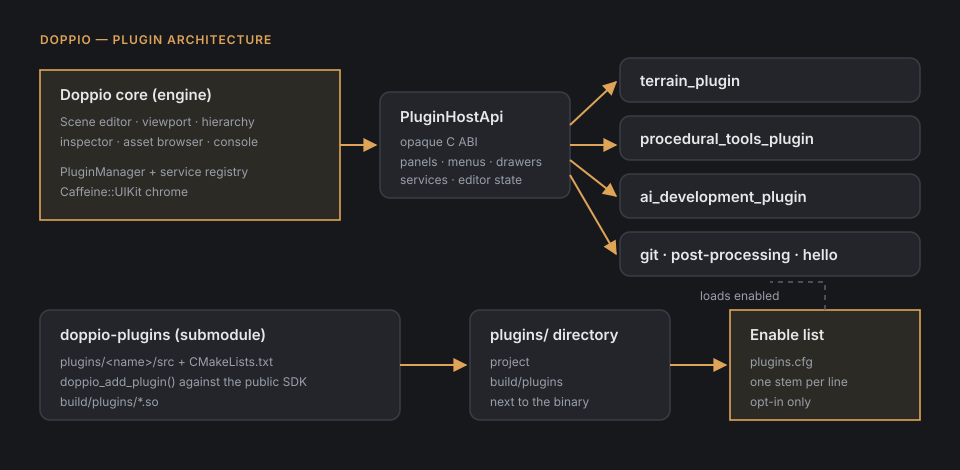

# Plugins

<div class="doc-meta">
  <span class="doc-badge doc-badge--reference">Reference</span>
  <span>Last updated: <time datetime="2026-11-18">2026-11-18</time></span>
</div>

<div class="doc-callout doc-callout--warning">
  <p><strong>Host legado.</strong> O Doppio atual em Rust/Iced não carrega plugins C++.
  Estas páginas documentam o SDK de plugins C++/ImGui e o seu host no editor C++ arquivado
  (<code>doppio-archived/</code>). A engine continua a compilar todos os plugins do
  submódulo, para que o SDK se mantenha testado na compilação.</p>
</div>


<p class="doc-lede">O catálogo de plugins, o contrato do SDK C++/ImGui e os passos de
build e instalação para o host do editor legado.</p>

As extensões do editor são **bibliotecas partilhadas** construídas contra o SDK público
`caffeine/plugin/`. Vivem no repositório separado
[doppio-plugins](https://github.com/devscafecommunity/doppio-plugins), fixado como
submódulo da engine.

O build da engine compila-as para `build/plugins/`; o host legado não carrega nenhuma
no arranque. Instala as bibliotecas num diretório de plugins e ativa as que precisas no
Plugin Manager desse host. O Doppio atual em Rust não procura nem carrega estas
bibliotecas.

<figure class="doc-figure">
  
  <figcaption>Arquitetura de plugins do Doppio</figcaption>
</figure>


## Catalog

| Plugin | Binary | What it adds |
|--------|--------|--------------|
| Hello | `hello_plugin` | Minimal SDK example: panel and menu action |
| Terrain Generator | `terrain_plugin` | Ultra-realistic terrain, heightmap import, terrain editor panel |
| Procedural Tools | `procedural_tools_plugin` | Streaming worlds, benchmarks, procedural director |
| Post Processing | `post_processing_plugin` | Post-process stack UI and camera helpers |
| Git | `git_plugin` | Project Git status, history and commit actions |
| AI Development | `ai_development_plugin` | Nav volumes, nav agents and behaviour templates |
| VC&M | `volumetric_clouds_plugin` | Procedural volumetric clouds and ground mist |
| Natural Fluids | `natural_fluids_plugin` | Flat, wind/physics and realistic water surfaces plus real 2D/3D water, fire, fog and smoke fluids |

## Pages

| Page | Contents |
|------|----------|
| [Getting started](getting-started.md) | Build the hello template and install it |
| [Installing plugins](installing-plugins.md) | Discovery paths, enable list, distribution |
| [Writing a plugin](writing-a-plugin.md) | C ABI, `IPlugin` lifecycle, host API |
| [Service registry](service-registry.md) | Cross-plugin services such as terrain and procedural |
| [Plugin Manager](../editor/plugin-manager.md) | Opt-in loading and troubleshooting |
| [Compatibility](compatibility.md) | ABI, build flags and platform matrix |
| [VC&M](volumetric-clouds.md) | Volumetric clouds and mist plugin |
| [Natural Fluids](natural-fluids.md) | Water surfaces and real Eulerian fluids |

## Quick build

```bash
git submodule update --init doppio-plugins

cmake -S doppio-plugins -B doppio-plugins/build \
  -DCAFFEINE_ROOT="$PWD" \
  -DIMGUI_DIR="$PWD/build/_deps/imgui-src"
cmake --build doppio-plugins/build -j

cp doppio-plugins/build/plugins/*.so build/plugins/
```

Depois arranca o host C++ legado e ativa o plugin no Plugin Manager desse host. As
bibliotecas continuam a compilar contra a engine atual; apenas o host é legado.
