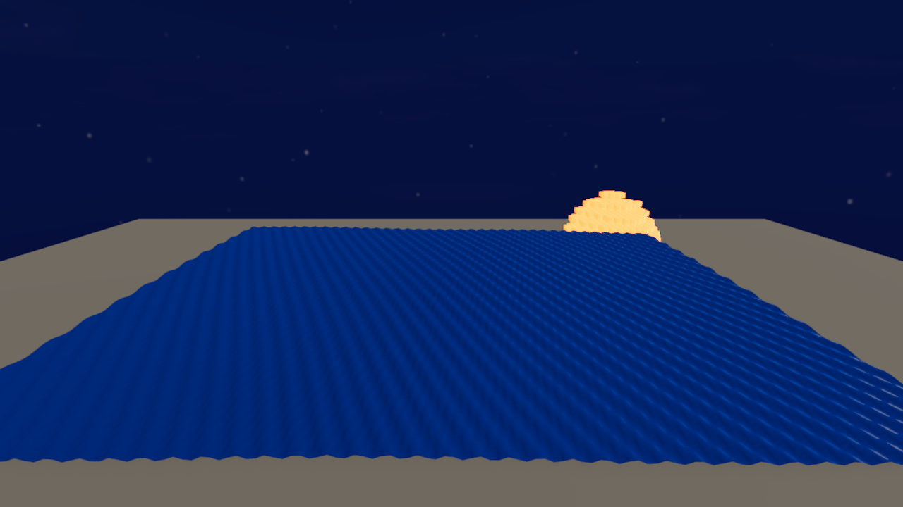

# Natural Fluids

O Natural Fluids é um **plugin do Doppio** para água animada e fluidos reais.
Adiciona um `NaturalFluidComponent` às entidades e quatro níveis de autoria, de um
plano de água parado a um volume de fluido Euleriano 3D.



## Quatro níveis

| Nível | O que faz |
|-------|-----------|
| **Água plana** | Um plano de água animado com material transparente de baixa rugosidade. |
| **Vento + física** | Ondas de Gerstner com vento e um solver conservativo de shallow water: tensão do vento, gotas, impulsos, leito do terreno e conservação de volume. |
| **Água realista** | Um espetro largo de Gerstner com dispersão de profundidade finita, choppiness, espuma de cristas e atenuação com a profundidade. |
| **Volume de fluido** | Um solver Stable-Fluids 3D real para água, fogo, nevoeiro e fumo. |

## Como funciona

A simulação vive na engine, não no plugin:

- `WaveField` amostra um espetro determinístico de Gerstner a partir do vento,
  direção, choppiness, comprimento de onda e profundidade.
- `ShallowWater` é um solver de águas rasas com velocidades em faces. Conserva o
  volume numa bacia fechada e reage a vento, gotas e impulsos.
- `EulerFluid2D` e `FluidVolume` usam adveção semi-Lagrangiana, projeção de pressão
  por Jacobi, empuxo e confinamento de vorticidade. Densidade e temperatura são
  transportadas pelo campo de velocidade incompressível: o fogo sobe e o fumo e o
  nevoeiro seguem o escoamento real.
- `Scene::tickNaturalFluids` reconstrói todos os frames uma malha de água com
  normais suaves ou uma malha de voxels de densidade e entrega-a ao renderer da
  cena.

O `NaturalFluidComponent` é POD e fica gravado na cena. As malhas geradas não são
gravadas; são reconstruídas ao carregar.

## Painel

Abre **View → Panels → Natural Fluids** (ou ativa o plugin e usa o painel dockado).
Seleciona uma entidade com o componente, ou cria uma no painel.

O painel expõe tamanho, nível de água, vento, amplitude, choppiness, limiar de
espuma, resolução da malha/física, escala temporal e material. A secção de volume
adiciona o preset (água, fogo, nevoeiro, fumo), taxa/raio/calor da fonte, vento do
fluido e emissão. Os botões injetam gotas, impulsos e puffs e reiniciam a
simulação. O preview desenha o mapa de altura/espuma, uma fatia 2D de densidade ou
duas fatias 3D.

## Rendering

A água usa o shader PBR da cena com um material transparente. O próximo passo é um
shader dedicado com refração/reflexão planar e textura de espuma. Os volumes são
visualizados como voxels de densidade; um passe de raymarch pode substituí-los sem
mexer no solver.

## Instalação

```bash
cmake -S doppio-plugins -B doppio-plugins/build \
  -DCAFFEINE_ROOT="$PWD" \
  -DIMGUI_DIR="$PWD/build/_deps/imgui-src"
cmake --build doppio-plugins/build --target natural_fluids_plugin
cp doppio-plugins/build/plugins/natural_fluids_plugin.so build/plugins/
```

Ativa **Natural Fluids** em **Plugins → Plugin Manager**.
