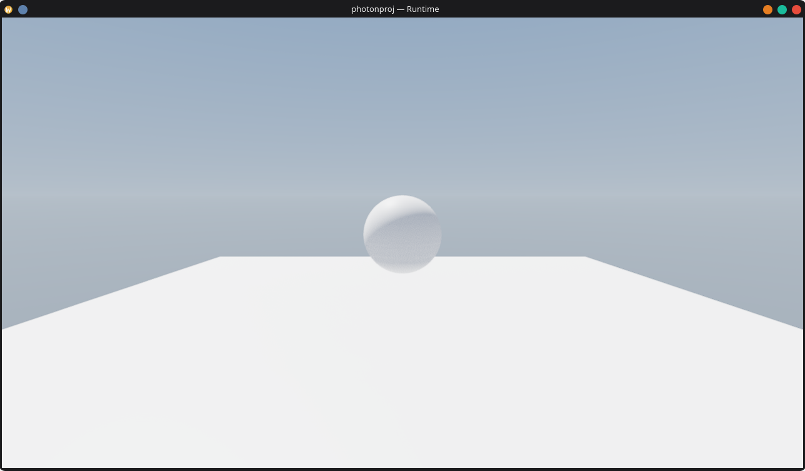

# Photon — GI híbrido por radiance cascades

O Photon é o plugin de **iluminação global** do Doppio: um sistema de GI em tempo
real para cenas sem hardware de ray tracing. É uma alternativa ao estilo Lumen para
GPUs que só expõem pipelines gráficos normais.

## Âmbito v0.1

| Spec Photon | Estado v0.1 |
|-------------|-------------|
| Near field ancorado ao ecrã | **Implementado**: K intervalos exponenciais traçados contra o depth buffer |
| Merge de intervalos | **Implementado**: acumulação de radiance front-to-back |
| Far field | **Aproximado**: fallback de céu + ambiente quando o raio sai do ecrã |
| Campo de probes world-anchored | Ainda não |
| Feedback multi-bounce | Ainda não |
| Passe de reflexos glossy | Ainda não |
| Denoiser temporal | Fornecido pelo TAA da engine: o Photon corre antes dele |

A especificação completa é o alvo. Este plugin é a primeira fatia funcional do near
field e está marcado como v0.1 onde difere do design de referência.

## Presets

| Preset | Qualidade | Cascatas | Raio |
|--------|-----------|----------|------|
| **Performance** | Low | 3 | 10 m |
| **Balanced** | Medium | 4 | 14 m |
| **High** | High | 5 | 22 m |
| **Cinematic** | High | 6 | 32 m |

## Parâmetros

| Parâmetro | Significado |
|-----------|-------------|
| **Intensity** | Multiplicador de luz indireta |
| **Cascades** | Número de intervalos de distância |
| **Radius** | Alcance do near field em unidades de mundo |
| **Thickness** | Tolerância de profundidade para aceitar um hit |
| **Sky intensity** | Fallback quando um raio sai do ecrã |
| **Ambient** | Termo de bounce constante |
| **Tint RGB** | Aproximação de albedo aplicada à radiance recolhida |
| **Debug** | Cena iluminada, só GI, ou só fallback |

## Utilização

1. Abra uma cena com Camera 3D e geometria.
2. Ative **Photon** em **Plugins → Plugin Manager**.
3. Use **Plugins → Create Photon GI** ou **View → Photon Global Illumination**.
4. Escolha um preset e ajuste radius/thickness à escala da cena.
5. Use **Debug → GI only** para inspecionar o resultado das cascatas.

O componente é `ECS::PhotonGIComponent`; o Inspector tem um drawer completo mesmo
sem o plugin.

## Performance

O passe reutiliza o post-process stack da engine:

- Low: 4 raios × 2 passos por intervalo
- Medium: 8 raios × 2 passos
- High: 12 raios × 3 passos

O Photon corre **antes do TAA**, por isso o resolve temporal limpa o padrão
estocástico. Comece em Balanced para edição e use High/Cinematic para capturas.

## Oclusão de ambiente pré-processada (sem RTX)

A secção **Baked ambient occlusion** do painel Photon pré-calcula AO estática para o
material do mesh selecionado:

1. Selecione uma entidade com mesh estática (ou use **Bake scene**).
2. Escolha resolução (256/512/1024), raios, distância máxima e bias.
3. Prima **Bake selected mesh**.

O baker usa **compute na GPU** quando o render device expõe compute (o caminho normal
do Doppio/runtime) e recorre ao BVH CPU caso contrário. A CPU só rasteriza UVs e
constrói a lista de triângulos; os testes de raio pesados correm na GPU. Cenas com
mais de 8192 triângulos usam o caminho CPU.

O baker:

- recolhe todos os triângulos estáticos da cena como oclusores,
- rasteriza o mesh alvo em espaço UV,
- lança raios com peso cosseno contra um BVH CPU,
- escreve um **PNG ORM** com AO no R (roughness/metallic preservados em G/B),
- atualiza `orm_map` e `ao_strength` do material.

O shader da engine já usa ORM.R como oclusão de ambiente, por isso o resultado é
aplicado **sem hardware de ray tracing** e sem ruído de screen-space. Refaça o bake
depois de alterar geometria estática.

> O AO pré-processado é para meshes estáticas. Objetos em movimento devem continuar
> a usar o passe screen-space do Photon. Meshes com UVs sobrepostas fazem média das
> faces; use UVs únicas para AO por face.
## Limitações

- Sem campo de probes world-anchored: a luz fora do ecrã usa um fallback constante
  de céu + ambiente.
- Bounce único: a irradiância indireta do frame anterior ainda não é realimentada.
- Oclusão em screen-space pode vazar em geometria fina; aumente **Thickness** ou
  reduza **Radius**.
- Reflexos glossy não fazem parte da v0.1.

## Relacionado

- [Catálogo de plugins](README.md)
- [Plugin Manager](../editor/plugin-manager.md)
- [Scene viewport](../editor/scene-viewport.md)
