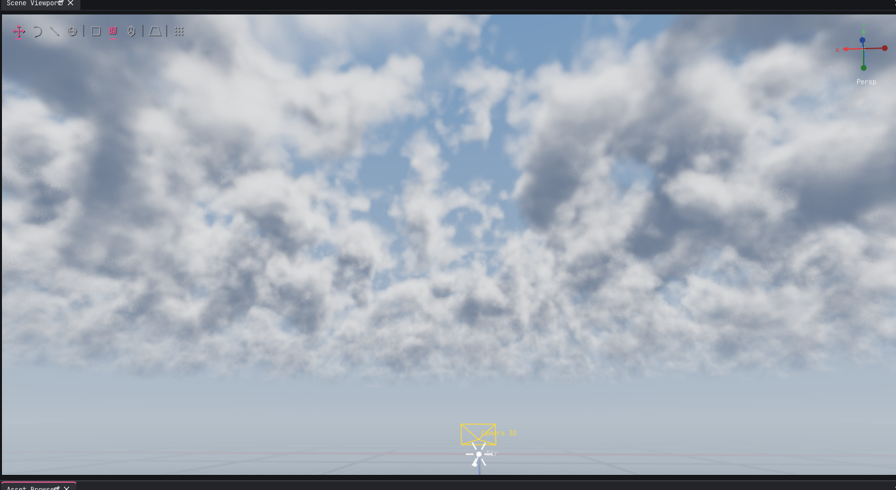

# VC&M — Volumetric Clouds & Mist

O VC&M é um **plugin do Doppio** que gera proceduralmente nuvens volumétricas e
nevoa ao nível do solo. O plugin é dono do modelo meteorológico e da UI de autoria;
a engine faz o ray-march da camada de nuvens no passe do céu.



## O que faz

- Gera um perfil meteorológico a partir de **humidade**, **instabilidade**, **vento**
  e **seed**.
- Faz ray-march de uma camada 3D de FBM de value-noise entre duas altitudes.
- Marcha na direção do sol para self-shadowing e scattering.
- Adiciona nevoa que também alimenta o fog volumétrico da cena, envolvendo a
  geometria.
- Disponibiliza um **drawer no Inspector** para o `VolumetricCloudsComponent`.

## Presets

| Preset | Aspeto |
|--------|--------|
| **Fair weather** | Nuvens altas, esparsas e suaves |
| **Cumulus** | Nuvens fofas a média altitude, com detalhe |
| **Overcast** | Camada baixa, densa e plana |
| **Storm** | Células espessas, vento e detalhe elevados |
| **Misty morning** | Pouca cobertura com nevoa forte no vale |
| **Alpine** | Base alta, detalhe nítido, pouca nevoa |
| **Clear sky** | Desativa a camada |

## Como o algoritmo mapeia o tempo

| Input | Efeito |
|-------|--------|
| **Humidade** | Cobertura, densidade, base mais baixa, camada mais espessa, mais nevoa |
| **Instabilidade** | Oitavas de detalhe e desenvolvimento vertical |
| **Vento (velocidade/direção)** | Deriva do campo procedural |
| **Seed** | Desloca o campo de ruído 3D |
| **Qualidade** | Passos de ray-march: Low 8, Medium 16, High 24 |

O plugin escreve um `VolumetricCloudsComponent` na entidade selecionada (ou numa
entidade dedicada `Volumetric Clouds`). A engine resolve o componente uma vez por
frame e envia-o para o shader do céu.

## Instalação

```bash
./scripts/submodules.sh

cmake -S doppio-plugins -B doppio-plugins/build \
  -DCAFFEINE_ROOT="$PWD" \
  -DIMGUI_DIR="$PWD/build/_deps/imgui-src"
cmake --build doppio-plugins/build --target volumetric_clouds_plugin
cp doppio-plugins/build/plugins/volumetric_clouds_plugin.so build/plugins/
```

Ative **VC&M** em **Plugins → Plugin Manager** e abra
**Effects → Volumetric Clouds & Mist**.

## Utilização

1. Selecione uma entidade ou deixe o VC&M criar uma entidade de atmosfera.
2. Escolha um preset e ajuste humidade/instabilidade.
3. Prima **Generate**.
4. Mude o viewport para **3D** e olhe para o céu.
5. Ajuste a camada e a nevoa diretamente; o viewport atualiza em live.

## Performance

High usa 24 passos de ray-march mais 4 passos de sun-march. Use **Medium** durante a
edição e **High** para capturas. O passe de nuvens só sombreia píxeis de céu; é
saltado para raios abaixo do horizonte.

## Relacionado

- [Catálogo de plugins](README.md)
- [Plugin Manager](../editor/plugin-manager.md)
- [Scene viewport](../editor/scene-viewport.md)
