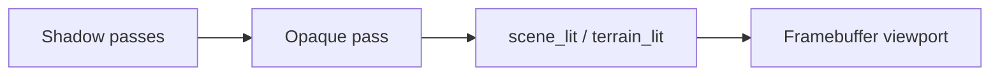

# Materiais no passe forward 3D

<div class="doc-meta">
  <span class="doc-badge doc-badge--reference">Reference</span>
  <span><strong>Namespace:</strong> `Caffeine::Render`, `Caffeine::ECS`</span>
  <span>Last verified: <time datetime="2026-11-18">2026-11-18</time></span>
  <span>Source: <a href="https://github.com/devscafecommunity/caffeine/blob/main/src/caffeine/render/shaders/scene_lit.frag"><code>render/shaders/scene_lit.frag</code></a></span>
</div>

<p class="doc-lede">O que o shader forward avalia realmente para meshes e terreno, os slots
de sampler por trás disso, e porque os antigos campos “Phong” são hoje apenas dados legados.</p>

> **Shaders:** `src/caffeine/render/shaders/scene_lit.vert` / `.frag`, `terrain_lit.frag`
> **Renderer:** `GpuSceneRenderer`

---

## Visão Geral

As meshes com um `.mat` usam metallic, roughness, ORM e emission. Ver
[`materials-pbr.md`](materials-pbr.md). O passe GPU avalia um lóbulo especular GGX:

```text
final = ambient/IBL + Σ (diffuse Lambert + specular GGX) × shadow
```

- **Difuso:** `max(dot(N, L), 0) × albedo × lightColor × (1 - metallic)`
- **Especular:** GGX com roughness e metallic
- **Normal mapping:** `N` via TBN e textura normal (meshes) ou triplanar (terreno)

O terreno (`terrain_lit.frag`) é um dieléctrico rugoso: difuso Lambert mais IBL do céu, com
normal map triplanar. Não tem lóbulo especular.

---

## Componentes ECS

### MeshFilterComponent

```cpp
struct MeshFilterComponent {
    MeshPrimitive primitive = MeshPrimitive::Cube;
    std::string   customMeshPath;
    std::string   customTexturePath;
    std::string   customNormalPath;   // relativo ao projecto
    std::string   customMaterialPath;
    f32           shininess = 32.0f;  // legado; mantido para serialização
};
```

**Inspector (Doppio):** Albedo Texture, Normal Map, Shininess.

O `shininess` já não é lido pelo shader: o passe forward tira roughness e metallic do `.mat`
ou do material glTF embutido.

### TerrainComponent

```cpp
char normalMapPath[256] = {};
f32  shininess = 16.0f;   // legado; a iluminação do terreno não tem termo especular
bool castShadows = true;
bool receiveShadows = true;
```

**Inspector:** Normal Map, Shininess, Albedo Texture (camadas de splat).

---

## Pipeline GPU



1. `renderDirectionalShadows()` — até 2 lâmpadas direcionais com `castShadows`.
2. `renderPointShadows()` / `renderSpotShadows()` — até 2 lâmpadas pontuais e 2 spot.
3. Passe principal com o UBO de luzes, o UBO de sombras e os uniforms de material.

### Samplers (meshes — `scene_lit.frag`)

| Slot | Textura |
|------|---------|
| 0 | Albedo |
| 1 | Normal map |
| 2–3 | Shadow maps direcionais |
| 4–5 | Cubemaps de sombra pontual |
| 6–7 | Shadow maps de spot |
| 8 | Reflexão planar |
| 9 | Cubemap de probe de reflexão |
| 10 | Mapa ORM |
| 11 | Environment (céu) |
| 12–13 | Cor / profundidade do frame anterior (SSR, TAA) |
| 14 | Mapa de emission |
| 15 | Cópia da cena opaca (blend) |

### Samplers (terreno — `terrain_lit.frag`)

| Slot | Textura |
|------|---------|
| 0 | Splat map |
| 1–4 | Camadas de splat |
| 5 | Normal map triplanar |
| 6–7 | Shadow maps direcionais |
| 8–9 | Cubemaps de sombra pontual |
| 10–11 | Shadow maps de spot |

---

## Tangentes

`MeshLoader::computeMeshTangents()` calcula tangentes por vértice (MikkTSpace simplificado)
depois de um import OBJ/glTF. O vertex shader constrói a matriz TBN:

```text
TBN = mat3(normalize(T), normalize(B), normalize(N))
N'  = normalize(TBN * (sample(normalMap) * 2 - 1))
```

---

## Ver também

- [`materials-pbr.md`](materials-pbr.md) — parâmetros do `.mat` e o editor de materiais
- [`shadow-mapping.md`](shadow-mapping.md) — passes de sombra GPU e a regra dos samplers
- [`../assets/mesh-loading.md`](../assets/mesh-loading.md) — tangentes e import
- [`../terrain/terrain-system.md`](../terrain/terrain-system.md) — sombreamento do terreno
