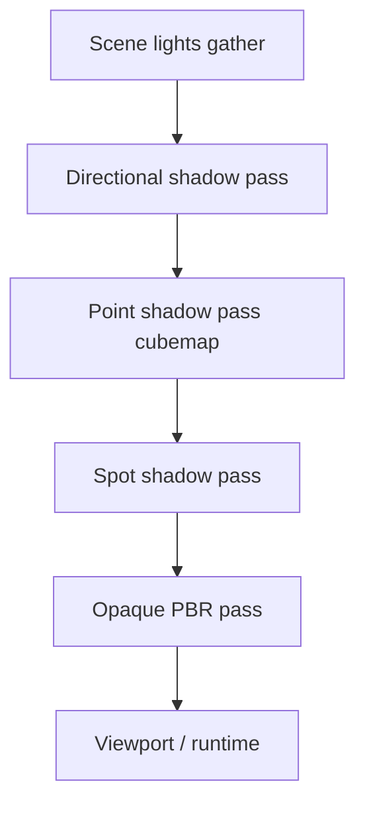

# Shadow Mapping (GPU)

<div class="doc-meta">
  <span class="doc-badge doc-badge--reference">Reference</span>
  <span><strong>Namespace:</strong> `Caffeine::Render`</span>
  <span>Last verified: <time datetime="2026-11-18">2026-11-18</time></span>
  <span>Source: <a href="https://github.com/devscafecommunity/caffeine/blob/main/src/caffeine/render/GpuSceneRenderer.cpp"><code>render/GpuSceneRenderer.cpp</code></a></span>
</div>

<p class="doc-lede">Os três passes de sombra na GPU — cascatas direcionais, cubemaps
pontuais e mapas de spot — como os shaders os amostram, e a regra do editor que mantém os
samplers ligados.</p>

> **Ficheiros:** `GpuDirectionalShadowMap.*`, `GpuPointShadowMap.*`, `GpuSpotShadowMap.*`,
> `GpuSceneRenderer.cpp`
> **Shaders:** `shadow_depth.vert` / `shadow_depth.frag`, `scene_lit.frag`, `terrain_lit.frag`

---

## Visão Geral

As sombras dinâmicas são renderizadas em passes separados antes do passe opaco principal. O
fragment shader aplica um PCF Poisson rotativo (12 amostras) aos mapas de profundidade; o TAA
média a rotação.



---

## Luzes suportadas

| Tipo | Pass | Limite | Amostra no shader |
|------|------|--------|-------------------|
| Direcional | Atlas 4096² (4 cascatas de 2048² na luz 0) | 2 | `sampleDirShadow()` — PCF Poisson rotativo |
| Pontual | Cubemap de profundidade, 512² por face | 2 | `samplePointShadow()` |
| Spot | Profundidade perspectiva 2D, 1024² | 2 | `sampleSpotShadow()` |

Só as luzes com `castShadows == true` entram nos passes GPU.

---

## SceneShadowUBO

Espelhado em C++ (`GpuSceneRenderer.cpp`) e GLSL (`scene_lit.frag`, `terrain_lit.frag`):

```glsl
// Direcional: mat4 light VP × 8 (4 cascatas × 2 luzes) + splits + flags
// Point: vec4 position × 2, vec4 radius, vec4 valid
// Spot: mat4 light VP × 2, vec4 position × 2, vec4 params × 2, vec4 valid
layout(set = 3, binding = 1) uniform ShadowUBO { ... } shadows;
```

`uDirShadowValid` / `uPointShadowValid` / `uSpotShadowValid` permitem ao shader ignorar
slots não atribuídos.

---

## GpuPointShadowMap

- `setSlot(index, position, radius, isValid)` depois de renderizar o cubemap.
- `clearSlot(index)` quando a luz deixa de projectar sombra.
- Ligado aos samplers 4–5 nas meshes e 8–9 no terreno.

---

## Editor vs runtime

| Contexto | **Passes** de sombra | **Samplers** de sombra ligados |
|----------|----------------------|-------------------------------|
| Viewport do editor (`caffeine_session_*`) | ❌ `enableShadows=false` | ✅ sempre (`bindShadowTextures`) |
| Previews do editor | ❌ | ✅ |
| Runtime / play mode | ✅ com `enableShadows=true` | ✅ |

### ⚠️ Regra de segurança (SIGSEGV NVIDIA)

`enableShadows=false` **omite** `renderDirectionalShadows` / point / spot — não omitir
`bindShadowTextures()`.

Os fragment shaders declaram samplers de sombra mesmo quando `uDirShadowValid=0`. Slots sem
textura podem causar **segmentation fault** no driver NVIDIA.

```cpp
// GpuSceneRenderer::renderMeshes — padrão correcto
if (options.enableShadows) {
    renderDirectionalShadows(...);
}
bindShadowTextures(2, 4, 6);  // meshes: dir 2–3, point 4–5, spot 6–7
// passe do terreno: bindShadowTextures(6, 8, 10)
```

Com a GPU a deter a cena, `gatherSceneLighting` com shadow maps de CPU não corre para meshes
(`gpuOwnsSceneMeshes`).

---

## CSM (cascaded shadow maps)

- **Luz direcional slot 0:** até 4 cascatas num atlas 4096² (2048² cada).
- Splits práticos (λ=0.5) entre `nearClip` e `shadowDistance`.
- `SceneShadowUBO`: `uDirShadowVP[8]`, `uDirCascadeSplits[2]`, `uCameraView`.
- **Luz slot 1:** mapa único (sem cascatas).

## Spot shadows GPU

- `GpuSpotShadowMap` — até 2 lâmpadas, 1024², `lightVP` + `cosHalfAngle` (mesma matemática
  do fallback CPU).
- Iluminação spot em `scene_lit.frag` / `terrain_lit.frag` com cone + shadow map.

## Próximos passos (roadmap)

1. **PCSS** — sombras suaves nas cascatas.
2. **CSM na luz secundária** — slot 1 com cascatas.
3. **Blending entre cascatas** — reduzir costuras entre cascatas.

---

## Referências

- [`materials-phong.md`](materials-phong.md) — passe forward e tabelas de samplers
- [`../plans/2026-09-21-rendering-roadmap.md`](../plans/2026-09-21-rendering-roadmap.md) — fase P4
- [`../plans/2026-09-22-phong-gpu-handles-session.md`](../plans/2026-09-22-phong-gpu-handles-session.md)
